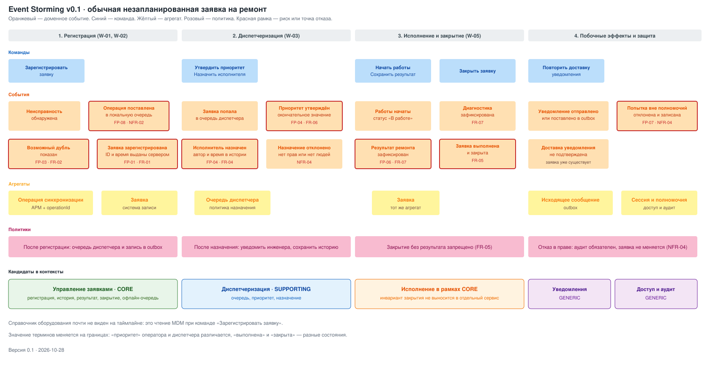
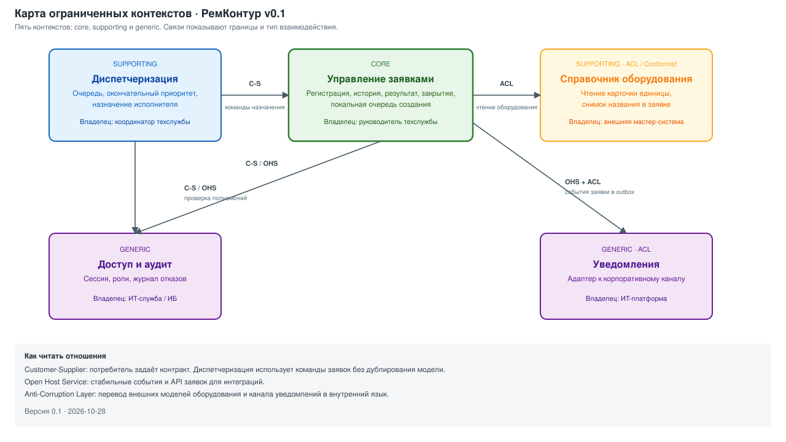
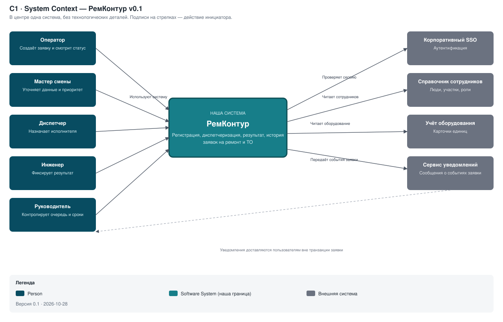
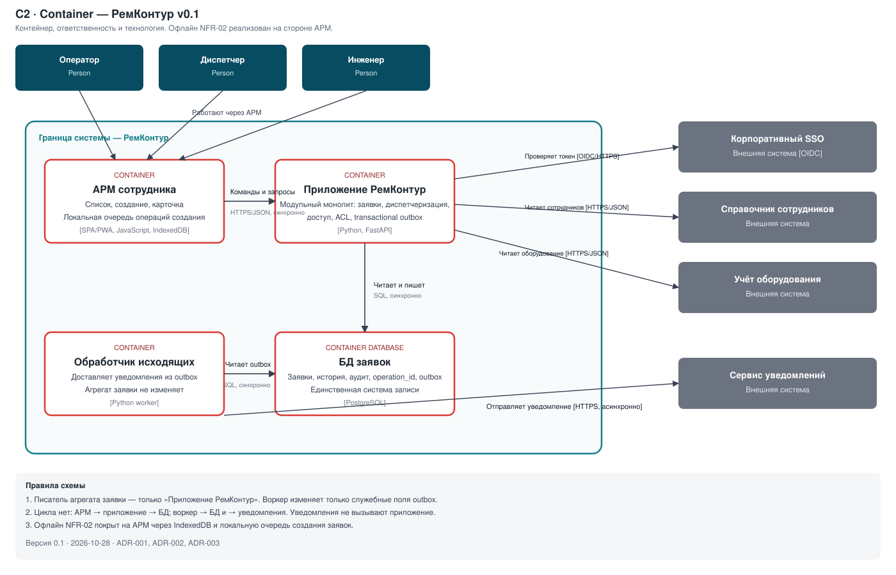

# Доменная архитектура v0.1: контексты, C4 и ADR

## 1. Назначение и статус

Этот документ переводит итоги модуля 1 в структуру системы. Он отвечает на вопросы занятия 5: где проходят ограниченные контексты, как система выглядит на C1/C2 и какие архитектурные решения приняты первыми.

Вход:

- роли и внешнее окружение — [System Charter](01-system-charter.md);
- способности «управление заявками» и «диспетчеризация» — [Capability Map](02-capability-value-stream.md);
- Journey, Blueprint, точки отказа — [Experience Pack](03-experience-pack.md);
- FR/NFR, в том числе ASR NFR-02 и NFR-04 — [реестр требований](04-requirements.md);
- проверяемый механизм офлайн-очереди — [TS-01](04-technical-spike.md).

Выход: карта из пяти контекстов, диаграммы C1 и C2 как код, три ADR, таблица владения «контекст → контейнер → роль».

## 2. Event Storming ключевого сценария

Сценарий тот же, что в VSM и Journey: **обычная незапланированная заявка** от обнаружения неисправности до закрытия. Плановое ТО, авария, IoT и склад не моделируются.

Хронология фактов, которые система должна уметь восстановить:

| # | Событие | Команда / источник | Агрегат | Контекст |
|---|---|---|---|---|
| 1 | Неисправность обнаружена | действие человека, вне системы | — | триггер потока |
| 2 | Операция поставлена в локальную очередь | Зарегистрировать заявку при обрыве связи | Операция синхронизации | Управление заявками (АРМ) |
| 3 | Возможный дубль показан | выбор оборудования | Заявка (чтение открытых) | Управление заявками |
| 4 | Заявка зарегистрирована | подтверждение сервера | Заявка | Управление заявками |
| 5 | Заявка попала в очередь диспетчера | политика после регистрации | Очередь диспетчера | Диспетчеризация |
| 6 | Приоритет утверждён | Утвердить приоритет | Заявка + политика очереди | Диспетчеризация → заявка |
| 7 | Исполнитель назначен | Назначить исполнителя | Заявка | Диспетчеризация → заявка |
| 8 | Работы начаты | Начать работы | Заявка | Управление заявками |
| 9 | Диагностика / результат зафиксированы | Сохранить результат | Заявка | Управление заявками |
| 10 | Заявка выполнена / закрыта | Закрыть заявку | Заявка | Управление заявками |
| 11 | Уведомление поставлено в outbox | политика после 4, 7, 10 | Исходящее сообщение | Уведомления |
| 12 | Попытка вне полномочий отклонена | любая изменяющая команда | Сессия / журнал аудита | Доступ и аудит |

Политики, которые нельзя «потерять в чате»:

- регистрация публикует заявку в очередь диспетчера и в outbox;
- закрытие без результата отклоняется (FR-05) — это инвариант агрегата «Заявка», а не отдельный сервис;
- отказ в праве не меняет заявку и всегда пишет аудит (NFR-04);
- неизвестный исход отправки не показывается как успех (NFR-02, AC-01.3).

Физический ремонт между «работы начаты» и «результат зафиксирован» остаётся вне системы, как в Charter.

## 3. Карта контекстов

| Контекст | Тип поддомена | Задача | Почему такой тип | Бизнес-владелец | Отношения |
|---|---|---|---|---|---|
| **Управление заявками** | Основной (core) | Зарегистрировать, сохранить, показать статус и историю, не потерять создание без связи | Даёт отличие от мессенджера и таблиц; здесь W-01, W-02, W-05, NFR-02 | Руководитель технической службы | OHS для событий заявки; customer для диспетчеризации |
| **Диспетчеризация** | Поддерживающий | Очередь, окончательный приоритет, назначение | Нужна, но не отличает предприятие от любого ремонтного процесса; правила можно упрощать | Координатор / руководитель техслужбы | Customer–Supplier к заявкам и к доступу |
| **Справочник оборудования** | Поддерживающий, типовой на предприятии | Дать достоверный ID и название единицы | Мастер-данные уже должны быть во внешней системе учёта (Charter §4, OQ-10) | Владелец MDM оборудования (вне системы) | Conformist / ACL: принимаем чужую модель, переводим в снимок в заявке |
| **Доступ и аудит** | Типовой (generic) | Сессия, роли, журнал отказов | Одинаков у многих систем; покупаем SSO, свою модель ролей заявки изолируем | ИТ-служба / ИБ | OHS: проверка полномочия для заявки и диспетчеризации |
| **Уведомления** | Типовой (generic) | Сообщить участникам о событии | Канал корпоративный и внешний (OQ-12) | ИТ-платформа | ACL к сервису уведомлений; consumer событий заявки |

Нет Shared Kernel: участки и люди читаются из кадрового справочника как Conformist, без совместно эволюционирующей модели.

Make-or-buy следует из типа: core строим сами; диспетчеризацию — простой модуль, не отдельный продукт; SSO, MDM оборудования и канал уведомлений — готовые системы за адаптером.

## 4. C1 · System Context

| Элемент | Тип | Откуда в Dossier |
|---|---|---|
| Оператор, мастер смены, диспетчер/координатор, инженер, руководитель техслужбы | Person | Charter §5, матрица прав Experience Pack §2, прототип §2 |
| РемКонтур | Software System | наша граница Charter §4 In Scope |
| SSO, справочник сотрудников, учёт оборудования, сервис уведомлений | внешние Software System | Charter §4 «внешнее окружение» |
| SCADA, IoT, склад, закупки, ERP/EAM, HR | отсутствуют на C1 | Charter Out of Scope |

Чек-лист занятия 5:

- в центре одна система; граница совпадает с Charter;
- все роли Blueprint/Charter на месте; ИТ-служба не рисуется как пользователь предметных экранов;
- технологий и протоколов нет;
- стрелка подписана глаголом и направлена от инициатора;
- есть заголовок, легенда и версия.

Если внешний сервис уведомлений недоступен 15 с, заявка уже записана: на C1 это связь «передаёт события», а не условие существования заявки. Изоляция сбоя видна на C2.

## 5. C2 · Containers

| Контейнер                      | Ответственность | Технология | Зачем отдельный контейнер |
|--------------------------------|---|---|---|
| АРМ сотрудника                 | Экраны FR-01…07; локальная очередь создания; состояния «не отправлено / синхронизируется / зарегистрировано / ошибка» | SPA/PWA, JavaScript, IndexedDB | NFR-02 и TS-01: переживает обрыв и перезапуск без сервера |
| Приложение РемКонтур           | Модули контекстов; единственный писатель агрегата заявки; идемпотентный приём `operation_id` | Python, FastAPI | [ADR-001](adr/0001-architectural-style.md); Python — стек репозитория |
| БД заявок                      | Система записи заявок, истории, аудита, ключей идемпотентности, outbox | PostgreSQL | [ADR-002](adr/0002-database.md); один владелец данных |
| Обработчик исходящих сообщений | Читает outbox, вызывает сервис уведомлений, не меняет заявку | Python worker | [ADR-003](adr/0003-messaging.md); изолирует 15 с задержки провайдера от HTTP пользователя |

Связи:

| От | К | Что | Протокол | Синхронность |
|---|---|---|---|---|
| АРМ | Приложение | Команды и запросы | HTTPS/JSON | синхронно, когда связь есть |
| Приложение | БД | Чтение и запись агрегата | SQL | синхронно, одна транзакция с outbox |
| Обработчик | БД | Чтение outbox, отметка доставки | SQL | синхронно для воркера |
| Обработчик | Сервис уведомлений | Событие заявки | HTTPS | асинхронно относительно пользователя |
| Приложение | SSO | Проверка токена | OIDC/HTTPS | синхронно |
| Приложение | Справочник сотрудников | Сотрудник, участок, кандидат в исполнители | HTTPS/JSON | синхронно |
| Приложение | Учёт оборудования | Карточка единицы | HTTPS/JSON | синхронно |

Ревью по стрелкам:

| Вопрос занятия / борда | Ответ на этой схеме |
|---|---|
| Где граница и кто владелец? | РемКонтур; бизнес-владелец способности — руководитель техслужбы |
| Связь оборвалась на 15 с? | Создание: очередь АРМ (NFR-02). Назначение/закрытие: операция отклоняется, данные формы не выдаются за успех. Уведомление: копится в outbox |
| Какие связи синхронны и почему? | Команды пользователя к монолиту — чтобы инвариант заявки проверялся сразу. Уведомления — нет, иначе NFR-03 и внешний таймаут связаны |
| Кто ещё пишет в БД? | Приложение пишет бизнес-данные. Воркер пишет только статус доставки outbox |
| Где офлайн NFR-02? | Контейнер «АРМ сотрудника», IndexedDB |
| Есть ли цикл? | Нет: АРМ → приложение → БД; воркер → БД и → уведомления. Уведомления не вызывают приложение |

Модули внутри монолита на C2 не рисуем: это уровень C3. Их соответствие контекстам — в таблице владения.

## 6. Три ADR

Полные записи: [реестр ADR](adr/index.md).

| ADR | Выбор | Отвергнуто | Главный драйвер |
|---|---|---|---|
| [001](adr/0001-architectural-style.md) | Модульный монолит | Сервисы по контекстам; микросервисы | Команда из трёх человек и инвариант заявки |
| [002](adr/0002-database.md) | PostgreSQL | MongoDB; CouchDB/PouchDB | Транзакции, уникальность `operation_id`, аудит |
| [003](adr/0003-messaging.md) | Outbox без брокера | RabbitMQ; Kafka; синхронный вызов уведомлений | Атомарность «заявка + событие» и цена эксплуатации |

Трассировка NFR-02:

NFR-02 (≥ 4 ч автономного **создания** — гипотеза) → механизм TS-01 → **не** ADR-003 (это серверный outbox) → структура C2: АРМ с IndexedDB → проверка: сценарии S-01…S-07 → метрика: возраст старейшей клиентской операции и глубина очереди АРМ.

Серверные уведомления трассируются иначе: FR-03 / OQ-12 → ADR-003 → обработчик исходящих → метрика возраста записи outbox.

Если порог NFR-02 изменят с 4 до 24 часов, пересматриваются реализация АРМ и, при необходимости, ADR-002 (ёмкость и защита локальных данных). ADR-001 и ADR-003 сами по себе от длительности обрыва не ломаются.

## 7. Владение: контекст → контейнер → роль

У каждого контейнера один владелец. В учебной команде владелец — роль, а не отдельная продуктовая команда. Имена — рабочие назначения для закона Конвея; они должны быть подтверждены командой.

| Контекст | Модуль монолита | Контейнеры C2 | Учебная роль-владелец | Участник |
|---|---|---|---|---|
| Управление заявками | `work-request` | АРМ (экраны заявки и очередь), приложение, БД заявок | Архитектор приложений | Martin |
| Диспетчеризация | `dispatching` | Приложение (модуль), те же АРМ и БД | Архитектор домена процесса | Andrey |
| Справочник оборудования | `equipment-acl` | Приложение (адаптер) | Архитектор интеграций | Martin |
| Доступ и аудит | `access-audit` | Приложение (модуль), БД (журнал аудита), SSO как внешняя система | Архитектор платформы / ИБ | Amir Gabdullin |
| Уведомления | `notification-outbox` | Обработчик исходящих, таблица outbox в БД | Архитектор платформы | Amir Gabdullin |

Следствие: диспетчеризация **не** получает свою базу и **не** пишет в таблицы заявки в обход модуля `work-request`. Иначе на C2 появится второй писатель — антипаттерн занятия 5 и вход в конфликт Темы 2.2.

Обратный манёвр Конвея: целевая структура — модули по контекстам внутри одного релиза, а не команды «фронтенд / бэкенд / DBA». АРМ не выделен в отдельную продуктовую команду, потому что офлайн-очередь принадлежит языку заявки, а не «слою UI».

## 8. Открытые вопросы к Теме 2.2

1. Кто мастер данных оборудования, участков и сотрудников (OQ-10) и какой SLA у их API?
2. Снимок названия оборудования в заявке — копия на момент регистрации или живая ссылка?
3. Журнал аудита — те же таблицы, что история заявки, или отдельная модель с иным сроком хранения?
4. Когда история обслуживания и анализ повторных неисправностей потребуют OLAP отдельно от OLTP заявки?
5. Какие поля заявки являются персональными данными на устройстве оператора и как их чистить в IndexedDB?

Эти вопросы не меняют C1 и три ADR, но определяют владение данными следующего занятия.
