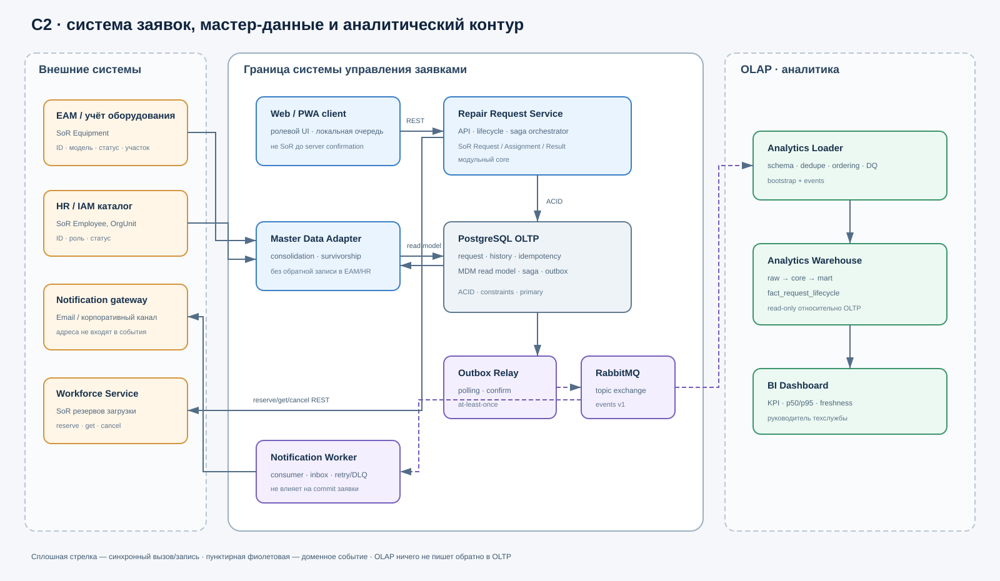

# Неделя 6. Архитектура данных v1.0

## 1. Результат недели

Комплект переводит требования и прототип недель 1–4 в проверяемую архитектуру данных:

- определены 8 ключевых сущностей, связи, инварианты и системы-источники;
- назначены Data Owner, Data Steward, Custodian и consumers;
- составлена CRUD-матрица с одним SoR для каждого факта;
- выбран консолидационный MDM для оборудования и правила выживания атрибутов;
- разделены OLTP и OLAP, хранилище добавлено в C2;
- оформлены 6 правил Data Quality с порогом, владельцем и реакцией;
- прослежен путь KPI времени назначения;
- принято [ADR-001](adr/ADR-001-analytics-delivery.md) о доставке данных в аналитику.

Все значения свежести и пороги качества — проектные гипотезы до пилотных измерений. Комплект не утверждает, что промышленная инфраструктура уже существует.

## 2. Архитектурный базис и допущение о неделе 5

В исходной истории Git обнаружены материалы занятий 1–4, но нет отдельного комплекта занятия 5 с C1/C2 и картой контекстов. Чтобы выполнить требования недели 6 без ложной ссылки на отсутствующий артефакт, здесь зафиксирован минимальный C2-базис. Он продолжает внешнее окружение из [System Charter, §4](01-system-charter.md) и технический Spike недели 4.

### Контейнеры и ответственность

| Контейнер | Ответственность | Данные / владение |
|---|---|---|
| Web/PWA client | формы, роли, локальная очередь создания при потере связи | локальная неподтверждённая операция; не SoR заявки |
| Repair Request Service | API и доменная модель lifecycle, сага назначения | владелец заявок, назначений, результатов, истории |
| PostgreSQL OLTP | ACID, ограничения, idempotency store, MDM read model и outbox в раздельных схемах | операционный SoR системы заявок |
| Master Data Adapter | загрузка оборудования и подразделений из мастер-источников | техническая золотая read model, без обратной записи |
| Workforce Service | доступность и резервирование инженера | SoR резервов загрузки, не заявки |
| Outbox Relay + RabbitMQ | надёжная доставка доменных событий | at-least-once; возможны дубли |
| Notification Worker | уведомления по событиям | только проекция минимальных данных |
| Analytics Loader + Warehouse | raw/core/mart, DQ и аналитические запросы | read-only копия фактов и витрины |

Core остаётся одним модульным сервисом, а не набором микросервисов. Отдельные контейнеры выделены только для внешнего владения загрузкой, асинхронной доставки и аналитического профиля нагрузки.

## 3. Артефакты

| Требование занятия 6 | Артефакт |
|---|---|
| 5–8 сущностей и связи по контекстам | [Логическая модель](data/06-logical-data-model.md) |
| CRUD и SoR | [Владение данными, §2](data/06-ownership-mdm.md) |
| MDM и survivorship | [Владение данными, §3–4](data/06-ownership-mdm.md) |
| OLTP/OLAP, способ доставки и свежесть | [OLTP/OLAP, §1–2](data/06-oltp-olap-quality-lineage.md) |
| 4–6 правил Data Quality | [DQ-01…DQ-06](data/06-oltp-olap-quality-lineage.md) |
| Data Lineage метрики | [Lineage KPI назначения](data/06-oltp-olap-quality-lineage.md) |
| ADR с матрицей альтернатив | [ADR-001](adr/ADR-001-analytics-delivery.md) |
| Хранилище в C2 | [C2 data contours](diagrams/06-c2-data-contours.svg) |

## 4. Ответы на стресс-вопросы защиты

| Вопрос | Ответ и доказательство |
|---|---|
| Кто владеет статусом заявки? | Только `Repair Request Service`; другие контексты читают API/события. CRUD-матрица содержит один `CRUD*`. |
| BI и OLTP разошлись — кому верить? | Для текущего факта — OLTP SoR. BI помечается degraded, причина ищется назад по lineage; копия руками не исправляется (DQ-05). |
| Оборудование вывели из эксплуатации — когда это увидит форма? | Рабочая цель MDM ≤ 15 мин, блокирующий порог старения 60 мин. Открытая заявка сохраняет историю, новая блокируется. |
| Warehouse недоступен 2 часа — можно ли закрывать заявки? | Да. OLTP не зависит от OLAP; события накапливаются в outbox/broker и догружаются после восстановления. |
| Нужны ФИО в отчёте — что делать? | Для выбранных KPI ФИО не нужны. В витрине используется псевдоним; доступ к личности остаётся в корпоративном каталоге. |
| Изменилась схема события — что сломается? | AsyncAPI consumers, raw validator, core transform и витрина перечислены в lineage; breaking change требует нового major и параллельной поддержки. |

## 5. Критерии готовности

- [x] 8 ключевых сущностей; у каждой есть SoR.
- [x] В CRUD-матрице нет двух владельцев одного авторитетного факта.
- [x] Выделены мастер-, справочные, транзакционные данные и метаданные.
- [x] MDM-стиль и правила survivorship не превращают систему заявок в EAM.
- [x] OLTP не обслуживает тяжёлые аналитические запросы.
- [x] DQ-правила имеют измерение, порог, рубеж, владельца и реакцию.
- [x] Lineage начинается с пользовательского факта и заканчивается определённой метрикой.
- [x] ADR содержит альтернативы, последствия и триггеры пересмотра.

## 6. Неподтверждённые вопросы

1. Названия и фактические API корпоративных EAM, HR/IAM и платформы данных.
2. Разрешённый срок хранения заявок, аудита, outbox и аналитической истории.
3. Фактическая частота и длительность недоступности внешних справочников.
4. Наличие отдельного сервиса загрузки специалистов; до подтверждения это логическая граница, которая может быть модулем существующей EAM/HR-системы.
5. Реальные baseline качества и lag; до пилота пороги считаются SLO-гипотезами.
