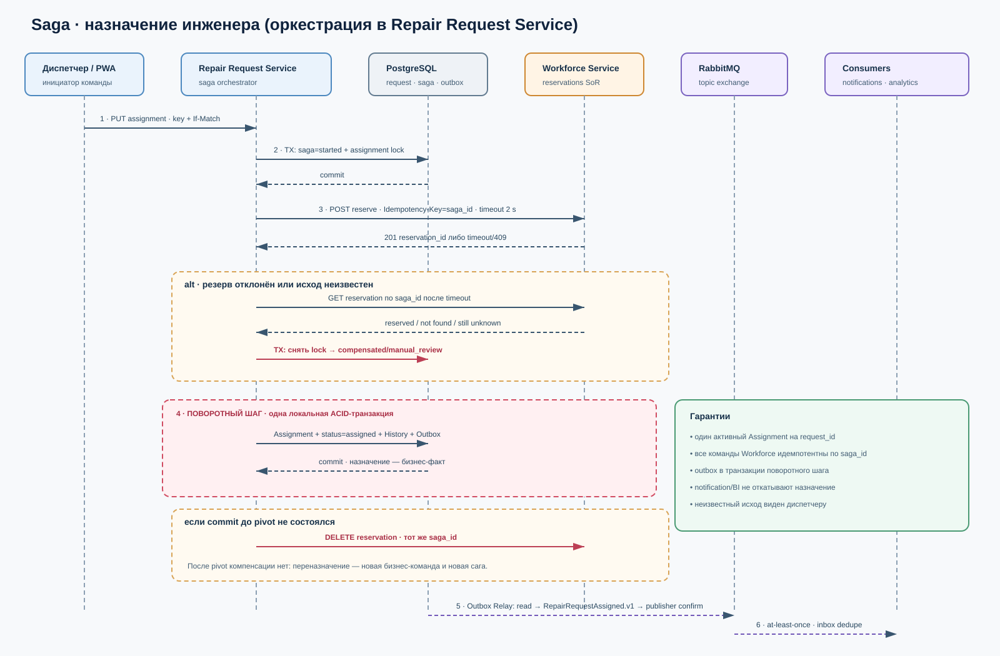

# Неделя 7. Интеграции и распределённая согласованность v1.0

## 1. Результат недели

Архитектура сохраняет простой core системы заявок и формализует только необходимые границы:

- два синхронных OpenAPI-контракта: публичный API заявок и внутреннее резервирование инженера;
- AsyncAPI для трёх ключевых доменных событий;
- оркестрируемая сага назначения с компенсацией резерва и явной точкой невозврата;
- Transactional Outbox вместо dual write;
- ключи идемпотентности у REST-команд и transactional inbox у consumers;
- правила timeout/retry/eventual consistency;
- [ADR-002](adr/ADR-002-assignment-saga-orchestration.md) о выборе оркестрации;
- [политика версий и проверки контрактов](07-contract-versioning.md);
- [оценка NLP-кандидата](07-ml-nlp-assessment.md).

Контракты описывают целевой backend, которого нет в HTML-прототипе. Пройденный Spike недели 4 подтверждает только минимальный механизм клиентской очереди и идемпотентного повтора, не промышленную реализацию этих API.

## 2. Карта интеграций

| От → к | Стиль | Контракт | Почему |
|---|---|---|---|
| Web/PWA → Repair Request Service | REST, request-response; локальная очередь только для создания | [`repair-requests-v1.yaml`](../openapi/repair-requests-v1.yaml) | клиенту нужен подтверждённый ID/исход команды |
| Repair Request Service → Workforce Service | REST внутри саги | [`workforce-v1.yaml`](../openapi/workforce-v1.yaml) | перед назначением нужен ответ о резерве конкретного инженера |
| Repair Request Service → RabbitMQ → Analytics/Notifications | доменные события | [`repair-events-v1.yaml`](../asyncapi/repair-events-v1.yaml) | потребители независимы, немедленный ответ core не нужен |
| EAM/HR → Master Data Adapter | API или инкрементальная выгрузка | контракт внешней системы неизвестен | интеграция остаётся допущением и не выдумывается как утверждённый API |

Общей базы между контекстами нет. Аналитика и уведомления не вызываются синхронно в пользовательской транзакции.

## 3. Контракт синхронных команд

### Создание заявки

1. Клиент создаёт UUID `Idempotency-Key` до первой попытки и сохраняет его вместе с payload.
2. Сервер в одной транзакции резервирует ключ, создаёт `RepairRequest`, `RequestHistory` и `OutboxEvent`.
3. Повтор с тем же ключом и hash тела возвращает тот же status/body с `Idempotent-Replayed: true`.
4. Тот же ключ с другим телом возвращает `409 IDEMPOTENCY_KEY_REUSED`.
5. `503` или timeout означает неизвестный исход; клиент не создаёт новый ключ, а повторяет прежнюю операцию после backoff.

### Назначение исполнителя

`PUT /v1/repair-requests/{requestId}/assignment` запускает сагу. `If-Match` защищает от назначения на устаревшую версию заявки. Быстрый итог возвращается как `200`; если бюджет 3 секунды исчерпан, сервер возвращает `202` и `Location` состояния саги. Это третий исход, отдельный от успеха и ошибки.

Внутренний Workforce API использует `saga_id` как `Idempotency-Key`. После timeout оркестратор сначала читает состояние резерва, а не создаёт новый.

### Ошибки и повторы

| Ситуация | Исход | Повтор |
|---|---|---|
| 400/401/403/404/422 | окончательная ошибка текущего запроса | только после исправления причины; новый ключ для новой бизнес-операции |
| 409/412 | конфликт состояния/версии/ключа | перечитать состояние, принять бизнес-решение; слепой повтор запрещён |
| 429 | временное ограничение | тот же ключ после `Retry-After` |
| 503 / network timeout | исход может быть неизвестен | тот же ключ и тело; exponential backoff с jitter, максимум 3 автоматические попытки |
| 202 | сага ещё выполняется | `GET Location`, не новый `PUT` |

## 4. Сага назначения исполнителя



### Шаги, локальные транзакции и компенсации

| № | Участник | Локальное действие | Тип | Ошибка / компенсация |
|---:|---|---|---|---|
| 1 | Repair Request Service | создаёт `AssignmentSaga(started)`, проверяет `If-Match` и блокирует параллельное назначение, не меняя пользовательский статус | компенсируемый | снять блокировку; при переназначении прежнее назначение остаётся действующим |
| 2 | Workforce Service | резервирует инженера по `saga_id` | компенсируемый | если отказ — снять `assigning`; если timeout — GET по ID/ключу до решения |
| 3 | Repair Request Service | закрывает прежнее назначение при его наличии, создаёт новое активное `Assignment`, меняет/сохраняет статус `assigned`, добавляет history + outbox в одной транзакции | **поворотный** | до commit — отменить новый резерв; после commit — только отдельное переназначение |
| 4 | Outbox Relay | публикует `RepairRequestAssigned.v1` | повторяемый | повторять до подтверждения брокера; компенсация не нужна |
| 5 | Notifications / Analytics | применяют событие идемпотентно | повторяемый | retry/DLQ; назначение не откатывается из-за уведомления или BI |

**Точка невозврата** — commit шага 3. После неё назначение является бизнес-фактом. Недоставленное уведомление не отменяет его, а переназначение оформляется новой аудируемой командой.

### Состояния саги

`started → reserving → reserved → confirmed` — успешный путь.

`started/reserving/reserved → compensating → compensated` — штатная компенсация.

`reserving → failed_manual_review` — исход резерва не удалось определить после ограниченных проверок.

`compensating → failed_manual_review` — Workforce не подтвердил отмену; диспетчер видит блокировку и correlation/saga ID.

Состояние хранится у оркестратора и доступно через `GET /v1/assignment-sagas/{sagaId}`. Подробное решение — [ADR-002](adr/ADR-002-assignment-saga-orchestration.md).

## 5. Transactional Outbox

### Почему

Запись заявки, а затем публикация в брокер — dual write: сбой между ними теряет событие. Публикация до commit может сообщить о факте, которого нет. Поэтому бизнес-изменение, history и outbox фиксируются одной транзакцией PostgreSQL.

### Минимальная физическая схема

```sql
CREATE TABLE outbox_event (
  event_id uuid PRIMARY KEY,
  aggregate_type text NOT NULL,
  aggregate_id text NOT NULL,
  aggregate_version bigint NOT NULL,
  event_type text NOT NULL,
  event_version integer NOT NULL,
  occurred_at timestamptz NOT NULL,
  correlation_id uuid NOT NULL,
  payload jsonb NOT NULL,
  published_at timestamptz,
  attempts integer NOT NULL DEFAULT 0,
  last_error text,
  UNIQUE (aggregate_id, aggregate_version, event_type)
);
```

Relay выбирает до 100 строк `WHERE published_at IS NULL ORDER BY occurred_at FOR UPDATE SKIP LOCKED`, публикует с AMQP publisher confirm и только после confirm ставит `published_at`. Polling раз в секунду выбран для умеренного учебного потока. Если процесс упал после publish до отметки, событие придёт повторно — это ожидаемо.

Неотправленные записи не удаляются. Успешные можно архивировать через 7 дней и удалить из OLTP через 30 дней только после подтверждения политики хранения. Эти сроки — проектные, не регуляторное требование.

## 6. Идемпотентный приём событий

Каждый consumer использует собственный transactional inbox:

```sql
CREATE TABLE processed_event (
  consumer_name text NOT NULL,
  event_id uuid NOT NULL,
  processed_at timestamptz NOT NULL,
  PRIMARY KEY (consumer_name, event_id)
);
```

Алгоритм:

1. получить сообщение;
2. начать локальную транзакцию;
3. вставить `(consumer_name, event_id)`;
4. при конфликте уникальности завершить без повторного эффекта;
5. иначе применить business change и `aggregate_version`;
6. commit;
7. отправить ack брокеру только после commit.

Если пришла версия меньше или равная применённой — событие считается повтором/устаревшим. Если версия больше ожидаемой более чем на 1, consumer не угадывает состояние: помещает сообщение в retry, затем DLQ и запрашивает восстановление проекции.

## 7. Eventual consistency и SLO

| Интервал | Проектная цель | Поведение при нарушении |
|---|---:|---|
| commit → публикация в RabbitMQ | p99 ≤ 5 с | alert relay; операции OLTP продолжаются |
| публикация → уведомление | p95 ≤ 60 с | retry, затем DLQ; назначение не откатывается |
| occurred_at → аналитическая витрина | 99% ≤ 15 мин | DQ-06, degraded banner и инцидент |
| неизвестный исход резерва | до 60 с автоматического выяснения | `failed_manual_review`, новый резерв блокируется |

Это измеримые проектные SLO, а не результаты тестов. Локальные времена Spike недели 4 не доказывают сетевые значения.

## 8. Контроль ПДн и минимизация

- События содержат внутренние `employee_id`, но не ФИО, телефон, email и текст диагностики/описания.
- Уведомляющий consumer запрашивает разрешённый адрес доставки в своём контексте.
- В аналитике `employee_id` псевдонимизируется; выбранный KPI не требует личности.
- Свободный текст заявки остаётся в OLTP и не публикуется в событиях v1.

## 9. Ответы на стресс-вопросы

| Вопрос | Ответ |
|---|---|
| Workforce ответил через 15 секунд | HTTP-клиент уже завершил ожидание; оркестратор проверяет резерв по `saga_id`. Новый резерв с новым ключом не создаётся. |
| Событие пришло дважды | unique `(consumer_name, event_id)` пропускает второй эффект; ack выполняется после локального commit. |
| Сервис упал после commit заявки | outbox уже в той же транзакции; relay опубликует после восстановления. |
| Почему оркестрация? | Нужны порядок, видимое состояние, timeout с неизвестным исходом и компенсация резерва; ADR-002 сравнивает варианты. |
| Переименовали поле события | Это breaking change: новый `.v2`, параллельная поддержка и миграция consumers. |
| Уведомление не отправилось | Назначение остаётся действительным; notification consumer повторяет и переводит в DLQ по своей политике. |

## 10. Границы реализации

- Backend, PostgreSQL, RabbitMQ, Workforce и Warehouse являются целевой архитектурой, не развернутым стендом.
- Реализованный HTML-прототип использует `localStorage` и имитацию сервера; его тесты остаются доказательством только прототипа.
- Значения timeout, retries, retention и SLO должны быть подтверждены инфраструктурой и владельцами процесса.
