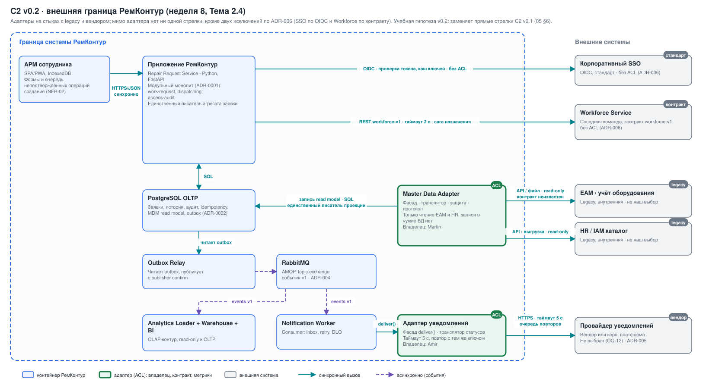

# Неделя 8. Внешняя среда: legacy, ACL и вендоры v1.0

## 1. Результат недели

Комплект достраивает цифровой каркас внешней средой (Тема 2.4) и закрывает часть 4 чек-листа к Практике 2:

- таблица внешней среды и ограничения legacy как драйверы архитектуры (§2–3);
- адаптеры на C2 v0.2 с владельцами ([диаграмма как код](diagrams/08-c2-external-boundary.puml), [SVG](diagrams/08-c2-external-boundary.svg), §4);
- таблицы перевода моделей: EAM, HR, провайдер уведомлений, SSO (§5);
- поведение каждой внешней связи при отказе и задержке 15 с (§6);
- матрица зависимости от поставщиков и план выхода (§7);
- три ADR: [ADR-004 · брокер](adr/ADR-004-message-broker-rabbitmq.md), [ADR-005 · канал уведомлений и план выхода](adr/ADR-005-notification-channel-adapter.md), [ADR-006 · внешняя граница и ACL](adr/ADR-006-external-boundary-acl.md);
- сквозная трассировка, план проверки адаптеров, ответы на стресс-вопросы (§9–10).

**Статус: учебная гипотеза v1.0.** Контракты EAM, HR и провайдера уведомлений нам не известны, поэтому имена полей и коды в таблицах перевода условные: их уточняют владельцы систем. Адаптеры — целевая архитектура, а не развёрнутый стенд; тесты из §9 не выполнялись. Пороги и таймауты — проектные гипотезы, как в [неделе 7](07-integration-architecture.md).

## 2. Внешняя среда

Вопрос лекции: сколько стрелок C2 уходят за границу и сколько из них ведут к системам, которые мы не можем изменить. На [C2 v0.2](diagrams/08-c2-external-boundary.svg) внешних стрелок **пять**; к четырём из них (EAM, HR, SSO, провайдер) мы не можем ничего менять, кроме своей стороны границы. Workforce — сервис соседней команды: контракт можно согласовывать.

| Система | Тип | Бизнес-владелец | Ограничения | Что можем менять | Отношение (05 §4) |
|---|---|---|---|---|---|
| Система учёта оборудования (EAM) | legacy, внутренняя | руководитель службы эксплуатации активов ([06](data/06-ownership-mdm.md)) | контракт неизвестен, своя модель и статусы, возможны окна обслуживания | только свою сторону | Conformist + ACL |
| HR / IAM каталог | legacy, внутренняя | HR-владелец корпоративного каталога ([06](data/06-ownership-mdm.md)) | свои роли, коды подразделений и статусы сотрудников | только свою сторону | Conformist + ACL |
| Корпоративный SSO | стандарт (OIDC) | ИТ-служба / ИБ | токены, ключи и сроки задаёт владелец IdP | настройку клиента | OHS, без ACL |
| Провайдер уведомлений | вендор или корпоративная платформа, не выбран (OQ-12) | ИТ-платформа | коды ответа, лимиты, цена, доставка не гарантирована | адаптер и выбор провайдера | ACL |
| Workforce Service | сервис соседней команды по контракту | команда сервиса загрузки ([06](data/06-ownership-mdm.md)) | доступность, версия контракта | условия контракта | Customer–Supplier, без ACL |

PostgreSQL и RabbitMQ — не внешние системы, но поставщики технологий; они оцениваются в §7.

## 3. Legacy: ограничения как драйверы архитектуры

Как ведёт себя EAM или HR, мы **не знаем**: контракт не получен. Ниже ограничения типичного legacy из лекции 8, помеченные как допущения (OQ-8.1), и архитектурный ответ на каждое. Они записаны в контекст [ADR-006](adr/ADR-006-external-boundary-acl.md), а не в комментарии к коду.

| Ограничение | Как может проявиться `[Допущение]` | Архитектурный ответ |
|---|---|---|
| Пакетный или инкрементальный обмен | изменения приходят пачкой или по расписанию | локальная проекция, цель свежести ≤ 15 мин, суточная полная сверка ([06 §2](data/06-ownership-mdm.md)) |
| Медленный отклик | ответ может стать заметно медленнее нормы; чек-лист проверяет задержку 15 с | только асинхронно, вне пути регистрации; таймаут вызова 10 с и повтор |
| Окна обслуживания | недоступность в плановые окна владельца | последняя проекция с отметкой времени, повтор после окна |
| Своя модель | чужие коды статусов, форматы времени, идентификаторы | перевод на границе (ACL), §5 |
| Нет идемпотентности записи | повтор пакета ведёт к дублю | не актуально: записи в EAM и HR у нас нет |
| Лимиты запросов | число обращений в минуту ограничено | пакетное и инкрементальное чтение, ограничение скорости в адаптере |

### Четыре вопроса к стыку EAM

| Вопрос | Ответ | Основание |
|---|---|---|
| Что умеет legacy? | API, инкрементальная выгрузка или файл: **неизвестно** | [06 §2](data/06-ownership-mdm.md) допускает «инкрементальная выгрузка/API» |
| Нужна ли свежесть? | цель ≤ 15 мин; суточная сверка | [06 §2](data/06-ownership-mdm.md); регистрация не должна ждать EAM |
| Кто владелец и готов ли держать контракт? | владелец определён, готовность **неизвестна** | риск записан, OQ-8.2 |
| Пишем ли мы? | **нет** | [06 §4](data/06-ownership-mdm.md): обратной записи в источники нет |

### Способ сопряжения

| Способ | Решение | Почему |
|---|---|---|
| API / фасад владельца | **предпочтителен** | контракт и права у владельца; по умолчанию официальный вход |
| Файловый обмен (SFTP) | допустим как запасной | просто, но задержка и ошибки формата; нужен статус передачи |
| Инкрементальная выгрузка | допустим | совместим с проекцией и суточной сверкой |
| CDC из БД legacy | **не выбираем** | это чтение журнала чужой БД и привязка к её схеме |
| Шина (ESB) | не используем, пока её нет | если корпоративная шина появится, адаптер может стать её частью |
| Прямой SQL к таблицам EAM или HR | **запрещён** | нет контракта; временное исключение только по ADR со сроком и владельцем (сейчас их нет) |

## 4. Адаптеры на C2

[C2 v0.2](diagrams/08-c2-external-boundary.puml) собирает в одну картину контейнеры недель 5–7: монолит, PostgreSQL, relay, RabbitMQ ([ADR-004](adr/ADR-004-message-broker-rabbitmq.md)), потребители и адаптеры. SVG выполнен по тому же описанию, что и `.puml`; при необходимости `.puml` можно перегенерировать PlantUML (в среде подготовки он не запускался).

### Что изменилось относительно C2 v0.1 (05 §6) и недели 6

| Было | Стало |
|---|---|
| Приложение → EAM и справочник сотрудников: прямые синхронные HTTPS-вызовы | Master Data Adapter читает EAM и HR, пишет только в MDM-проекцию PostgreSQL; на пути формы внешних вызовов нет |
| Обработчик исходящих → сервис уведомлений напрямую | Notification Worker → Адаптер уведомлений → провайдер |
| «Без брокера» (ADR-003) на C2 v0.1 и RabbitMQ на C2 недели 6 | RabbitMQ, [ADR-004](adr/ADR-004-message-broker-rabbitmq.md) заменяет ADR-003 |
| Workforce Service как внешний сервис без адаптера и без владельца клиента | Тот же сервис, ACL не ставится ([ADR-006](adr/ADR-006-external-boundary-acl.md)), владелец клиента назначен |

### Адаптеры, владельцы и метрики

Владельцы — рабочие назначения по ролям из README, как в [05 §8](05-domain-architecture.md).

| Адаптер | Стык | Состав | Владелец | Метрики |
|---|---|---|---|---|
| Master Data Adapter (ACL) | EAM, HR → MDM-проекция | **фасад:** `sync_equipment`, `sync_org_units`, `sync_employees` (чтение, пакетно); **транслятор:** §5.1, §5.2; **защита:** таймаут 10 с, повтор с паузой, карантин невалидных записей, отметка свежести; **протокол:** API, файл или выгрузка, определяет владелец | Martin | возраст последней успешной синхронизации; число записей в карантине; доля `unknown` и `invalid_reference` |
| Адаптер уведомлений (ACL) | Notification Worker → провайдер | **фасад:** `deliver()`, `delivery_status()`; **транслятор:** §5.3; **защита:** таймаут 5 с, повтор тем же ключом, очередь, DLQ; **протокол:** HTTPS провайдера | Amir | доля `unknown`; глубина очереди повторов; возраст старейшего недоставленного; p95 доставки |
| Клиент Workforce (без ACL) | сага назначения → Workforce | контракт `workforce-v1`, таймаут 2 с, ключ `saga_id` | Andrey | доля неизвестных исходов резерва; саги в `failed_manual_review` |

Правило границы: нет стрелки во внешнюю систему мимо адаптера. Исключения только два и оба записаны в ADR-006: SSO (стандарт OIDC) и Workforce (контракт соседней команды).

## 5. Таблицы перевода моделей

Названия полей и коды внешних систем **условные**: контракты EAM, HR и провайдера неизвестны. Правило: чужие коды не выходят за адаптер, исходное значение можно сохранить только в журнале адаптера для разбора.

### 5.1. EAM → `Equipment` (MDM-проекция)

Правила выживания и ключи — [06 §4](data/06-ownership-mdm.md); здесь перевод на границе.

| Понятие | У EAM (условно) | В нашей модели | Правило и реакция |
|---|---|---|---|
| Идентификатор | `EQ_ID`, строка формата EAM | `equipment_id`, строка до 64 символов | главный ключ; сопоставление по названию запрещено |
| Инвентарный и серийный номер | `INV_NO`, `SERIAL`; регистр и пробелы произвольны | `inventory_number`, `serial_number` после trim и приведения к одному регистру | конфликт уникальности блокирует публикацию записи, задача steward |
| Название и модель | `NAME`, `MODEL` | `name`, `model` | последняя валидная версия по `source_updated_at` |
| Статус | коды статуса (например, `A`, `R`) | `lifecycle_status`: `active`, `retired`, `unknown` | код выведения → `retired` и `valid_to`; **незнакомый код → `unknown` и алерт, запись не публикуется как `active`** |
| Подразделение | `UNIT_CODE` | `org_unit_id` | неизвестный код → `invalid_reference`; заявку на такое оборудование создать нельзя до разбора |
| Время изменения | локальное время EAM без часового пояса | `source_updated_at` в UTC | пояс EAM задаётся конфигурацией адаптера; запись из будущего не принимается |
| Удаление | флаг или отсутствие записи | `retired`, `valid_to`; исторические заявки остаются | физически запись не удаляется |
| Ремонтная критичность | в EAM нет | локальный атрибут системы заявок | адаптер его не перезаписывает |

`unknown` — значение, которое добавляет адаптер; в [06](data/06-ownership-mdm.md) его нет, это предложение на согласование.

### 5.2. HR → `Employee` и `OrgUnit`

| Понятие | У HR (условно) | В нашей модели | Правило и реакция |
|---|---|---|---|
| Идентификатор | `PERSON_ID` или табельный номер | `employee_id` | устойчивый ключ; e-mail и ФИО ключом не служат |
| ФИО | `FULL_NAME` | `display_name` для экрана | в события и витрину **не передаётся** ([06 §7](data/06-ownership-mdm.md)) |
| Должность | код или свободный текст | `role`: `operator`, `master`, `dispatcher`, `engineer`, `head`, `unknown` | перевод таблицей; неизвестная должность → `unknown`, права не выдаются |
| Квалификация | код специализации | `specialization` | нет значения → не участвует в подсказке, назначение вручную |
| Статус | `ACTIVE`, `TERMINATED`, `LEAVE` | `status`: `active`, `inactive` | `TERMINATED` и `LEAVE` → `inactive`: новые назначения запрещены ([06 §6](data/06-ownership-mdm.md)) |
| Подразделение | `DEPT_CODE`, закрытие с датой | `org_unit_id`, `valid_to` | закрытие действует с даты и не переписывает историю |

### 5.3. Провайдер уведомлений → статус доставки

| Понятие | У провайдера (условно) | В нашей модели | Поведение |
|---|---|---|---|
| Принято провайдером | HTTP 2xx, код «принято» | `accepted` | событие считается доставленным потребителю, подтверждается |
| Постоянный отказ | 4xx, «адрес недействителен» | `rejected(reason)` | без повторов; причина доступна диспетчеру |
| Временная ошибка или лимит | 429, 5xx | повтор внутри адаптера | пауза с нарастанием, тот же ключ |
| Нет ответа | таймаут 5 с | `unknown` | проверка по `event_id` (`delivery_status`), новая отправка с тем же ключом, не новая |
| Незнакомый код | любой новый | `unknown` и алерт | адаптер **не падает**, поток событий продолжается |
| Время | время провайдера без пояса | UTC | — |

### 5.4. SSO claims → роли системы (внутри модуля `access-audit`)

ACL для SSO не ставится ([ADR-006](adr/ADR-006-external-boundary-acl.md)), но модель ролей заявки изолирована в модуле `access-audit`, как в [05 §4](05-domain-architecture.md).

| Понятие | У SSO | В нашей модели | Правило |
|---|---|---|---|
| Пользователь | claim `sub` | `user_id` | стабильный ключ, не e-mail |
| Права | claim групп или ролей | роль системы по таблице | **неизвестная группа не даёт прав** (deny by default) |
| Срок сессии | `exp` | время жизни сессии | истёк токен — повторная проверка |
| Ключи подписи | JWKS | кэш ключей с отметкой времени | при недоступности IdP действует последний набор до срока кэша; срок согласует ИБ |

## 6. Поведение внешних связей при отказе и задержке 15 с

Правило лекции: сбой внешней системы остаётся в адаптере и не доходит до пользователя. Таймауты и повторы проектные.

| Связь | Режим и таймаут | Отказ (минуты, часы) | Ответ 15 с | Что видит пользователь | Кто узнаёт и как |
|---|---|---|---|---|---|
| EAM → Master Data Adapter | вне пути регистрации; вызов 10 с, повтор с паузой; суточная сверка | работаем с последней проекцией; см. «Устаревшая проекция» ниже | вызов обрывается по таймауту 10 с, фиксируется `sync_failed`, повтор; чтения экранов идут из PostgreSQL и не ждут | отметка «данные оборудования от ЧЧ:ММ» на форме | steward по возрасту синхронизации, владелец адаптера (Martin) |
| HR → Master Data Adapter | то же | то же; назначение использует проекцию | то же | предупреждение диспетчеру при устаревшей проекции | steward HR, владелец адаптера |
| Notification Worker → адаптер → провайдер | асинхронно после commit; таймаут 5 с, повтор тем же ключом, затем DLQ | уведомления копятся, назначение остаётся действительным | вызов обрывается через 5 с, статус `unknown`, проверка по `event_id`; регистрация и назначение не затронуты | участник видит назначение при открытии АРМ ([FR-03](04-requirements.md)) | владелец адаптера (Amir) по доле `unknown` и возрасту очереди |
| Приложение → SSO | проверка токена локально по кэшу ключей; запрос ключей с таймаутом 2 с | действующие сессии работают до `exp`; новый вход невозможен; операции создания в АРМ без связи ждут в очереди ([NFR-02](04-requirements.md)) | запрос ключей не блокирует проверку токена с кэшированными ключами | страница входа с понятным сообщением | ИТ-служба / ИБ |
| Сага назначения → Workforce | синхронно, таймаут 2 с ([workforce-v1](../openapi/workforce-v1.yaml)) | резерв не выполняется, заявка остаётся без исполнителя | клиент уже завершил ожидание на 2 с; проверка резерва по `saga_id` до 60 с, затем `failed_manual_review` ([07 §4, §7](07-integration-architecture.md)) | диспетчер видит блокировку и saga ID | владелец клиента (Andrey) |
| Outbox Relay → RabbitMQ | асинхронно, подтверждение публикации с таймаутом 5 с | события копятся в outbox, регистрация не затронута ([ADR-004](adr/ADR-004-message-broker-rabbitmq.md)) | повтор публикации; at-least-once, потребители дедуплицируют | ничего | алерт: возраст старейшей неотправленной записи; цель p99 commit → публикация ≤ 5 с |

### Устаревшая проекция EAM и HR

Документы недель 6–7 описывают реакцию на устаревшие мастер-данные по-разному: [06 §2](data/06-ownership-mdm.md) говорит о предупреждении steward после 60 минут, DQ-03 и обзор недели 6 — о блокировке новой операции. Блокировка всех новых заявок через час после сбоя EAM противоречила бы цели NFR-01 и NFR-02 (обращения не теряются), поэтому здесь принято **предложение на согласование** с владельцем DQ-03:

| Возраст проекции | Поведение |
|---|---|
| ≤ 15 мин | норма |
| 15–60 мин | отметка свежести на форме, лаг виден steward |
| > 60 мин | предупреждение steward и баннер; создание заявки на **известное** оборудование не блокируется и помечается как созданное по устаревшим данным; блокируются оборудование без записи, `retired` и `invalid_reference`; назначение неактивного или неизвестного сотрудника |

Принятый риск: во время сбоя заявка может быть создана на оборудование, выведенное из эксплуатации. Такую заявку диспетчер получает с пометкой и разбирает после синхронизации. Если бизнес решит иначе, меняется только это правило в адаптере и DQ-03.

## 7. Матрица зависимости от поставщиков

Риск = вероятность события × цена выхода. Оценки учебные, качественные, не измерения.

| Компонент | Тип | Глубина интеграции | Цена выхода | Альтернативы | Вероятность события | Риск |
|---|---|---|---|---|---|---|
| PostgreSQL | открытое ПО | высокая: SQL, транзакции, outbox и idempotency в БД ([ADR-0002](adr/0002-database.md)) | высокая | совместимые сборки | низкая: нет владельца, поднимающего цену | низкий |
| RabbitMQ | открытое ПО | средняя: relay, 2 потребителя, AMQP-bindings ([ADR-004](adr/ADR-004-message-broker-rabbitmq.md)) | средняя: относится только к транспорту | другие AMQP-брокеры, Kafka | низкая | низкий |
| Канал уведомлений | вендор или корпоративная платформа | низкая: за адаптером ([ADR-005](adr/ADR-005-notification-channel-adapter.md)) | низкая | несколько на рынке | средняя: цена, снятие API, качество доставки, провайдер не выбран | низкий при адаптере (без него был бы высокий) |
| Корпоративный SSO | стандарт OIDC | средняя: токен в каждом запросе, роли в одном модуле | средняя | любой OIDC-совместимый IdP | низкая | низкий |
| EAM | legacy, внутренняя | средняя: за адаптером, только чтение | не определяется | не наш выбор | — | принимаем и изолируем |
| HR / IAM | legacy, внутренняя | средняя: за адаптером, только чтение | не определяется | не наш выбор | — | принимаем и изолируем |
| Workforce Service | сервис соседней команды | средняя: синхронный контракт в саге | средняя | реализация внутри монолита | средняя: статус сервиса не подтверждён (OQ-8.3) | средний |

Почему ADR выпущен по каналу уведомлений, а не по PostgreSQL: это единственный коммерческий поставщик, которого мы выбираем и можем заменить; PostgreSQL — открытое ПО с высокой ценой выхода, но низкой вероятностью ценовых событий, решение зафиксировано в ADR-0002. План выхода — в [ADR-005](adr/ADR-005-notification-channel-adapter.md).

## 8. Стратегии снижения зависимости

| Мера | Где применена |
|---|---|
| Своя модель и адаптер (ACL) | EAM, HR, провайдер уведомлений |
| Открытые стандарты | SQL, OpenAPI, AsyncAPI, AMQP, OIDC |
| Свои данные | журнал доставок и MDM-проекция хранятся у нас |
| Второй поставщик | не применён: условия перехода записаны в ADR-005 |
| Договор: SLA, выгрузка данных, срок уведомления об изменении API | требования к будущему договору с провайдером (OQ-12) |
| План выхода до подписания договора | [ADR-005](adr/ADR-005-notification-channel-adapter.md) |

## 9. Сквозная трассировка и проверка

Комиссия берёт одно требование и тянет «нить» через каркас. Нити для трёх ключевых требований:

| Нить | Требование | Решение | Структура C2 | Контракт | Проверка |
|---|---|---|---|---|---|
| 1 | [NFR-03](04-requirements.md): p95 ≤ 2 с на список, карточку, форму создания | [ADR-006](adr/ADR-006-external-boundary-acl.md): EAM и HR за адаптером, внешние данные из проекции | Master Data Adapter, PostgreSQL (MDM read model); приложение не вызывает EAM на пути формы | `createRepairRequestV1`: только ссылки `equipment_id`, `org_unit_id`; ответ `503 ServiceUnavailable` с `Retry-After` ([openapi](../openapi/repair-requests-v1.yaml)) | QA-03 и ACL-T05: эмулятор EAM отвечает 15 с, p95 создания не меняется |
| 2 | [NFR-04](04-requirements.md): действие вне полномочий отклоняется и пишется в аудит | [ADR-006](adr/ADR-006-external-boundary-acl.md): SSO без ACL, роли в модуле `access-audit`, неизвестные claims без прав | Приложение (`access-audit`), SSO | `bearerAuth`, ответы `401` и `403` | QA-04, ACL-T03 (строки таблицы §5.4), ACL-T04 (незнакомая группа → отказ) |
| 3 | цель недели 7: уведомление p95 ≤ 60 с, сбой не откатывает назначение ([07 §7](07-integration-architecture.md)) | [ADR-004](adr/ADR-004-message-broker-rabbitmq.md), [ADR-005](adr/ADR-005-notification-channel-adapter.md) | RabbitMQ, Notification Worker, Адаптер уведомлений | AsyncAPI v1: `event_id`, версия, дедупликация потребителем | ACL-T02 и ACL-T05: эмулятор провайдера 15 с; событие приходит дважды |

**Разрыв нити 3:** в реестре требований нет NFR на доставку уведомления, цель стоит только в документе недели 7. Это кандидат в реестр (OQ-8.4), он не добавлялся в эту неделю.

### План проверки адаптеров

По лекции 8 адаптер проверяется без поставщика: эмулятор с «плохими» ответами, тест на каждую строку таблицы перевода.

| ID | Что проверяет | Как | Связь |
|---|---|---|---|
| ACL-T01 | соответствие контрактам | контрактные тесты по спецификации: [workforce-v1](../openapi/workforce-v1.yaml), [AsyncAPI v1](../asyncapi/repair-events-v1.yaml); для EAM, HR и провайдера после получения их контрактов | [07-contract-versioning](07-contract-versioning.md) |
| ACL-T02 | поведение при медленных и ошибочных ответах | эмулятор EAM, HR, провайдера: ответ 15 с, 5xx, обрыв | §6 |
| ACL-T03 | перевод | по тесту на каждую строку таблиц §5.1–5.4 | §5 |
| ACL-T04 | незнакомое значение | новый код статуса EAM, новый код провайдера, неизвестная группа SSO: результат `unknown` или отказ, без падения | §5, DQ-03 |
| ACL-T05 | задержка и обрыв | ответ 15 с и обрыв связи: форма создания остаётся в бюджете NFR-03, доставка уходит в повторы | нити 1 и 3 |
| ACL-T06 | регрессия | записанные ответы песочницы поставщика, когда она появится | после выбора провайдера |

**Статус: тесты не выполнялись.** Адаптеры и эмуляторы не реализованы; это план приёмки, как и в [07 §10](07-integration-architecture.md).

## 10. Ответы на стресс-вопросы

Адаптированы под нашу систему: «ERP» — EAM, «провайдер оплаты» — провайдер уведомлений, «магазин» — подразделение или площадка с другим форматом данных.

| Вопрос | Ответ и ссылка |
|---|---|
| EAM недоступна три дня. Что с работой? | Регистрация и карточка идут из проекции PostgreSQL. После 60 минут steward получает предупреждение, форма показывает возраст данных (§6). Новое оборудование из EAM недоступно до восстановления: это принятое ограничение. Адаптер: Master Data Adapter, ADR-006 |
| Провайдер добавил новый код ответа. Что увидит пользователь? | Ничего: адаптер переводит незнакомый код в `unknown`, поднимает алерт и не падает; событие продолжает повторяться тем же ключом. Диспетчер видит недоставленное уведомление. Строка таблицы §5.3, ACL-T04 |
| Провайдер уходит с рынка через 60 дней. Ваш план? | [План выхода ADR-005](adr/ADR-005-notification-channel-adapter.md): второй адаптер за флагом `notification.provider`, оценка перехода 2–3 недели, запас есть; если срок короче, включается ручной обход |
| Почему вы читаете таблицы EAM напрямую? Кто владелец? | Не читаем. Правило границы ADR-006: официальный вход владельца (API, выгрузка, файл); прямой SQL запрещён, временное исключение только по ADR со сроком и владельцем, сейчас их нет |
| Подразделение шлёт данные в своём формате. Что меняется? | Добавляется переводчик в Master Data Adapter (новая строка таблицы §5.1). Ядро, события и API не меняются; конфликты идентификаторов идут steward |
| Сколько стоит заменить ваш брокер? | Затрагивается только транспорт: relay, два потребителя и `bindings.amqp` в AsyncAPI; полезная нагрузка событий не меняется. Оценка 2–4 недели для другого AMQP-брокера ([ADR-004](adr/ADR-004-message-broker-rabbitmq.md), строка RabbitMQ в §7) |

## 11. Чек-лист части 4 и состав пакета Практики 2

| Пункт | Статус | Где |
|---|---|---|
| Внешние системы на C2 стоят за адаптерами, у адаптера есть владелец | выполнено, два исключения записаны в ADR-006 | §4, C2 v0.2 |
| Таблица перевода моделей для 1–2 самых сложных систем | выполнено: EAM и HR (плюс провайдер и SSO) | §5 |
| Поведение каждой внешней связи при отказе и задержке 15 с | выполнено; значения проектные | §6 |
| Нет записи в чужие БД; legacy через официальный вход | выполнено; контракт EAM неизвестен | §3, ADR-006 |
| Матрица зависимости от поставщиков с оценкой риска | выполнено | §7 |
| ADR по критичному поставщику с планом выхода | выполнено | [ADR-005](adr/ADR-005-notification-channel-adapter.md) |

Пакет Практики 2 (пункты программы) и где он лежит: C1 и C2 как код (`docs/diagrams/c4-*.puml`, `08-c2-external-boundary.puml`); пакет ADR (0001–0003 недели 5, ADR-001 и ADR-002 недель 6–7, ADR-004…006 недели 8); доменные границы, владение и качество данных ([05](05-domain-architecture.md), [06](06-data-architecture.md)); контракты и сага ([07](07-integration-architecture.md), `openapi/`, `asyncapi/`); внешняя среда и проверка задержек (этот документ).

## 12. Известные расхождения и открытые вопросы

Расхождения пакета, о которых нужно знать до защиты и ревью:

| № | Расхождение | Влияние |
|---|---|---|
| 1 | Нумерация ADR: файлы `0001`–`0003` (неделя 5) и `ADR-001`, `ADR-002` (недели 6–7) повторяют номера | в тексте «ADR-001» и «ADR-002» неоднозначны; новые ADR начинаются с 004 |
| 2 | C2 v0.1 (05), C2 недели 6 и C2 v0.2 (здесь) — три схемы | актуальной считается v0.2; v0.1 и неделя 6 остаются историей |
| 3 | ADR-003 («без брокера») против RabbitMQ в неделях 6–7 | снято [ADR-004](adr/ADR-004-message-broker-rabbitmq.md); согласовать с авторами |
| 4 | DQ-03, 06 §2 и обзор недели 6 по-разному описывают реакцию на устаревшую проекцию | предложение в §6, согласовать с владельцем DQ-03 |
| 5 | В реестре нет NFR на доставку уведомления | нить 3 разорвана, OQ-8.4 |

Открытые вопросы недели 8:

| ID | Вопрос | Влияет на |
|---|---|---|
| OQ-8.1 | Что умеют EAM и HR: API, выгрузка или файл; окна обслуживания, лимиты, формат кодов | §3, §5, §6 |
| OQ-8.2 | Готов ли владелец EAM держать контракт и предупреждать об изменениях | риск стыка EAM |
| OQ-8.3 | Workforce Service — отдельная система соседней команды или модуль EAM/HR | ADR-006: нужен ли ACL |
| OQ-8.4 | Добавить в реестр NFR на доставку уведомления и показ статуса доставки диспетчеру | нить 3, ADR-005 |
| OQ-8.5 | Какой канал и провайдер уведомлений (OQ-12), кто владелец ручного обхода при сбое | ADR-005 |
| OQ-8.6 | Есть ли в компании корпоративная шина (ESB) | способ сопряжения §3 |
