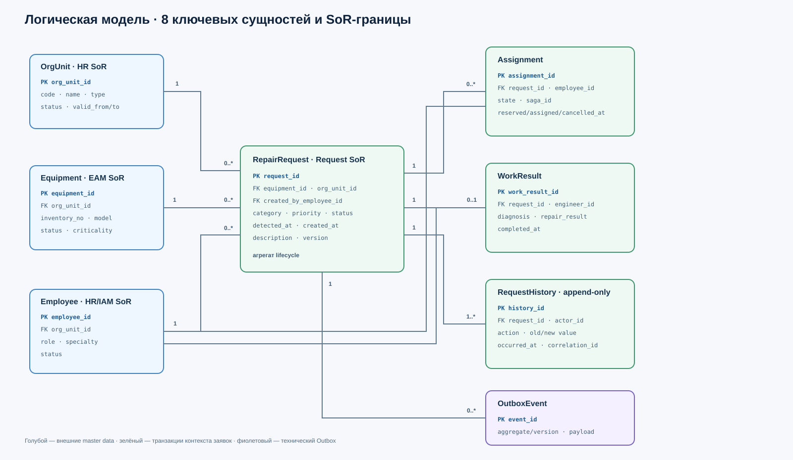
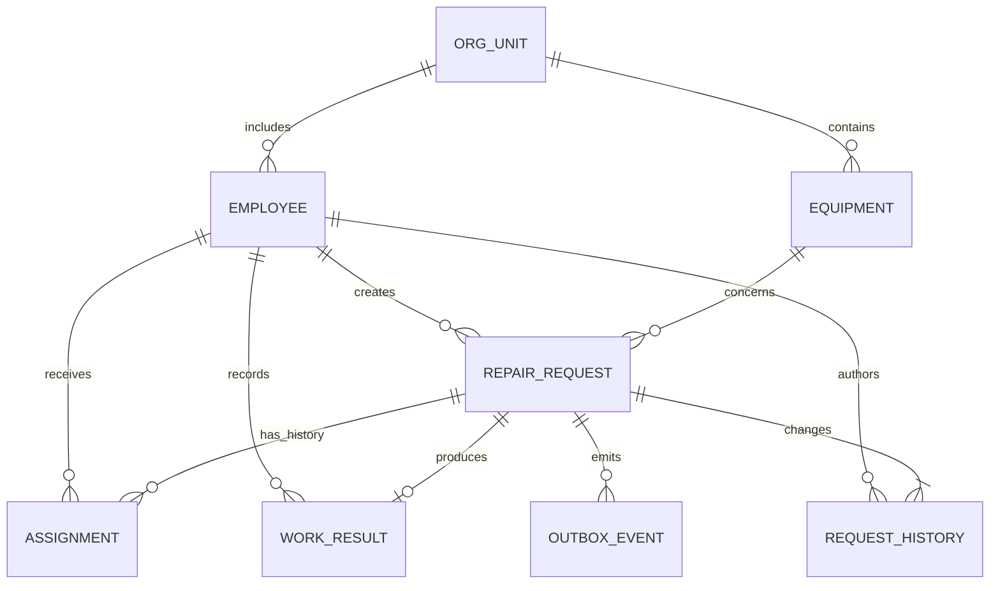

# Логическая модель данных v1.0

## 1. Назначение и границы

Модель поддерживает обычную незапланированную заявку из [System Charter](../01-system-charter.md) и статусную цепочку из [реестра требований, §6.3](../04-requirements.md): `Новая → Назначена → В работе → Выполнена → Закрыта`. Она описывает бизнес-сущности и связи, а не физическую DDL.

Физический ремонт, склад запчастей, закупки, телеметрия и плановое ТО не включены. ФИО и учётные данные не копируются в заявку: в транзакциях хранятся устойчивые корпоративные идентификаторы, а отображаемые имена запрашиваются из разрешённой проекции каталога сотрудников.

Отдельного комплекта занятия 5 в исходном репозитории не было. Поэтому контексты ниже — минимальный архитектурный базис, принятый для недель 6–7:

- **Управление заявками** — lifecycle заявки, назначение, результат, история и события;
- **Справочник оборудования** — внешняя EAM/учётная система и локальная консолидированная read model;
- **Корпоративный каталог** — сотрудники и подразделения;
- **Управление загрузкой** — доступность и резервирование исполнителя в саге назначения;
- **Уведомления** — доставка сообщений, но не владение заявкой;
- **Аналитика** — read-only хранилище и витрины.

## 2. Сущности и системы-источники

| Сущность | Контекст-источник / SoR | Ключ | Основные атрибуты | Инварианты |
|---|---|---|---|---|
| `Equipment` | Внешняя EAM; локально — только золотая read model | `equipment_id` | инвентарный номер, наименование, модель, статус эксплуатации, `org_unit_id`, критичность для ремонта | Заявка ссылается только на активную или явно разрешённую архивную запись; имя не используется как ключ |
| `Employee` | Корпоративный каталог HR/IAM | `employee_id` | отображаемое имя, роль, специализация, статус, `org_unit_id` | В события не передаётся ФИО; деактивация не удаляет исторические ссылки |
| `OrgUnit` | Корпоративный каталог | `org_unit_id` | код, название, тип, статус | Код уникален; закрытие подразделения действует с даты и не переписывает историю |
| `RepairRequest` | Управление заявками | `request_id` | оборудование, участок, категория, описание, предлагаемый и итоговый приоритет, статус, инициатор, времена обнаружения/регистрации, версия | Один текущий статус; допустимые переходы определены конечным автоматом; optimistic lock по `version` |
| `Assignment` | Управление заявками | `assignment_id` | заявка, исполнитель, автор назначения, времена резервирования/назначения/отмены, состояние, `saga_id` | Не более одного активного назначения на заявку; подтверждённый исполнитель должен быть активен |
| `WorkResult` | Управление заявками | `work_result_id` | заявка, инженер, диагностика, выполненные работы, время завершения | Не более одного актуального результата; статус `completed` требует непустых диагностики и результата |
| `RequestHistory` | Управление заявками | `history_id` | заявка, тип действия, автор, время факта, прежнее/новое значение, `correlation_id` | Append-only; исправление создаёт новую запись, прошлое не удаляется |
| `OutboxEvent` | Управление заявками | `event_id` | тип/версия события, заявка, версия агрегата, payload, время факта, статус публикации | Создаётся в одной транзакции с изменением заявки; `event_id` уникален |

`RequestHistory` — бизнес-аудит lifecycle. Технический журнал попыток доступа из NFR-04 хранится отдельно в защищённом audit log и в логическую модель предметной области не включён.

## 3. Связи и кардинальности

Исходное представление той же модели в Mermaid:

Ключевые ограничения:

1. `RepairRequest.equipment_id` и `org_unit_id` — снимок ссылок на мастер-данные; человекочитаемые названия в OLTP могут кэшироваться только для отображения и не считаются истиной.
2. Активное назначение обеспечивается уникальным частичным ограничением по `request_id`, где состояние `reserved` или `confirmed`.
3. Текущие данные заявки меняются транзакционно вместе с `RequestHistory` и требуемой записью `OutboxEvent`.
4. Физическое удаление заявок не используется. Завершённые записи архивируются по политике хранения, пока она не согласована с владельцем данных.
5. Времена факта хранятся в UTC с часовым поясом; пользовательский интерфейс показывает `Europe/Moscow`.

## 4. Жизненный цикл агрегата `RepairRequest`

| Текущий статус | Команда | Новый статус | Предусловия | Кто выполняет |
|---|---|---|---|---|
| `new` | `AssignEngineer` | `assigned` | резерв исполнителя подтверждён, активного назначения ещё нет | диспетчер через сагу назначения |
| `assigned` | `StartWork` | `in_progress` | действие выполняет назначенный инженер | инженер |
| `in_progress` | `CompleteRepair` | `completed` | заполнены диагностика и результат | назначенный инженер |
| `completed` | `CloseRequest` | `closed` | результат существует | диспетчер |
| `new` / `assigned` | `CancelAssignment` | `new` | отмена назначения разрешена отдельным бизнес-действием | диспетчер / компенсация саги |

Возврат из `completed`, переоткрытие `closed` и объединение дублей не были согласованы в неделях 1–4 и остаются вне v1. Добавление этих переходов требует требований, правил аудита и изменения контрактов.

## 5. Аналитическая модель

Зерно факта `fact_request_lifecycle` — **одна зарегистрированная заявка**. Факт не обновляет OLTP и строится из событий и исторической загрузки.

| Таблица | Тип | Назначение / поля |
|---|---|---|
| `fact_request_lifecycle` | Факт | `request_id` (degenerate dimension), ключи оборудования/участка/дат/приоритета, `registered_at`, `first_assigned_at`, `work_started_at`, `completed_at`, `closed_at`, длительности этапов, флаги SLA |
| `dim_equipment` | SCD Type 2 | оборудование, модель, участок, эксплуатационный статус и критичность на период действия записи |
| `dim_org_unit` | SCD Type 2 | подразделение/участок на период действия |
| `dim_priority` | Справочное измерение | `low`, `normal`, `high`, `critical`; смысл и порядок |
| `dim_category` | Справочное измерение | категория неисправности |
| `dim_date` | Календарь | день, неделя, месяц, смена при наличии утверждённого календаря |

Идентификаторы сотрудников в витрине псевдонимизируются. Для KPI назначения личность не нужна: достаточно агрегатов по подразделению и периоду.

## 6. Трассировка к требованиям

| Элемент модели | Требования / источник |
|---|---|
| `RepairRequest`, устойчивый ID и времена | FR-01, NFR-01 |
| `Assignment` и его история | FR-04 |
| `RequestHistory` | FR-03, FR-04, FR-06, NFR-04 |
| `WorkResult` и ограничение закрытия | FR-05, FR-07 |
| `OutboxEvent` | NFR-02 и интеграции недели 7 |
| `fact_request_lifecycle` | KPI времени регистрации и назначения из [Capability & Value Stream, §8](../02-capability-value-stream.md) |

## 7. Допущения для согласования

- EAM действительно предоставляет устойчивый `equipment_id` и является SoR оборудования.
- Корпоративный каталог предоставляет устойчивые ID сотрудников и подразделений; SSO не становится источником профиля.
- Диспетчер закрывает выполненную заявку, как принято в прототипе v0.2.
- Время первого подтверждённого назначения используется для KPI; переназначения сохраняются, но не заменяют его.
- PostgreSQL выбран как предполагаемое OLTP-хранилище для проектирования ограничений; это учебное архитектурное решение, не факт существующей инфраструктуры.
