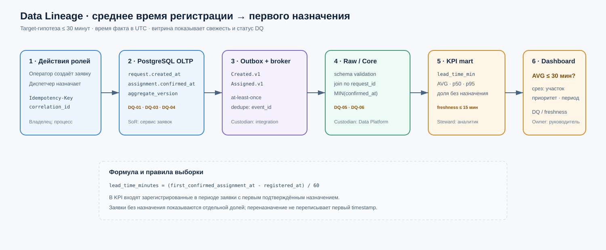

# OLTP/OLAP, Data Quality и Data Lineage v1.0

## 1. Разделение контуров

| Характеристика | OLTP · операции | OLAP · аналитика |
|---|---|---|
| Вопрос | Что происходит с конкретной заявкой сейчас? | Что происходит с потоком заявок за период? |
| Хранилище | PostgreSQL системы заявок | аналитическое хранилище с raw / core / mart слоями |
| Модель | нормализованный агрегат заявки, ограничения и транзакции | звезда `fact_request_lifecycle` + измерения |
| Нагрузка | короткие запросы по ID, команды lifecycle | сканирование периода, агрегаты, тренды |
| Свежесть | подтверждённое текущее состояние | 99% событий в витрине ≤ 15 минут |
| Владелец | руководитель технической службы | тот же Data Owner; Data Platform — custodian |
| Запись обратно | бизнес-команды с авторизацией | запрещена; исправление выполняется у SoR |

Операционные экраны очереди и карточки читают OLTP. KPI, повторные неисправности и тренды строятся в OLAP. Тяжёлые отчёты не выполняются по рабочей базе.

## 2. Доставка в аналитику

Выбран поток доменных событий через брокер:

1. сервис заявок в одной ACID-транзакции изменяет агрегат и добавляет `OutboxEvent`;
2. relay с polling публикует событие в RabbitMQ как минимум один раз;
3. Analytics Loader дедуплицирует по `event_id` и сохраняет неизменённый payload в raw-слое;
4. преобразование проверяет схему и Data Quality, затем обновляет core-факт и измерения;
5. витрина KPI обновляется инкрементально;
6. для первичной истории используется контролируемая bootstrap-выгрузка из OLTP с high-water mark; затем поток переключается на события.

Обоснование и альтернативы зафиксированы в [ADR-001](../adr/ADR-001-analytics-delivery.md). Детали Outbox и идемпотентного приёма описаны в [интеграционной архитектуре недели 7](../07-integration-architecture.md).

Если аналитическое хранилище недоступно, заявки продолжают обрабатываться: outbox и брокер удерживают события, а lag контролируется. Накопившиеся события догружаются идемпотентно; закрытие заявки не зависит от BI.

## 3. Карточки Data Quality

Пороги ниже — проектные SLO до измерения пилота. Для каждого правила указаны объект, измерение, рубеж проверки, владелец и реакция.

### DQ-01 · Полнота заявки

| Поле | Значение |
|---|---|
| Объект / измерение | `RepairRequest` · completeness |
| Правило | При регистрации заполнены `equipment_id`, `org_unit_id`, `category`, описание ≥ 10 символов, `detected_at`, инициатор и предлагаемый приоритет |
| Порог | 100% новых заявок; нарушение не допускается |
| Где проверяется | вход API и ограничения OLTP; контрольная проверка в raw→core |
| Владелец | Data Owner заявок; steward — координатор техслужбы |
| Реакция | API возвращает 422 без записи заявки; нарушение в хранилище помещается в quarantine и создаёт инцидент качества |
| Трассировка | FR-01, AC-01.2, FP-02 |

### DQ-02 · Валидность переходов и результата

| Поле | Значение |
|---|---|
| Объект / измерение | `RepairRequest.status`, `WorkResult` · validity |
| Правило | Переход соответствует конечному автомату; `completed`/`closed` возможен только при непустых диагностике и результате |
| Порог | 100%; любое нарушение — дефект целостности |
| Где проверяется | доменная логика и constraint/transaction в OLTP; повторный контроль в core |
| Владелец | руководитель технической службы |
| Реакция | команда отклоняется с 409/422; несогласованная сохранённая запись блокируется для изменения и разбирается как инцидент |
| Трассировка | FR-05, FR-07, статусная модель §6.3 требований |

### DQ-03 · Ссылочная точность мастер-данных

| Поле | Значение |
|---|---|
| Объект / измерение | ссылки заявки на `Equipment`, `OrgUnit`, `Employee` · accuracy/validity |
| Правило | ID существует в актуальной MDM-проекции; оборудование разрешено для новых заявок; назначаемый сотрудник активен и имеет роль инженера |
| Порог | 100% новых ссылок валидны; справочник не старше 60 минут для изменяющей операции |
| Где проверяется | вход API по локальной read model; ежедневная сверка с мастер-источниками |
| Владелец | владельцы EAM/HR для источников; руководитель техслужбы для реакции заявки |
| Реакция | новая операция блокируется; существующая история не переписывается; steward получает задачу на конфликт |
| Трассировка | FR-01, FR-04, MDM-правила |

### DQ-04 · Уникальность заявки и назначения

| Поле | Значение |
|---|---|
| Объект / измерение | создание заявки и активное `Assignment` · uniqueness |
| Правило | один `Idempotency-Key` с тем же payload создаёт не более одной заявки; у заявки не более одного активного назначения |
| Порог | 0 дублей; любое нарушение — инцидент |
| Где проверяется | уникальные ключи OLTP и idempotency store; аналитический контроль по ключу и request hash |
| Владелец | руководитель техслужбы; custodian — команда системы заявок |
| Реакция | повтор возвращает сохранённый результат; другой payload с тем же ключом — 409; конфликт назначения — 409 и разбор диспетчером |
| Трассировка | FR-01, FR-02, NFR-02, FP-03 |

### DQ-05 · Согласованность OLTP и аналитики

| Поле | Значение |
|---|---|
| Объект / измерение | количество и версии заявок по суткам · consistency |
| Правило | после учёта допустимого лага число уникальных `request_id` и максимальная `aggregate_version` в core совпадают с OLTP/outbox |
| Порог | расхождение 0 после 15 минут; во время активного лага расхождение маркируется как «данные неполны» |
| Где проверяется | автоматическая сверка каждые 15 минут и суточный контроль |
| Владелец | Data Steward технической службы; Data Platform выполняет проверку |
| Реакция | витрина получает статус degraded, публикация KPI за период приостанавливается; повторная загрузка из raw/outbox, исправление только у источника |
| Трассировка | доверие к KPI, ADR-001 |

### DQ-06 · Своевременность аналитического потока

| Поле | Значение |
|---|---|
| Объект / измерение | доменные события → `fact_request_lifecycle` · timeliness |
| Правило | `mart_loaded_at - occurred_at ≤ 15 мин` для событий, принятых брокером |
| Порог | ≥ 99% событий за календарные сутки; 100% критических событий должны быть догружены ≤ 60 мин после восстановления |
| Где проверяется | метрики relay, broker consumer lag и timestamp витрины |
| Владелец | Data Platform custodian; бизнес-владелец принимает остаточный риск |
| Реакция | предупреждение при 10 мин, инцидент при 15 мин; дашборд показывает время последнего успешного обновления |
| Трассировка | свежесть аналитики, ADR-001 |

## 4. Data Lineage ключевой метрики

**Метрика:** среднее время от регистрации заявки до первого назначения исполнителя. Baseline-гипотеза — 95 минут, target — ≤ 30 минут к концу третьего месяца пилота ([Capability & Value Stream, §8](../02-capability-value-stream.md)).



### Определение

```text
assignment_lead_time_minutes =
  (first_confirmed_assignment_at - registered_at) / 60 seconds

KPI(period, org_unit, priority) =
  AVG(assignment_lead_time_minutes)
```

В выборку входят заявки, зарегистрированные в периоде и получившие хотя бы одно подтверждённое назначение. `first_confirmed_assignment_at` не меняется при переназначении. Незавершённые по назначению заявки отдельно показываются как доля censored/ожидающих и не должны молча исчезать из отчёта.

### Путь и преобразования

| Звено | Набор / поля | Преобразование и контроль | Владелец |
|---|---|---|---|
| Действие пользователя | форма создания / команда назначения | клиент передаёт `correlation_id` и `Idempotency-Key` | пользователь процесса |
| OLTP | `repair_request.created_at`; первое `assignment.confirmed_at` | серверные UTC timestamps; DQ-01, DQ-03, DQ-04 | Управление заявками |
| Outbox / брокер | `RepairRequestCreated.v1`, `RepairRequestAssigned.v1` | та же транзакция; `event_id`, `aggregate_version`; дедупликация | Управление заявками |
| Raw | неизменённый envelope и payload | schema validation; невалидное → quarantine | Data Platform |
| Core | `fact_request_lifecycle` | join по `request_id`; `MIN(confirmed_at)`; версии применяются по порядку | Data Platform + steward |
| Mart | `mart_assignment_kpi_daily` | длительность в минутах; агрегация по дате, участку, приоритету | Data Steward |
| Dashboard | карточка среднего, p50/p95 и доля без назначения | показывает `data_freshness_at` и статус DQ | руководитель техслужбы |

### Анализ влияния

| Изменение источника | Что затронет | Безопасный порядок |
|---|---|---|
| переименование `occurred_at` | raw validator, core transform, SLA свежести | новая major-версия события, параллельная поддержка v1 и миграция consumer |
| изменение смысла `assigned_at` | KPI и историческая сопоставимость | новое поле, например `reservation_confirmed_at`; старое не переопределять |
| новый статус назначения | core transform и DQ-02 | добавить необязательное поле/значение только после проверки tolerant readers |
| смена источника оборудования | `dim_equipment`, срезы по участкам | сохранить стабильный `equipment_id`, загрузить mapping и выполнить DQ-сверку |

## 5. Контракт аналитического набора

| Поле | Договорённость v1 |
|---|---|
| Владелец / потребители | руководитель техслужбы / BI и руководство предприятия |
| Зерно | одна заявка в `fact_request_lifecycle` |
| Схема | поля и измерения из логической модели; изменения по SemVer |
| Качество | DQ-01…DQ-06; витрина не скрывает degraded status |
| Свежесть | 99% событий ≤ 15 мин; timestamp обновления обязателен |
| Доступ | агрегаты; сотрудник псевдонимизирован; свободного текста заявки в mart нет |
| Версии | совместимые добавления — minor; удаление/смена смысла — major с периодом параллельной поддержки |

## 6. Проверяемость

- DQ-01…DQ-04 реализуются как API/домен/БД-проверки и негативные контрактные тесты.
- DQ-05 проверяется сверкой количества и версии агрегатов по контрольному временному окну.
- DQ-06 проверяется распределением фактического lag, а не единичным временем локального вызова.
- KPI сверяется на фиксированном наборе заявок ручным расчётом и SQL/витриной; фактических производственных данных в проекте пока нет.
