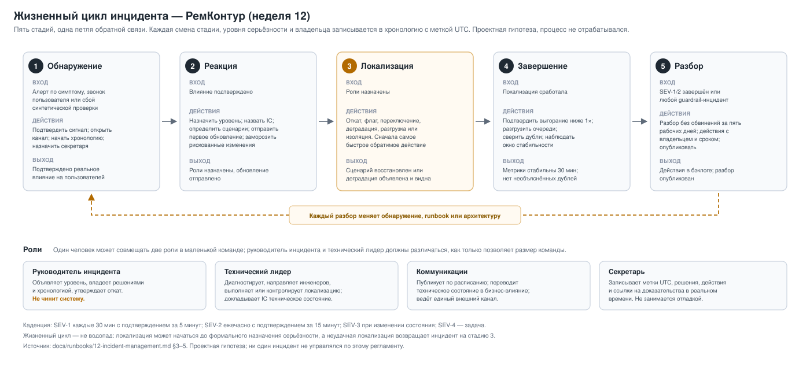

# Неделя 12 · Управление инцидентами и on-call-регламент

**Статус** — проект v1.0. Дежурная ротация пока не укомплектована. Регламент, сроки и лимиты предстоит проверить на пилоте.

**Основание:** лекция 12, слайды 5–13, 18–22 и 30–35; [SRE-спецификация](../sre/11-sre-specification.md); [план DR](../sre/11-dr-plan.md); [каталог E2E](../quality/10-e2e-catalog.md); [внешняя среда](../08-external-environment.md); [доступ и аудит](../security/09-access-audit.md); [реестр FR/NFR](../04-requirements.md); [ADR-007](../adr/ADR-007-assignment-security.md) и [ADR-009](../adr/ADR-009-disaster-recovery-strategy.md).

**Метки доказательности.** `[D]` — выведено из существующего артефакта Досье; `[H]` — проектная гипотеза, введённая здесь и требующая измерения или согласования.

## 1. Область и место в модели доверия

Регламент задаёт критичность, роли, сроки реакции, коммуникации и учения. Инцидент — сбой или ухудшение, влияющее на пользователя либо SLO. Сначала восстанавливают сервис, затем устраняют причину. Плановые запросы идут обычным порядком.

| Задача | Документ |
|---|---|
| Оценить влияние и расход бюджета | [SRE §3](../sre/11-sre-specification.md) |
| Локализовать конкретный сбой | [Инструкции RB-01…RB-05](12-runbooks.md) |
| Объявить аварию и восстановиться | [План DR §6](../sre/11-dr-plan.md) |
| Разобрать причины и зафиксировать действия | [Постмортем](../postmortems/12-incident-review.md), [реестр долга](../tech-debt/12-tech-debt-register.md) |

## 2. Уровни серьёзности

Серьёзность определяется влиянием на пользователя и бизнес. При росте влияния уровень пересматривается.

| Уровень | Критерий | Пример для РемКонтур | Реакция и коммуникация |
|---|---|---|---|
| SEV-1 | Основная операция невозможна в масштабе, либо под угрозой безопасность, юридическое доказательство или персональные данные | Регистрация невозможна в регионе; дубли активных назначений в масштабе; разорвана аудиторская цепочка; подтверждена утечка персональных данных | Подтвердить за 5 мин; руководитель инцидента; уведомлён владелец бизнеса; обновления каждые 30 мин |
| SEV-2 | Серьёзная деградация с обходным путём либо guardrail блокирует привилегированную работу | Назначение недоступно; провайдер уведомлений недоступен; аудитохранилище недоступно, привилегированные действия отклоняются; p95 чтения выше 5 с | Подтвердить за 15 мин; руководитель инцидента при длительности более 30 мин; обновления ежечасно |
| SEV-3 | Частичная деградация с ограниченным влиянием на пользователей | Затронут один диспетчерский участок; задержка аналитики выше 1 ч; проекция мастер-данных старше 60 мин | В рабочие часы; ведёт владелец сценария; обновление при изменении состояния |
| SEV-4 | Влияния на пользователей нет | Неверная цифра в отчёте; косметический дефект; у одной заявки есть ручной обходной путь | Задача в обычном бэклоге |

К каждому уровню применяются следующие правила:

1. **Влияние, а не причина.** Упавший брокер без влияния на пользователей — максимум SEV-3; здоровый брокер с неверными результатами назначения — SEV-1.
2. **Эскалация дешева.** Любой участник может повысить серьёзность; понизить её может только руководитель инцидента, и решение фиксируется.
3. **Один инцидент — один уровень.** В одном инциденте может быть несколько отказавших компонентов; уровень описывает худший видимый пользователю эффект, а не каждый компонент отдельно.
4. **Безопасность важнее доступности.** Подозрение на компрометацию остаётся SEV-1, пока ИБ не решит иначе, даже если сервис полностью доступен ([09 §2](../security/09-access-audit.md)).
5. **Guardrail — это инцидент.** Потерянная аудиторская запись, дубль активного назначения или несанкционированное привилегированное изменение никогда не понижаются до задачи: последствие юридическое или связанное с безопасностью, а не просто более медленный ответ.

Значения уровней — учебные `[H]`. Реальный сервис калибровал бы их по измеренной стоимости простоя, которой в Досье нет ([02 §10](../02-capability-value-stream.md)).

## 3. Жизненный цикл инцидента

В жизненном цикле пять стадий и одна петля обратной связи. Петля и есть смысл процесса: инцидент, который не изменил обнаружение, runbook или архитектуру, повторится с другим человеком (лекция 12, слайд 19).

| Стадия | Условие входа | Действия | Условие выхода | Доказательство |
|---|---|---|---|---|
| 1 · Обнаружение | Сработал алерт по симптому, позвонил пользователь или упала синтетическая проверка | Подтвердить сигнал; открыть канал инцидента; начать хронологию; назначить секретаря | Сигнал подтверждён как реальное влияние на пользователей, а не артефакт мониторинга | Ссылка на алерт, первое сообщение пользователя, метка времени |
| 2 · Реакция | Влияние подтверждено | Назначить серьёзность; назвать руководителя инцидента; определить затронутые сценарии; отправить первое сообщение бизнесу; заморозить рискованные изменения | Роли назначены, первое обновление опубликовано | Запись инцидента, решение об уровне, первое обновление |
| 3 · Локализация | Роли назначены | Откат, переключение флага, failover, деградация, разгрузка или изоляция; предпочесть самое быстрое обратимое действие | Пользователи могут завершить затронутый сценарий, либо объявленная деградация активна и видима | Журнал действий с ожидаемым и фактическим результатом |
| 4 · Завершение | Локализация сработала | Подтвердить, что выгорание ниже 1×; разгрузить очереди; сверить дубли; наблюдать окно стабильности | Метрики стабильны 30 мин; нет необъяснённых дублей или пропавших фактов; владелец бизнеса принимает результат | Снимок дашборда, результат сверки |
| 5 · Разбор | SEV-1 или SEV-2 завершён, либо любой guardrail-инцидент | Постмортем без обвинений в течение пяти рабочих дней; действия с владельцем и сроком; публикация | Действия в бэклоге; разбор опубликован; runbook и тесты обновлены | [Постмортем](../postmortems/12-incident-review.md), реестр действий |

Границы стадий — не водопад. Локализация может начаться до формального назначения серьёзности, а неудачная локализация возвращает инцидент на стадию 3. Чего быть не должно — молчаливого перехода: каждая смена стадии, уровня или владельца записывается в хронологию с меткой UTC.

### 3.1 Обнаружение

Отсчёт начинается с первой неуспешной операции. Цели [H]: SEV-1 ≤ 5 мин, SEV-2 ≤ 15 мин. Источники — оповещения по расходу бюджета и обращения пользователей. В учебном разборе обнаружение заняло 9 мин, а пользователь сообщил о сбое на 2 мин раньше оповещения. [SRE §3.7](../sre/11-sre-specification.md) · [Постмортем](../postmortems/12-incident-review.md)

### 3.2 Сначала локализация, потом диагностика

Идти от обратимых мер к восстановлению из копии и исправлению кода:

1. Ограничить влияние флагом, откатом или переключением трафика.
2. Явно деградировать по таблице [SRE §7.2](../sre/11-sre-specification.md).
3. Переключиться на реплику или вторичный канал.
4. Восстановиться из резервной копии или задействовать [план DR](../sre/11-dr-plan.md).
5. Менять код только тогда, когда первые четыре варианта недоступны или недостаточны.

Сохранять правила аудита и единственного писателя. При сбое назначения оставить заявку неназначенной, сообщить диспетчеру и сверить сагу.

## 4. Роли

У серьёзного инцидента четыре роли. В маленькой команде один человек может совмещать несколько ролей, но руководитель инцидента и технический лидер должны быть разными людьми, как только позволяет размер команды.

| Роль | Ответственность | Явная зона «не делать» | Текущее назначение |
|---|---|---|---|
| Руководитель инцидента (IC) | Объявляет серьёзность; владеет хронологией и решениями; назначает роли; утверждает локализацию и откат; является единой точкой ответственности | Не отлаживает, не вводит команды и не чинит систему | Ротация: Martin, Amir, Andrey |
| Технический лидер | Диагностирует; направляет инженеров; выполняет или контролирует локализацию; докладывает IC техническое состояние | Не отвечает за коммуникацию с бизнесом | Владелец сервиса затронутого сценария |
| Ответственный за коммуникации | Публикует обновление по расписанию; переводит техническое состояние в бизнес-влияние; ведёт единый внешний канал | Не рассуждает о причинах и сроках | Представитель продукта или эксплуатации |
| Секретарь | Записывает метки UTC, решения, действия и ссылки на доказательства в реальном времени | Не участвует в отладке | Любой член команды, по ротации |

Поддерживающие роли приглашаются по необходимости: ИБ — на любое событие безопасности или аудита, владелец данных — на инцидент корректности, владелец бизнеса — на приёмку деградировавшего или восстановленного сервиса, соседняя команда — на инциденты Workforce. Их запрашивает IC; ответственный за коммуникации говорит им, что и когда сообщать.

Правило «руководитель инцидента ничего не чинит» не церемониальное. Командир, который отлаживает, перестаёт координировать, и остальные участники теряют единую точку принятия решений. В команде из трёх человек IC может быть единственным доступным; тогда IC явно передаёт техническую работу второму дежурному и фиксирует разделение.

## 5. Коммуникации

Первое сообщение и обновления ведёт ответственный за коммуникации по следующему шаблону.

| Поле | Правило содержания | Пример для РемКонтур |
|---|---|---|
| Что происходит | Одно предложение: видимый пользователю эффект и время начала | Назначение недоступно в Центральном диспетчерском участке с 10:05 |
| Влияние | Что работает, а что нет | Регистрация, карточка, история и закрытие работают; новые назначения не проходят, заявки остаются неназначенными |
| Что мы делаем | Текущее действие, а не гипотеза о причине | Мы отключили клиентский ретрай и сверяем резервы по `saga_id` |
| Обходной путь | Конкретное действие пользователя | Оставьте заявку неназначенной; повторите через 15 минут; укажите предполагаемого инженера в комментарии к заявке |
| Следующее обновление | Фиксированное время, даже если новостей нет | 11:00 UTC, даже если ничего не изменится |
| Ссылка | ID инцидента и для поддержки — диапазон correlation ID | INC-2026-04; ссылка поддержки SUP-4412 |

Правила коммуникации:

1. **Каденция.** SEV-1 каждые 30 минут; SEV-2 ежечасно; SEV-3 при изменении состояния. Обновление публикуется в обещанное время, даже когда нового нет.
2. **Один канал.** Статус-страница или бизнес-чат — источник истины; канал инцидента внутренний. Разговоры на стороне суммируются обратно в канал инцидента.
3. **Без домыслов.** Не называйте причину, вендора или человека, пока факт не подтверждён. «Мы разбираемся» допустимо; «провайдер лежит» — нет, пока это не проверено.
4. **Без внутренних деталей.** Не раскрывайте бизнес-пользователям имена хостов, стек-трейсы, токены, correlation ID и персональные данные. Ссылка поддержки сопоставляется с correlation ID внутри команды.
5. **Сначала то, что работает.** Пользователям нужно знать, как продолжить работу, а не как устроена система.
6. **Закрывающее сообщение.** Укажите восстановленный сервис, известные ограничения, период наблюдения и когда будет опубликован разбор.

## 6. On-call-регламент

### 6.1 Ротация и передача смены

| Элемент | Правило |
|---|---|
| Ротация | Одна неделя, с понедельника 09:00 до понедельника 09:00; основной и резервный дежурный |
| Передача смены | Письменная записка до начала смены: открытые инциденты, SLO под риском, изменения за последние 24 ч, истекающие сертификаты и секреты, известные деградации, плановые работы |
| Подтверждение | SEV-1 за 5 мин; SEV-2 за 15 мин; SEV-3 в рабочие часы |
| Эскалация | Нет подтверждения за 5 мин (SEV-1) или 10 мин (SEV-2) → резервный дежурный; затем руководитель инцидента; затем инженерный руководитель |
| Проверка доступа | Доступ к runbook’ам, дашбордам, процедуре break-glass и списку контактов проверяется до начала смены, а не во время инцидента |
| Ночные вызовы | Не более двух на человека в неделю как проектное допущение; превышение запускает разбор качества алертов и компенсацию |
| Компенсация | Согласуется с работодателем; документ определяет эксплуатационную потребность, а не условия трудового договора |

У команды три инженера. До финансирования ротации обнаружение планируется в рабочие часы, ночное покрытие — по возможности. [TD-05](../tech-debt/12-tech-debt-register.md)

### 6.2 Гигиена алертов

| Правило | Обоснование |
|---|---|
| Вызывать дежурного только по пользовательским симптомам или нарушению guardrail | Порог CPU — сигнал дашборда, а не повод будить человека |
| У каждого вызова есть ссылка на runbook и владелец | Алерт без действия — шум |
| С каждым вызовом можно разобраться за 15 минут | Иначе это задача, а не вызов |
| Не алертить по одиночной транзиентной ошибке | Дребезг приучает игнорировать вызовы |
| Пересматривать объём вызовов еженедельно | Более двух ночных вызовов на человека в неделю — дефект проектирования |
| Удалять или понижать алерты, которые никогда не приводят к действию | Игнорируемый алерт хуже отсутствующего: он скрывает следующий настоящий |

Каталог оповещений и пороги приведены в [SRE §3.7 и §5.2](../sre/11-sre-specification.md).

## 7. Guardrail- и security-инциденты

Некоторые сбои не являются отклонениями надёжности и не должны обрабатываться как «медленный сервис». Таблица определяет первую реакцию; подробные шаги — в наборе runbook’ов и плане DR.

| Событие | Серьёзность | Первое действие | Runbook или план |
|---|---|---|---|
| Аудитохранилище недоступно | SEV-2 | Привилегированные изменения отклоняются; обычные чтения продолжаются; проверить надёжный буфер | [DR-06](../sre/11-dr-plan.md); §7.1 ниже |
| Подтверждена потеря или изменение аудиторской записи | SEV-1 | Сохранить доказательства; остановить привилегированные записи; привлечь ИБ | [DR-06](../sre/11-dr-plan.md); §7.1 ниже |
| Подозрение на компрометацию сервисных учётных данных | SEV-1 | Отозвать учётные данные, ротировать секрет, сохранить доказательства, оценить радиус поражения | [RB-04](12-runbooks.md) |
| Дубль активного назначения | SEV-1 | Остановить новые назначения в затронутом участке; сверить по `saga_id`; проверить аудиторский след | [RB-01](12-runbooks.md) |
| Утечка персональных данных в логи или трейсы | SEV-1 | Остановить утечку, отозвать доступ, сохранить доказательства, уведомить ИБ | [SRE §4.7](../sre/11-sre-specification.md) |

### 7.1 Процедура fail-closed для аудита

Аудиторский след юридически значим и не имеет бюджета ошибок ([SRE §3.3](../sre/11-sre-specification.md)). Правило fail-closed означает, что привилегированное действие отклоняется, если аудиторскую запись нельзя надёжно сохранить; доступность сознательно обменивается на доказательство.

1. Подтвердите, что сбой в аудиторском пути, а не в бизнес-транзакции: проверьте `audit_buffer_oldest_age_seconds`, логи Audit Writer и здоровье аудитохранилища.
2. Держите привилегированные записи закрытыми. Не обходите audit writer «временно»: обход превращает инцидент доступности в юридический.
3. Сохраните надёжный буфер. Это источник восстановления; его нельзя обрезать или пересоздавать.
4. Если хранилище недоступно, следуйте [DR-06](../sre/11-dr-plan.md): восстановите неизменяемую копию, проверьте хеш-цепочку и только затем откройте привилегированные записи.
5. Сверьте буфер с бизнес-записями по `audit_event_id` и `correlation_id`; подтвердите, что у каждого принятого привилегированного действия ровно одна аудиторская запись.
6. Зафиксируйте инцидент как SEV-2, если затронута только доступность, и как SEV-1, если запись потеряна или изменена. Закрытие подписывают владелец бизнеса и ИБ.

## 8. Программа учений и GameDay

Для учений заранее назначают роли, задают сбой и проверяют поведение по панели и инструкции.

| Сценарий | Что проверяет | Runbook | Ожидаемое автоматическое поведение | Критерий прохождения |
|---|---|---|---|---|
| Потеря связи с площадкой | Offline-АРМ, границы очереди, переподключение, защита от дублей | [RB-03](12-runbooks.md) | Создание ставится в локальную очередь; назначение, приоритет и закрытие отключены; чтения идут из кэша | После переподключения нет потерянных или продублированных созданий; очередь типовой площадки разгружается за 60 с |
| Компрометация сервисных учётных данных | Отзыв, ограничение радиуса поражения, проверка аудита | [RB-04](12-runbooks.md) | Аномальные вызовы запускают security-алерт; учётные данные отзываются; аудиторский след цел | Старые учётные данные отклонены; после отзыва нет несанкционированных назначений или уведомлений |
| Потеря основного региона | Объявление DR, повышение реплики, переключение DNS, ворота проверки | [RB-05](12-runbooks.md); [DR-02](../sre/11-dr-plan.md) | Проверки здоровья региона падают; объявляется pilot light; реплика повышается | RTO ≤ 60 мин; RPO ≤ 5 мин; ворота G1–G5 пройдены |
| Медленный провайдер уведомлений | Тайм-аут, circuit breaker, DLQ, вторичный канал | [RB-02](12-runbooks.md) | Адаптер отваливается по тайм-ауту 5 с, повторяет с тем же ключом, затем DLQ; назначение остаётся валидным | Успешность доставки выше 99% в течение 10 мин; DLQ разобран; дублей доставки нет |
| Медленный Workforce | Тайм-аут назначения, circuit breaker, сверка саги | [RB-01](12-runbooks.md) | Назначение быстро падает; создание, чтение и закрытие продолжаются | Нет дубля активного назначения; выгорание SLO-03 возвращается ниже 1× |
| Устаревшая проекция мастер-данных | Баннер свежести, последняя валидная проекция, блокировка неизвестного оборудования | [RB-01](12-runbooks.md) и [SRE §7.2](../sre/11-sre-specification.md) | Адаптер отдаёт последнюю валидную проекцию и поднимает баннер свежести | Неизвестное или списанное оборудование нельзя использовать; баннер виден |

Отчёт учений фиксирует автоматическую реакцию, влияние на пользователя, расход бюджета, пробелы инструкции и действия.

## 9. Процессные метрики

Метрики помогают улучшать обнаружение, восстановление и дежурство. Цели проверяются на пилоте.

| Метрика | Определение | Начальная цель `[H]` | Зачем нужна |
|---|---|---|---|
| MTTD | Первая неуспешная транзакция → подтверждённое обнаружение | ≤ 5 мин SEV-1, ≤ 15 мин SEV-2 | Обнаружение — та часть восстановления, которую команда может сократить без изменения кода |
| MTTR | Обнаружение → восстановление сервиса | ≤ 60 мин SEV-1, ≤ 4 ч SEV-2 | Восстановление — обещание пользователю |
| Своевременность постмортема | SEV-1/2 с опубликованным разбором в течение пяти рабочих дней | 100% | Память угасает; поздний разбор повторяет хронологию по догадкам |
| Закрытие действий | Действия разбора, закрытые к согласованному сроку | ≥ 80% через 30 дней, ≥ 95% через 90 дней | Разбор без выполненных действий — документ, а не петля обучения |
| Повторные инциденты | Инциденты с тем же способствующим фактором в течение 90 дней | 0 | Сильнейший сигнал, что петля обучения сломана |
| Объём вызовов | Вызовы за on-call-неделю с разделением на ночные и дневные | ≤ 2 ночных вызовов на человека | Большой объём — дефект алертов или архитектуры |
| Действенные вызовы | Вызовы, приведшие к действию | ≥ 90% | Измеряет качество алертов, а не старательность дежурного |
| Использование runbook’ов | Инциденты, где открывался runbook | 100% для покрытых сценариев | Неиспользуемый runbook либо неизвестен, либо неверен |

Исходные значения измеряются за первые три месяца пилота.

## 10. Чек-лист готовности и открытые вопросы

| Элемент | Статус | Где |
|---|---|---|
| Уровни серьёзности с критериями влияния и сроками реакции | Спроектировано | §2 |
| Жизненный цикл с условиями входа и выхода | Спроектировано | §3 |
| Роли с явными зонами «не делать» | Спроектировано | §4 |
| Шаблон и каденция коммуникаций | Спроектировано | §5 |
| On-call-ротация, передача смены и эскалация | Спроектировано, не укомплектовано | §6 |
| Guardrail- и security-инциденты | Спроектировано | §7 |
| Пять runbook’ов, включая GameDay | Спроектировано, не отрабатывалось | [Runbook’и](12-runbooks.md) |
| Один учебный постмортем и шаблон | Написано | [Постмортем](../postmortems/12-incident-review.md) |
| Реестр техдолга с процентами и приоритетом | Написано | [Реестр](../tech-debt/12-tech-debt-register.md) |
| Профинансированная круглосуточная ротация | Отсутствует | [TD-05](../tech-debt/12-tech-debt-register.md) |
| Измеренная база MTTD/MTTR | Отсутствует | §9 |
| Проведённый GameDay | Отсутствует | §8 |

| ID | Вопрос | Влияние |
|---|---|---|
| Q1 | Профинансирует ли бизнес круглосуточную ротацию и с какими сроками реакции? | От этого зависят таблица реакции и SLO 99,5% |
| Q2 | Кто назначен владельцем бизнеса, принимающим деградировавший или восстановленный сервис? | Закрытие каждого SEV-1/2 |
| Q3 | Какой канал коммуникации авторитетен для диспетчерских площадок? | Шаблон и статус-страница |
| Q4 | Каков юридический срок хранения аудиторских записей? | Серьёзность аудиторских инцидентов и стоимость хранения ([TD-07](../tech-debt/12-tech-debt-register.md)) |
| Q5 | Какая соседняя команда владеет контрактом Workforce и его on-call? | Инциденты назначения пересекают организационную границу |
