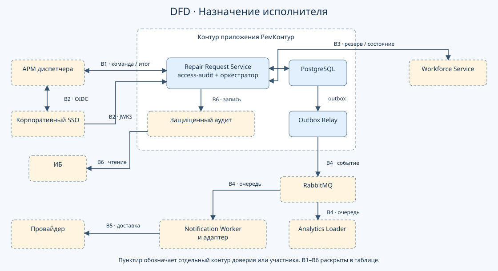

# Неделя 9 · Модель угроз назначения исполнителя

Основание — занятие 9, слайды 35–38, [C2 v0.2](../08-external-environment.md), [сага назначения](../07-integration-architecture.md), [FR-04 и NFR-04](../04-requirements.md). Назначение выбрано из-за влияния на сроки ремонта и общего процесса с Workforce: результат затрагивает очередь диспетчера, резерв инженера, уведомления и аналитику.

## 1. DFD и границы доверия

Стрелки ниже уточняют состав данных и обратные ответы. EAM и HR питают локальную MDM-проекцию по схеме недели 8. Во время назначения прямых обращений к ним нет.

| Поток | Откуда → куда | Данные и контроль |
|---|---|---|
| B1 | АРМ диспетчера ↔ Repair Request Service | Access token, ID заявки и инженера, причина, ETag, ключ идемпотентности, correlation ID. Ответ содержит итог или ссылку на сагу. Сервер проверяет полномочия и контекст до выполнения команды, в том числе при повторе |
| B2 | АРМ ↔ SSO, сервис заявок ← SSO | OIDC-вход и выдача access token; сервис получает JWKS по доверенной конфигурации и проверяет токен локально |
| B3 | Оркестратор ↔ Workforce | Создание, чтение и отмена резерва по авторизованному сервисному каналу; saga ID, ID инженера, статус и ID резерва |
| Внутренний | Оркестратор ↔ PostgreSQL | MDM, заявка, назначения, состояние саги; pivot атомарно фиксирует активное назначение, историю, outbox и запись для доставки аудита |
| B4 | Relay → RabbitMQ → Notification Worker и Analytics Loader | `RepairRequestAssigned.v1`, event ID и correlation ID; подтверждения брокера, раздельные очереди и права |
| B5 | Notification Worker → адаптер → провайдер | Минимум данных для доставки, стабильный ключ отправки и нормализованный статус ответа |
| B6 | Сервис заявок → защищённый аудит, ИБ ← аудит | Записи назначения, отказов и компенсаций; чтение журнала по отдельному полномочию. Граница предлагаемого решения [ADR-007](../adr/ADR-007-assignment-security.md) |

## 2. Реестр STRIDE

Оценка — рабочая: **высокая** означает риск остановки процесса, систематического нарушения прав или потери доказательств. **Средняя** означает локальное влияние или восстанавливаемый эффект. Самая дорогая угроза — T-03: ложное назначение может задержать реакцию на критичный ремонт и исказить downstream-данные. Статусы относятся к проектированию целевого backend.

| ID | Граница | STRIDE | Угроза и эффект | Риск | Мера | Владелец | Статус |
|---|---|---|---|---|---|---|---|
| T-01 | B1 | S | Чужая или истёкшая сессия выдаёт себя за диспетчера | Высокий | Проверка подписи, issuer, audience, срока; отзыв полномочий и ограничение срока токена | Amir | Запланировано |
| T-02 | B1 | T | Повтор или конкурентная команда меняет подтверждённое назначение | Высокий | Idempotency-Key с привязкой к субъекту, операции и телу; If-Match, единственное активное назначение | Andrey | Спроектировано в неделе 7 |
| T-03 | B1 | E | Сотрудник без нужной роли или области изменяет чужую заявку | Высокий | Серверный RBAC + ABAC до изменения и при выдаче результата повтора; атомарная фиксация решения | Amir | Решение ADR-007 |
| T-04 | B2 | S | Токен неизвестного издателя или для другого API принимается за корпоративный | Высокий | Доверенные issuer/JWKS, явная audience и разрешённые алгоритмы; отказ при неизвестном ключе | Amir | Запланировано |
| T-05 | B3 | E | Сервисная учётная запись действует с избыточными правами на резервы | Высокий | Отдельная идентичность оркестратора, audience Workforce, минимальные scopes, привязка резерва к сервису-владельцу | Andrey | Запланировано |
| T-06 | B3 | D | Workforce недоступен или отвечает после таймаута, исход резерва неизвестен | Высокий | Таймаут 2 с, сверка по saga ID, ограниченные повторы, блокировка до разрешения исхода | Andrey | Спроектировано в неделях 7–8 |
| T-07 | B4 | T | Повтор события создаёт повторный эффект у потребителя | Средний | Права на публикацию, валидация контракта, inbox по event ID и идемпотентность эффекта | Amir | Спроектировано в неделях 7–8 |
| T-08 | B4 | D | Брокер недоступен, downstream не получает назначение | Средний | Устойчивый outbox, publisher confirms, независимые очереди, контроль возраста записей | Amir | Спроектировано в неделе 8 |
| T-09 | B5 | I | Провайдер или диагностика получает лишние данные заявки | Высокий | Минимальный контракт адаптера, исключение токенов и описаний из журналов, проверка полей | Amir | Запланировано |
| T-10 | B6 | R | Автор оспаривает назначение, запись отсутствует или изменена | Высокий | Транзакционный буфер, отдельный append-only журнал, контроль доставки, аудит чтения | Amir / ИБ | Решение ADR-007 |

Для взаимного ревью нужно проследить каждый B1–B6 от DFD до меры и [проверки](../quality/10-traceability.md), отдельно разобрать украденный токен, устаревшую роль и отказ доставки аудита. Ревью соседней командой пока не проводилось.
