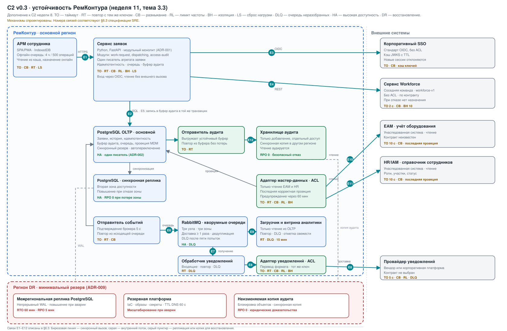

# Неделя 11 · Спецификация SRE: надёжность, наблюдаемость и устойчивость

**Статус** — проектная гипотеза v1.0 учебной архитектуры. Промышленной телеметрии, истории трафика и подписанного соглашения об уровне обслуживания пока нет. Цели, объёмы и пороги предстоит проверить на пилоте.

**Основания** — занятие 11, слайды 6–32 и 34–37, [реестр FR/NFR](../04-requirements.md), [каталог E2E](../quality/10-e2e-catalog.md), [матрица трассировки](../quality/10-traceability.md), [архитектура интеграций](../07-integration-architecture.md), [внешняя среда](../08-external-environment.md), [доступ и аудит](../security/09-access-audit.md), [ADR-004](../adr/ADR-004-message-broker-rabbitmq.md), [ADR-005](../adr/ADR-005-notification-channel-adapter.md), [ADR-006](../adr/ADR-006-external-boundary-acl.md), [ADR-007](../adr/ADR-007-assignment-security.md), [ADR-008](../adr/ADR-008-synthetic-test-data.md) и [ADR-009](../adr/ADR-009-disaster-recovery-strategy.md).

**Обозначения** — `[D]` означает основание в существующем документе досье, `[H]` — гипотезу, требующую измерения или согласования.

## 1. Область и метод

Надёжность оценивается по наблюдаемому результату пользовательского сценария. Цель 100% потребовала бы недостижимой надёжности и остановки изменений. Бюджет ошибок задаёт правило принятия оставшегося риска.

Спецификация охватывает пять сценариев и их SLI, SLO, предлагаемые SLA и бюджеты (§2–3), телеметрию (§4–5), механизмы устойчивости на диаграмме C2 (§6), управляемую деградацию (§7) и программу проверок (§8). RTO/RPO и выбор стратегии описаны отдельно в [плане DR](11-dr-plan.md) и [ADR-009](../adr/ADR-009-disaster-recovery-strategy.md).

За пределами документа — внутренняя надёжность EAM, HR, корпоративного поставщика удостоверений и провайдера уведомлений, реагирование на инциденты ИБ за пределами нужной для расследования телеметрии, регламент инцидентов и разбор без поиска виноватых из темы 3.4. Стоимость простоя пока не измерена. [Досье, §10](../02-capability-value-stream.md)

Порядок работы следует лекции: определить SLI с точки зрения пользователя, задать SLO и бюджет, настроить телеметрию, защитить внешние связи, описать деградацию и восстановление. Для SLO нужны запрос расчёта, владелец и оповещение.

## 2. Критические пользовательские сценарии

Пять сценариев взяты из каталога E2E. Они покрывают запись, чтение, назначение через внешнюю границу, асинхронную доставку и корректность истории ремонта. Доставка уведомлений имеет вспомогательный SLO, поскольку задержка уведомления сохраняет силу назначения. [Внешняя среда, §6](../08-external-environment.md)

| ID | Сценарий | Пользователь и результат | E2E и требования | Почему критичен | Тип SLI |
|---|---|---|---|---|---|
| P1 | Регистрация заявки | Оператор получает подтверждённый ID надёжно сохранённой заявки | [E2E-01](../quality/10-e2e-catalog.md), FR-01, NFR-01/02, DQ-01/03/04 | Утраченное обращение о неисправности нельзя воссоздать | Доступность и сохранность |
| P2 | Список, карточка и история | Оператор, диспетчер или инженер видит состояние и ответственного | [E2E-01/04](../quality/10-e2e-catalog.md), FR-03, NFR-03, A-02 | NFR-03 задаёт p95 ≤ 2 с. При задержке пользователи возвращаются к звонкам и таблицам | Задержка |
| P3 | Назначение инженера | Диспетчер получает ровно одно подтверждённое назначение | [E2E-02](../quality/10-e2e-catalog.md), FR-04, NFR-04, T-03/05/06, A-03/04/08 | Самая длинная синхронная бизнес-операция пересекает границу Workforce | Успех и согласованность |
| P4 | Доставка факта назначения | Инженер, аналитик и руководитель получают подтверждённый факт | [E2E-03](../quality/10-e2e-catalog.md), FR-04, DQ-04/05/06, ADR-004/005 | Асинхронные потребители отказывают независимо от ядра. Устаревшая аналитика скрывает сбои процесса | Свежесть |
| P5 | Результат ремонта и закрытие | Инженер и диспетчер создают полную аудируемую запись | [E2E-04](../quality/10-e2e-catalog.md), FR-05/07, DQ-02, A-06/07 | Запись служит долговременным деловым и юридическим подтверждением | Корректность |

Раздельные SLO позволяют отличить потерю заявки, медленную карточку, задержку уведомления и некорректное закрытие.

## 3. SLI, SLO, SLA и бюджет ошибок

### 3.1 Правила расчёта

SLI — доля успешных событий среди учитываемых за выбранное окно.

| Правило | Определение |
|---|---|
| Учитываемое событие | Ожидаемая операция: аутентифицирована, синтаксически корректна, укладывается в профиль нагрузки и не исключена по §3.1.1 |
| Успешное событие | Учитываемое событие достигло результата и порога времени своего SLO. Частичный успех, неизвестный исход и скрытый обходной режим не засчитываются |
| Окно | Скользящие 30 дней для эксплуатации, календарный месяц только для отчёта SLA |
| Привязка ко времени | По времени бизнес-факта. Запоздавшие данные могут один раз скорректировать закрытое окно с записью исправления |
| Дедупликация | Повторы с одним ключом идемпотентности или ID события считаются один раз. Дублированный эффект нарушает ограничение §3.8 |
| Источник | Серверная телеметрия для технических SLI, сверенные бизнес-записи для корректности и свежести. Клиентские измерения используются для диагностики |
| Владение | Один ответственный за SLO ежемесячно проверяет запрос, бюджет и оповещение |

#### 3.1.1 Исключения

Исключаются запросы, отклонённые проверкой схемы или полномочий до обработки, конфликты `409`/`412` из-за устаревшей версии клиента, `429` в пределах опубликованного правила, плановые работы с уведомлением за пять рабочих дней и в согласованном окне, синтетический мониторинг. Правила применяются одинаково для всех событий, количество исключений контролируется.

Сбой зависимости расходует бюджет. Например, задержка Workforce расходует P3. Исключение — объявленный форс-мажор, согласованный владельцем процесса и отражённый в журнале надёжности.

### 3.2 Каталог SLO

Месячные объёмы — гипотезы `[H]` на основе профиля `[D]`: до 200 пользователей, 50 одновременных сессий, 50 000 заявок, пик 20 чтений/с и 5 записей/с. До первого SLA их заменяют измерениями пилота. [Требования, §6.5](../04-requirements.md)

| ID | Сценарий | SLI: успешные / учитываемые события | SLO за 30 дней | Предлагаемый SLA | Бюджет, событий | Владелец |
|---|---|---|---|---|---|---|
| SLO-01 | P1 Регистрация | Команды с подтверждённой и сохранённой заявкой за 60 с, включая очередь за 60 с после восстановления связи / все учитываемые команды создания | 99.5% | 99.0% | 60 из 12 000 | Martin |
| SLO-02 | P2 Чтение | Ответы списка, карточки и истории за ≤ 2 с / все учитываемые запросы чтения | 95.0% | 90.0% | 12 000 из 240 000 | Martin |
| SLO-03 | P3 Назначение | Саги с одним окончательным исходом за 60 с: `confirmed` с одним активным назначением или корректный бизнес-отказ без назначения / все учитываемые команды | 99.0% | 98.0% | 90 из 9 000 | Andrey |
| SLO-04 | P4 Доставка | Доменные события, доступные в хранилище аналитики за 15 мин с фиксации / все зафиксированные доменные события | 99.0% | 98.0% | 300 из 30 000 | Amir |
| SLO-05 | P5 Завершение | Переходы выполнения и закрытия с сохранёнными результатом, автором, временем и аудитом / все учитываемые переходы | 99.9% | 99.5% | 11 из 11 000 | Andrey |

Предлагаемый SLA мягче внутреннего SLO минимум на один шаг бюджета. Значения отражают предполагаемое внешнее обязательство с запасом на обычные колебания. Согласованного SLA пока нет.

#### SLO-01 · Регистрация

При потере обращения исходные сведения могут исчезнуть. NFR-02 предусматривает локальную очередь, четыре часа автономности и синхронизацию за 60 с после восстановления связи. Засчитывается подтверждённая сохранность, включая позднее подтверждение записи из очереди. Ответ HTTP `200` без сохранения нарушает ограничение. Цель 99,5% соответствует одному рабочему региону с минимальным резервом и автономной очередью. Для 99,9% потребовались бы автоматическое многозонное переключение и зрелое дежурство. [Требования, §6](../04-requirements.md) · [Технический эксперимент](../04-technical-spike.md)

#### SLO-02 · Задержка чтения

NFR-03 задаёт p95 ≤ 2 с для списка, карточки и формы создания. Для бюджета считаются отдельные события в пределах двух секунд, а p95 используется для диагностики. Цель 95% сохраняет порог NFR. SLA 90% оставляет запас на клиентские и сетевые колебания за границей сервиса.

#### SLO-03 · Назначение

Синхронный бюджет саги составляет три секунды. Затем API возвращает `202` со ссылкой, окончательный исход ожидается за 60 с. Корректный отказ `ENGINEER_UNAVAILABLE` засчитывается как успешный результат. Ошибки — таймауты, неразрешённые исходы, дубли активных назначений и расхождение саги с заявкой. Цель 99,0% учитывает внешнюю зависимость Workforce, предлагаемый SLA составляет 98,0%. [Интеграции, §3–4](../07-integration-architecture.md)

#### SLO-04 · Свежесть доставки

DQ-06 требует ≥ 99% событий в аналитике за 15 мин в суточном окне. Отсчёт ведётся от бизнес-события. Устаревшая витрина скрывает очередь назначений от аналитиков и руководителей. Ядро от неё не зависит. Один запрос обслуживает проверки DQ и SLO. [Качество данных](../data/06-oltp-olap-quality-lineage.md)

#### SLO-05 · Корректность завершения

Запись выполнения и закрытия подтверждает ремонт и используется при аудите. Потеря или изменение результата хуже задержки закрытия. При расчётном объёме цель 99,9% допускает 11 неуспешных переходов. Ограничения §3.8 отдельно задают события с нулевой терпимостью. [Доступ и аудит, §3](../security/09-access-audit.md)

### 3.3 Вспомогательные SLO зависимостей

Вспомогательные цели дают ранний сигнал для разбора расхода пользовательского бюджета. Владелец зависимости разбирает нарушения. Само отклонение не замораживает релизы.

| ID | Зависимость | SLI | SLO за 30 дней | Бюджет | Владелец |
|---|---|---|---|---|---|
| SLO-S1 | Публикация из исходящей очереди | События с подтверждением брокера за 5 с после фиксации / все зафиксированные | 99.5% | 150 из 30 000 | Amir |
| SLO-S2 | Уведомления | Принятые провайдером за 60 с / все уведомления | 98.0% | 360 из 18 000 | Amir |
| SLO-S3 | Свежесть мастер-данных | Минуты с возрастом проекции EAM/HR ≤ 15 мин / все минуты окна | 99.5% | 216 мин | Martin |
| SLO-S4 | Буфер аудита | Записи, сохранённые в транзакции бизнес-изменения без потерь и правок / все записи | 100%, жёсткое ограничение | Без бюджета | ИБ |

Для SLO-S4 потеря или правка записи считается инцидентом ИБ. Возраст буфера `audit_buffer_oldest_age_seconds` сигнализирует о задержке доставки сохранённой записи.

### 3.4 Стоимость целевого уровня

| Цель | Допустимая недоступность за 30 дней | Типичные требования | Решение для РемКонтура |
|---|---|---|---|
| 99.0% | 7 ч 12 мин | Один экземпляр, ручное восстановление, базовый мониторинг | Недостаточно для записи |
| 99.5% | 3 ч 36 мин | Резервирование, мониторинг, дежурство, проверка восстановления | Для P1. Для P2 — 95% в пределах 2 с |
| 99.9% | 43 мин | Автопереключение, зрелая эксплуатация | Только для корректности P5 |
| 99.95% | 22 мин | Несколько зон, автоматическое восстановление | Текущая модель затрат не обосновывает |
| 99.99% | 4 мин 19 с | Несколько регионов, высокие затраты, частые учения | Избыточно и слишком дорого |

Цели `[H]` предварительные до измерения стоимости простоя и обоснования SLA. Локальная очередь АРМ позволяет пережить краткий сбой сервера без потери обращения. При выбранной цели P1 бюджет недоступности сервера эквивалентен 3,6 часа. [Карта ценности, §10](../02-capability-value-stream.md)

### 3.5 Расчёт бюджета ошибок

`бюджет = (1 − SLO) × учитываемые события`

| SLO | Расчёт | Бюджет | Пример в середине окна | Остаток | Режим |
|---|---|---|---|---|---|
| SLO-01 | (1 − 0.995) × 12 000 | 60 | 25 неуспешных регистраций за две недели | 35 (58%) | Обычный |
| SLO-02 | (1 − 0.95) × 240 000 | 12 000 | 4 000 чтений дольше 2 с | 8 000 (67%) | Обычный |
| SLO-03 | (1 − 0.99) × 9 000 | 90 | 70 сбойных или незавершённых саг | 20 (22%) | Только надёжность |
| SLO-04 | (1 − 0.99) × 30 000 | 300 | 120 запоздавших событий | 180 (60%) | Обычный |
| SLO-05 | (1 − 0.999) × 11 000 | 11 | 3 некорректных перехода | 8 (73%) | Обычный |

Бюджеты ведутся отдельно по SLO. Запас задержки P2 не компенсирует потери P1. Внутренний бюджет рассчитывается от SLO и строже внешнего SLA.

### 3.6 Политика бюджета ошибок

Продукт, разработка и эксплуатация согласуют правила заранее. Режим выпуска определяется остатком бюджета конкретного сценария.

| Остаток | Режим | Действия |
|---|---|---|
| >50% | Обычный | Обычный темп, эксперименты и некритичные миграции разрешены. Работы по надёжности планируются |
| 25–50% | Осторожный | Для рискованных изменений нужны пробный выпуск на части трафика, план отката и ответственный. Разбор причин получает приоритет, работы входят в следующую итерацию |
| 1–25% | Только надёжность | По затронутому сценарию разрешены исправления, тесты, наблюдаемость и эксплуатационные улучшения. Исключение письменно согласуют продукт, разработка и руководитель надёжности |
| 0% | Заморозка | По сценарию разрешены аварийные исправления. Начинается разбор без поиска виноватых. Бюджет пересматривается после принятия мер |

Исключение ограничено по времени, называет принятый риск и автоматически истекает. В журнале фиксируются согласующие, SLO и компенсирующая мера. Повторные исключения запускают пересмотр цели.

### 3.7 Оповещения о скорости расходования

Длинное окно подтверждает тенденцию, короткое — что сбой продолжается. Оповещения ориентированы на пользовательские симптомы.

| Длинное окно | Короткое окно | Скорость | Израсходовано | Срочность | Действие |
|---|---|---|---|---|---|
| 1 ч | 5 мин | 14.4× | 2% | Вызов дежурного | Открыть панель сценария, действовать по регламенту зависимости, оценить сброс нагрузки или отключение функций |
| 6 ч | 30 мин | 6× | 5% | Вызов или срочная задача | Проверить зависимость и выкладку, подготовить откат |
| 3 дня | 6 ч | 1× | 10% | Задача | Добавить в план надёжности, обсудить на еженедельной встрече |
| 30 дней | — | Бюджет исчерпан | 100% | Заморозка | Применить §3.6 и начать разбор |

Коэффициент 14.4× получается делением 30 дней на час с умножением на 2%. Расход со скоростью 6× за шесть часов составляет 5% месячного бюджета. Правила зависят от SLO и действуют при росте трафика. Сигнал содержит ID SLO, скорость, остаток, сценарий и ссылку на панель. Пользовательские ID не передаются.

### 3.8 Жёсткие ограничения

Следующие события имеют нулевую терпимость. Они останавливают релизы и запускают разбор ИБ или целостности независимо от бюджета.

| ID | Ограничение | Источник | Реакция |
|---|---|---|---|
| G1 | Назначения вне роли или области диспетчера отсутствуют | T-03, A-03/A-04, [09 §1](../security/09-access-audit.md) | Sev-1, при подозрении отозвать сессии, проверка аудита ИБ |
| G2 | Потерь и изменений аудита нет | T-10, NFR-04, [09 §3](../security/09-access-audit.md) | Sev-1, остановить привилегированную запись, восстановить неизменяемую копию |
| G3 | Нет дублей активного назначения и заявки на операцию | DQ-04, [07 §3](../07-integration-architecture.md) | Sev-2, сверить по ключу идемпотентности, ID саги и события, исправить данные |
| G4 | Пользователь не видит ложного успеха | NFR-02, [E2E-01](../quality/10-e2e-catalog.md) | Sev-2, до подтверждения сервера показывать очередь либо неизвестный исход |
| G5 | Нет раскрытия данных другой области и роли | A-02, [09 §1](../security/09-access-audit.md) | Sev-1, проверка доступа и сверка аудита |

Инцидент по жёсткому ограничению разбирается отдельно от бюджета ошибок.

### 3.9 Ответственность и пересмотр

| Роль | Ответственность |
|---|---|
| Руководитель надёжности (Martin) | Спецификация, запросы SLO, проверка бюджета и готовности |
| Владельцы сценариев | Martin — P1/P2, Andrey — P3/P5, Amir — P4 и вспомогательные цели зависимостей |
| Владелец продукта | Цели, предложение SLA и исключения бюджета |
| ИБ | Жёсткие ограничения, SLO аудита, классификация G1/G2/G5 |
| Эксплуатация | Реакция на оповещения, деградация и DR |

Каталог проверяется ежемесячно по фактическому расходу и ежеквартально по бизнес-ценности. Изменение цели версионируется с причиной, новым бюджетом и списком сигналов. Во время активного инцидента цель сохраняется.

## 4. Телеметрия

### 4.1 Принципы

Мониторинг отвечает на заранее известные вопросы через панели и пороги. Наблюдаемость позволяет исследовать новые вопросы без выкладки кода, связывая журналы, метрики и трассировки.

1. Операция имеет один `correlation_id` от АРМ до аудита и потребителей.
2. Метрики показывают симптом, трассы локализуют его, журналы объясняют причину.
3. Телеметрия не блокирует транзакцию. Аудит подчиняется отдельному правилу безопасного отказа.
4. Сигналы не содержат ПДн, секреты и свободный текст заявки.

### 4.2 Три сигнала

| Сигнал | Роль | Применение | Хранение |
|---|---|---|---|
| Журналы | Переходы, причины отказа, повторы и состояния автомата | Диагностика операции и субъекта, аудит отдельно | 30 дней оперативно, 90 дней в архиве |
| Метрики | Частота, ошибки, длительность, насыщение и бизнес-счётчики | SLI, панели и оповещения | 30 дней исходные, 13 месяцев агрегированные |
| Трассировки | Путь через АРМ, API, БД, брокер и потребителей | Источник задержки и сбоя | 7 дней, ошибки 30 дней |

### 4.3 Идентификатор корреляции и контекст трассы

| Шаг | Компонент | Действие |
|---|---|---|
| 1 | АРМ | Создаёт UUIDv7 `correlation_id` при отправке или постановке в локальную очередь. Хранит с ключом идемпотентности и телом |
| 2 | Граница HTTP | Передаёт `traceparent` (W3C Trace Context) и `X-Correlation-ID`. Сервер проверяет формат, создаёт ID при отсутствии и возвращает его |
| 3 | Сервис заявок | Помещает ID в контекст, структурированные журналы, интервалы трассы, тело ошибки и заголовки поддержки |
| 4 | PostgreSQL | Хранит ID в истории, буфере аудита и исходящем событии |
| 5 | Контракт события | Передаёт `correlation_id` с `event_id` и `saga_id`. Потребитель связывает свой интервал с исходной трассой |
| 6 | Аудит и E2E | Аудит содержит ID, проверки E2E ждут запись по ID вместо фиксированной паузы |

Повтор сохраняет ID, новая операция получает новый. ID не даёт полномочий и не содержит ПДн. Если ID потерян на внутренней границе, это дефект. `saga_id` идентифицирует сагу, `event_id` — сообщение. Оба связываются с идентификатором корреляции.

### 4.4 Журналы

Журналы — JSON со стабильной схемой. Идентификаторы в примере условные.

```json
{
  "timestamp": "2026-11-19T08:15:22.431Z",
  "level": "INFO",
  "service": "repair-request-service",
  "version": "1.4.2",
  "environment": "production",
  "event": "repair_request.created",
  "correlation_id": "018f4c2e-7d1a-7c3b-9a11-6f0f2d8b4c21",
  "trace_id": "4bf92f3577b34da6a3ce929d0e0e4736",
  "span_id": "00f067aa0ba902b7",
  "actor_id": "usr_7f3c",
  "effective_role": "operator",
  "request_id": "REQ-2026-000123",
  "outcome": "success",
  "latency_ms": 84,
  "idempotent_replay": false
}
```

| Уровень | Когда применять | Обязательные данные |
|---|---|---|
| ERROR | Операция завершилась ошибкой и требует реакции | `event`, `correlation_id`, `outcome`, `reason_code`, при необходимости `dependency`. Исключить тело и секреты из стека |
| WARN | Деградация, повтор, разомкнутая цепь, старая проекция | `event`, `correlation_id`, `retry_count`, `circuit_state`, `age_seconds` |
| INFO | Переход бизнес-состояния, одна запись на факт | `event`, `correlation_id`, `request_id` или `saga_id`, `actor_id`, `outcome` |
| DEBUG | Диагностика, по умолчанию отключена в эксплуатации | Выборочная и временная, без ПДн |

Исключаются имена, телефоны, адреса почты, описания неисправностей, токены, cookie, заголовки авторизации, полные тела запросов и ответов, строки подключения. `actor_id` — стабильный псевдоним. Очистка выполняется в SDK и сборщике. Проверка схемы останавливает сборку при запрещённом поле. По умолчанию пишется одна INFO-запись на бизнес-факт и одна ERROR или WARN на отклонение, без записи каждого успешного внутреннего шага.

### 4.5 Метрики

Имена стабильны, используют snake_case и суффикс единицы. Метки — ограниченные перечисления. ID заявок и пользователей, адреса почты и свободный текст исключены.

| Метрика | Тип | Метки | Назначение | SLO |
|---|---|---|---|---|
| `rr_requests_total` | Счётчик | `operation`, `outcome` | Частота и доля ошибок по операции | SLO-01/02/03/05 |
| `rr_request_duration_seconds` | Гистограмма | `operation` | Распределение задержки команд и чтения | SLO-02 |
| `rr_read_duration_seconds` | Гистограмма | `view` (`list`, `card`, `history`) | p95 NFR-03 по экрану | SLO-02 |
| `assignment_saga_total` | Счётчик | `state` | Исходы саги, включая `failed_manual_review` | SLO-03 |
| `assignment_saga_duration_seconds` | Гистограмма | `outcome` | Время до окончательного исхода назначения | SLO-03 |
| `outbox_events_total` | Счётчик | `result` | Успехи, повторы и ошибки публикации | SLO-S1 |
| `outbox_oldest_age_seconds` | Текущее значение | — | Возраст старейшего неопубликованного события | SLO-S1 |
| `mq_consumer_lag_seconds` | Текущее значение | `consumer` | Задержка от фиксации до обработки | SLO-04 |
| `event_freshness_seconds` | Гистограмма | `consumer` | Возраст события при появлении в аналитике | SLO-04 |
| `notification_delivery_total` | Счётчик | `result` | Принято, повторено, отклонено, неизвестно | SLO-S2 |
| `notification_delivery_duration_seconds` | Гистограмма | — | Время до приёма провайдером | SLO-S2 |
| `dependency_request_duration_seconds` | Гистограмма | `dependency`, `operation` | Источник таймаутов и задержек | Все |
| `dependency_errors_total` | Счётчик | `dependency`, `reason` | Диагностика расхода бюджета | Все |
| `circuit_breaker_state` | Текущее значение | `dependency` | 0 — замкнут, 1 — пробный режим, 2 — разомкнут | Все |
| `db_pool_in_use` | Текущее значение | `pool` | Насыщение и состояние изоляции пулов | SLO-02 |
| `db_pool_wait_seconds` | Гистограмма | `pool` | Ожидание соединения | SLO-02 |
| `audit_buffer_oldest_age_seconds` | Текущее значение | — | Задержка доставки аудита | SLO-S4 |
| `business_requests_registered_total` | Счётчик | `org_unit` | Темп регистрации независимо от HTTP | P1 |
| `business_assignments_confirmed_total` | Счётчик | `org_unit` | Подтверждённые назначения по участку | P3 |
| `business_closures_total` | Счётчик | `org_unit` | Закрытые записи обслуживания | P5 |
| `business_unassigned_requests` | Текущее значение | `org_unit` | Заявки без назначения | P3 |
| `business_oldest_unassigned_age_seconds` | Текущее значение | `org_unit` | Возраст старейшей неназначенной заявки | P3 |
| `slo_budget_remaining_ratio` | Текущее значение | `slo` | Расчётный остаток бюджета | Все |
| `slo_burn_rate` | Текущее значение | `slo`, `window` | Расчётная скорость расходования | Все |

При ревью проверяется число уникальных меток. `org_unit` берётся из ограниченного справочника, `reason` — из перечисления, маршрут задаётся шаблоном `/v1/repair-requests/{id}`. CI отклоняет новые метки без обоснования кардинальности. Правила записи вычисляют производные метрики SLO централизованно.

Четыре основных сигнала — задержка, трафик, ошибки и насыщение. RED применяется для обработки запросов, USE — для PostgreSQL, RabbitMQ и узлов. Бизнес-метрики показывают случаи, когда технические показатели в норме, а регистрации прекратились (занятие 11, слайд 18).

### 4.6 Трассировки

Трасса — дерево интервалов с общим `trace_id`. Минимальный набор для двух критических цепочек:

| Интервал | Компонент | Атрибуты | Вопрос |
|---|---|---|---|
| `arm.create_request` | АРМ | `operation`, `offline`, `queue_depth` | Клиент ждал, поставил в очередь или завершился ошибкой? |
| `POST /v1/repair-requests` | API | `http.status`, `idempotent_replay`, `correlation_id` | Команда принята один раз? |
| `auth.verify_token` | API | `issuer`, `result`, `cache_hit` | Задержка на аутентификации? |
| `db.insert_request` | API | `db.system`, `db.operation`, `rows` | БД стала узким местом? |
| `outbox.append` | API | `event_type`, `event_id` | Событие записано вместе с фактом? |
| `assignment.command` | API | `saga_id`, `request_id` | Какая попытка назначения? |
| `saga.reserve_engineer` | Оркестратор | `saga_id`, `attempt` | На чём ждала сага? |
| `workforce.reserve` | Клиент | `http.status`, `timeout`, `circuit_state` | Workforce медленный или недоступен? |
| `saga.confirm_assignment` | Оркестратор | `outcome`, `version` | Поворотный шаг пройден один раз? |
| `outbox.publish` | Отправитель | `event_id`, `confirm_latency_ms` | Задержал ли брокер? |
| `notification.consume` | Обработчик | `event_id`, `attempt` | Была повторная доставка? |
| `notification.deliver` | Адаптер | `provider_status`, `attempt` | Принял ли провайдер? |
| `analytics.consume` | Загрузчик | `event_id`, `warehouse_latency_ms` | Насколько отстаёт аналитика? |

Атрибуты исключают тело, ПДн и токены. Имена интервалов имеют низкую кардинальность, ID передаются как атрибуты. Выборка составляет 100% для записи, ошибок и саг назначения, 10% для успешного чтения. По завершённой трассе сохраняются все ошибки и операции дольше двух секунд. Аудит сохраняется полностью в отдельном хранилище.

### 4.7 Конвейер телеметрии и отказы

Проект использует SDK OpenTelemetry и сборщик в каждой среде. Хранилище ещё не выбрано. Метрики передаются в формате, совместимом с OpenMetrics, журналы — в JSON, трассы — в OTLP. Сборщик очищает поля, отбирает завершённые трассы и маршрутизирует сигналы.

| Отказ | Поведение | Защита |
|---|---|---|
| Сборщик или хранилище недоступны | Ограниченный буфер SDK, например 10 000 интервалов или 50 МБ. Старые данные отбрасываются первыми, трафик продолжается | Сигнал по доле сброса и заполнению, без блокировки запросов |
| Расхождение часов | Длительности по монотонным часам, отметки UTC синхронизированы NTP | События более чем на пять минут из будущего отклоняются, отрицательные длительности помечаются |
| Рост кардинальности | Новые метки проверяются при ревью и в CI | Лимит по метрике, неизвестные метки отбрасывает сборщик |
| Утечка ПДн | Очистка в SDK и сборщике, тест схемы | Проверка схемы в CI, разбор подтверждённой утечки |
| Смещение выборки | Записи, ошибки и саги отбираются полностью | Документировать выборку, SLO считать по полным счётчикам |
| Сбой телеметрии при инциденте | Локальные буферы и аудит независимы | Использовать метрики БД, брокера и журнал аудита |

Телеметрия не блокирует бизнес-операцию. При невозможности записи аудита привилегированная операция отклоняется.

### 4.8 Хранение и доступ

| Данные | Оперативно | В архиве | Причина |
|---|---|---|---|
| Исходные метрики | 30 дней | 13 месяцев с шагом 5 мин | Окна SLO и квартальный пересмотр |
| Трассы | 7 дней | 30 дней для медленных и ошибочных | Диагностика и регрессии |
| Журналы | 30 дней | 90 дней | Расследование |
| Аудит | По правовому регламенту | Неизменяемая копия | Доказательства для ИБ и юристов, пять лет предложено к согласованию |
| Отчёты SLO | 13 месяцев | — | Пересмотр и отчёт SLA |

Дежурный и руководитель надёжности читают всю телеметрию, разработчики — данные своих сервисов, ИБ — аудит и сигналы безопасности, владельцы процессов — агрегаты без ПДн. Чтение аудита само записывается. Аварийный доступ ограничен по времени и проверяется.

### 4.9 Зоны без наблюдения

Остаются время отрисовки АРМ за пределами замера API, состояние EAM, HR, поставщика удостоверений и провайдера, физическое время ремонта, качество свободного описания и работа по телефону в обход системы. Для них применяются UX-исследования, показатели адаптеров и наблюдение за процессом.

## 5. Панели мониторинга

### 5.1 Уровни

| Уровень | Аудитория | Вопрос | Обновление |
|---|---|---|---|
| Бизнес | Владелец процесса, руководители | Заявки регистрируются, назначаются и закрываются в нужном темпе? | 5 мин |
| SLO сервиса | Руководитель надёжности, дежурный | Где расходуется бюджет? | 1 мин |
| Зависимости | Дежурный, владельцы сервисов | Какая связь медленная, сбойная или разомкнута? | 30 с |
| Изменения | Команда | Что изменилось и связано ли это с расходом? | При выкладке |

Панель спроектирована вокруг вопросов и представлена эскизом.


### 5.2 Основные блоки

| Блок | Вопрос | Содержимое | Порог и действие |
|---|---|---|---|
| Плитки SLO | Где расходуется бюджет? | Пять плиток: SLO, скорость, остаток, тренд за 30 дней | Красный при 14.4× за 1 ч или остатке <25%, открыть регламент |
| RED запросов | Здоров ли API? | Частота, ошибки, p50/p95/p99 по операциям | p95 > 2 с или ошибки > 1%, проверить зависимости |
| Воронка процесса | Где останавливаются пользователи? | Регистрация, назначение, завершение, очередь неназначенных и её возраст | Рост очереди 30 мин, проверить Workforce и нагрузку диспетчеров |
| Состояние зависимостей | Какая связь отказывает? | Workforce, EAM, HR, провайдер, SSO: p95, ошибки, состояние цепи | Разомкнуто или p95 выше таймаута, открыть таблицу деградации |
| Очередь и потребители | Успевает ли доставка? | Возраст старейшего события, отставание, глубина DLQ | p99 возраста > 5 с или лаг > 15 мин, проверить брокер и загрузчик |
| Темп бизнес-операций | Работает ли процесс? | Регистрации, назначения, закрытия в час по участку | Ноль при обычном потоке — оповещение о симптоме |
| Журнал изменений | Что изменилось? | Выкладки, флаги функций, конфигурация, инциденты | Расход после изменения — сопоставить с отметкой выкладки |

Блоки без действий удаляются. Остальные имеют порог и владельца, единый диапазон UTC и отметки выкладок на временных рядах.

### 5.3 Оповещения и инструкции

Сигнал ведёт к плитке, зависимостям и разделу регламента из темы 3.4. Первые проверки — скорость расходования, состояние цепи зависимости и последнее изменение. Маршрутизация идёт по владельцу пользовательского сценария.

### 5.4 Правила оформления

На первом экране максимум семь блоков, детализация операции доступна за один переход. Единицы явные, цвет показывает состояние, ПДн отсутствуют. Панели и сигналы получают значения из одних правил расчёта.

## 6. Механизмы устойчивости на C2

### 6.1 Каскадный отказ

1. Workforce отвечает за 15 с вместо 2 с по контракту.
2. Назначения занимают обработчики приложения и соединения общего пула.
3. Очередь растёт, чтение и регистрация ждут свободного обработчика.
4. API перестаёт отвечать, АРМ показывает ожидание или таймаут.
5. Диспетчеры всех участков теряют экран назначения и сообщают о падении системы.

Защита прерывает цепочку на втором шаге. Таймаут дополняется контролем повторов и изоляцией ресурсов.

### 6.2 Каталог механизмов

| Механизм | Правило | Что защищает | Основание |
|---|---|---|---|
| Таймаут | Короче остатка бюджета вызывающей стороны и пользовательского NFR | Потоки и пулы | [08 §6](../08-external-environment.md), §6.3 |
| Повтор | Только идемпотентные операции с тем же ключом и телом, экспоненциальная задержка с полной случайной разбежкой, максимум три автоматические попытки, бюджет ≤ 10% успешных вызовов | Зависимость и вызывающий сервис | [07 §3](../07-integration-architecture.md) |
| Автомат размыкания | По зависимости и экземпляру, размыкание при 50% ошибок или пяти таймаутах подряд за 30 с при ≥ 20 запросах, пауза 30 с, три пробных вызова | Вызывающий сервис при отказе зависимости | §6.3 |
| Ограничение частоты | Входящие по пользователю и IP, исходящие по провайдеру и унаследованной системе, `429` с `Retry-After`, очередь по контракту | Получатель и общая квота | §6.3 |
| Изоляция ресурсов | Отдельные пулы соединений и обработчиков для Workforce, EAM, HR, уведомлений и аналитики | Независимые сценарии | §6.3 |
| Сброс нагрузки | P0 — создание, чтение, назначение и выполнение, P1 — история и экспорт, P2 — отчёты и разовая аналитика. При насыщении сначала отклоняется P2 | Критические операции | §7 |
| DLQ | После пяти попыток или часа сообщение уходит в очередь неразобранных с ID события и корреляции. Повтор идемпотентен | Работа потребителя и диагностика | [07 §7](../07-integration-architecture.md) |
| Идемпотентность | Ключ у команды, входящая очередь дедупликации у потребителя, ID у события | Защита от повторных эффектов | [07 §3, §5](../07-integration-architecture.md) |
| Обратное давление | Ограниченные очереди и явное состояние `queued` | Устойчивость процесса | NFR-02 |

Таймаут, повтор и автомат размыкания работают совместно с изолированными пулами. Повтор из DLQ требует дедупликации эффекта.

### 6.3 Карта устойчивости C2

Вид C2 v0.3 дополняет внешнюю границу недели 8 проектными механизмами.



Номера связей соответствуют таблицам. [Исходник PlantUML](../diagrams/11-c2-resilience.puml)

#### 6.3.1 Таймауты, повторы и идемпотентность

| Связь | Направление | Таймаут | Повторы | Ключ идемпотентности |
|---|---|---|---|---|
| E1 | АРМ → сервис заявок | 10 с команда, 5 с чтение | Тот же ключ и тело, три попытки, 0,5/1/2 с с полной случайной разбежкой только при таймауте, `429` или `5xx` | UUID операции до первой попытки |
| E2 | Сервис → PostgreSQL | Подключение 2 с, чтение 1,5 с, запись 2 с, блокировка 1 с | Две попытки со случайной задержкой только при ошибке сериализации или взаимоблокировке | Транзакция и ID заявки |
| E3 | Сервис → JWKS SSO | 2 с | Две попытки с паузой 200 мс | Без ключа, безопасный GET и кэш ключей |
| E4 | Сервис → Workforce | 2 с | Сначала чтение резерва по `saga_id`, до трёх сверок за 60 с | `saga_id` |
| E5 | Сервис → буфер аудита | Та же локальная транзакция | Без сетевого повтора в транзакции, ошибка записи буфера отменяет транзакцию | `audit_event_id` |
| E6 | Отправитель → RabbitMQ | Подтверждение 5 с | Без ограничения числа повторов, с пределом задержки, исходящая очередь — источник | `event_id` |
| E7 | RabbitMQ → обработчик уведомлений | Подтверждение 30 с | Пять попыток с задержкой, затем DLQ | `event_id`, дедупликация входящих |
| E8 | Обработчик → адаптер → провайдер | 5 с | Тот же ключ, максимум пять попыток, затем DLQ | `event_id` или ID доставки |
| E9 | RabbitMQ → загрузчик аналитики | Подтверждение 60 с | Пять попыток, затем DLQ, повтор после исправления | `event_id`, дедупликация входящих |
| E10 | Адаптер мастер-данных → EAM | 10 с | Три плановые попытки с задержкой вне пользовательского пути | ID пакета |
| E11 | Адаптер мастер-данных → HR | 10 с | Три плановые попытки с задержкой вне пользовательского пути | ID пакета |
| E12 | Писатель аудита → хранилище | 5 с | Повтор из устойчивого буфера без ограничения числа попыток | `audit_event_id` |

#### 6.3.2 Размыкание, ограничения, изоляция и обходные режимы

| Связь | Автомат размыкания | Ограничение частоты | Изоляция | Обходной режим |
|---|---|---|---|---|
| E1 | В АРМ пять отказов подряд или 50% за 30 с, пауза 30 с, три пробы | 20 запросов/с на сессию, всплеск 40 | Локальная очередь 500 операций или 4 ч | Поставить создание в очередь, показать `queued` или `offline` до подтверждения |
| E2 | Переключение БД | Максимум соединений | 20, из них пять для записи | Запись отклоняется быстро или ждёт, чтение идёт из повышенной реплики или реплики чтения, без ложного подтверждения |
| E3 | 50% за 30 с при ≥ 10 запросах, пауза 30 с | Квота клиента поставщика удостоверений | Пять соединений | Кэш JWKS до TTL, безопасный отказ для новых сессий |
| E4 | 50% за 30 с при ≥ 20 запросах, пауза 30 с | Квота Workforce и команды на диспетчера | Десять соединений | Явный быстрый отказ с возможностью повтора, без частичного резерва, остальные операции продолжаются |
| E5 | Локальный буфер | — | Выделенный писатель | При сбое буфера привилегированное действие отклоняется |
| E6 | 50% за 30 с при ≥ 20 запросах, пауза 30 с | Предел публикаций | Выделенный канал | События сохраняются в очереди, ядро работает |
| E7 | Потребитель приостанавливается при отказе зависимости | Предвыборка 20, параллельность 4 | Отдельный пул | DLQ, назначение действительно |
| E8 | 50% за 30 с при ≥ 20 запросах, пауза 30 с | Квота договора, алгоритм корзины токенов | Десять соединений | Уведомления ждут в очереди, назначение действительно |
| E9 | Ошибки хранилища, 50% за 30 с | Предел повторной доставки | Параллельность 2 | Отметка устаревания, события сохранены |
| E10 | 50% за 30 с при ≥ 10 запросах, пауза 30 с | По квоте EAM | Пять соединений | Последняя корректная проекция с отметкой свежести |
| E11 | 50% за 30 с при ≥ 10 запросах, пауза 30 с | По квоте HR | Пять соединений | Последняя проекция, неизвестные и неактивные сотрудники недоступны для назначения |
| E12 | Устойчивый буфер | Ограничение частоты пакетов | Выделенный писатель | Рост буфера и оповещение, подтверждённый аудит сохраняется |

### 6.4 Обоснование параметров

Порог чтения по NFR-03 — две секунды. БД ограничивает чтение 1,5 с, клиентский таймаут API — 5 с, оставляя время на аутентификацию и сериализацию. Workforce получает 2 с при синхронном бюджете саги три секунды и конечном 60 с. Провайдер уведомлений получает 5 с на асинхронном пути. Пакетные EAM и HR получают 10 с. [Интеграции, §3](../07-integration-architecture.md)

Повторы принадлежат одному слою. Три уровня по три попытки дают 27 вызовов. Бюджет 10% сохраняет ресурсы первых попыток, случайные задержки рассеивают одновременные всплески.

Порог размыкания требует минимального объёма. Пауза 30 с даёт зависимости время восстановиться. Три пробных вызова ограничивают нагрузку после восстановления.

Входящие лимиты защищают API от отдельной сессии, исходящие соблюдают договор и возможности получателя. `429` сохраняет ресурсы при переполнении.

Размеры пулов рассчитаны на 50 сессий, 20 чтений/с и 5 записей/с. Пять из 20 соединений оставлены записи, Workforce выделен отдельный пул. Значения уточняются нагрузочным тестом.

### 6.5 Отклонённые подходы

| Подход | Причина |
|---|---|
| Повтор на каждом слое | Умножает нагрузку, нужен один ответственный слой |
| Неограниченная очередь | Исчерпывает память или диск и скрывает сбой |
| Автомат размыкания БД | Скрывает отставание репликации, мешает переключению или режиму чтения |
| Таймаут дольше бюджета вызывающего | Работа потребляет ресурсы после ухода пользователя |
| Незаметная выдача устаревших данных | Свежесть должна быть видна |
| Сигнал только по CPU | Зависимость может отказать при свободном процессоре |
| Журналы полных тел | Риск ПДн и секретов, у аудита минимизированная схема |
| Один общий SLO | Исправный сценарий скрывает сбойный |

### 6.6 Проверка

Матрица §8.1 проверяет поведение. Задержка 15 с сохраняет общий пул, разомкнутая цепь даёт быстрый явный отказ, повтор и воспроизведение DLQ не дублируют эффекты, насыщение одной зависимости сохраняет SLO других сценариев.

## 7. Управляемая деградация

### 7.1 Режимы

| Режим | Триггер | Что видит пользователь | Инвариант |
|---|---|---|---|
| M0 Обычный | Зависимости в бюджете | Полная функциональность | — |
| M1 Задержка назначения | Workforce недоступен или цепь разомкнута | Регистрация, чтение и завершение работают, назначение возвращает временный отказ с возможностью повтора | Нет частичного резерва и дубля назначения |
| M2 Задержка уведомлений или аналитики | Недоступен провайдер, брокер либо хранилище | Ядро работает, отставание явно обозначено | Подтверждённые факты сохранены |
| M3 Автономный АРМ | Обрыв сети между участком и ЦОД | Локальная очередь и кэш, назначение, приоритет и закрытие отключены | Очередь ограничена, синхронизация без дублей |
| M4 Только чтение | Основная БД недоступна, идёт переключение | Чтение согласованных данных, запись ждёт или ставится в очередь | Подтверждение только после сохранения |
| M5 Безопасный отказ | Буфер аудита либо атрибуты доступа недоступны | Привилегированные изменения отклоняются, обычное чтение продолжается | Каждое привилегированное изменение аудируется |

### 7.2 Таблица отказов

| Отказ | Продолжает работать | Деградирует | Сообщение | Ограничение | Обнаружение и владелец |
|---|---|---|---|---|---|
| Workforce недоступен | Регистрация, карточка, история, результат, закрытие | Назначение | «Назначение временно недоступно. Заявка остаётся без исполнителя. Повторите через несколько минут» | Без резерва, частичного назначения и дублей | Разомкнутая цепь, сбои саг, Andrey |
| Проекция EAM старше 60 мин | Регистрация известного оборудования, чтение, назначение | Свежесть оборудования | «Данные оборудования на ЧЧ:ММ» | Неизвестное, выведенное из эксплуатации или с неверной ссылкой недоступно. Заявка помечена | Возраст проекции, Martin |
| Проекция HR старше 60 мин | Чтение, регистрация, завершение | Выбор исполнителя | «Данные сотрудников могли устареть. Проверьте исполнителя» | Неактивный или неизвестный сотрудник недоступен | Возраст проекции, Martin |
| SSO недоступен | Сессии до истечения токена, локальная очередь | Новый вход | «Вход временно недоступен. Сохранённые в очереди операции останутся доступны» | Нет новых привилегированных сессий и неподписанных действий | Ошибки поставщика удостоверений, кэш JWKS, ИБ |
| Провайдер уведомлений недоступен | Назначение, карточка, закрытие | Доставка | «Уведомление задерживается. Назначение видно в АРМ» | Без ложного статуса доставки | Ошибки и возраст очереди, Amir |
| RabbitMQ недоступен | Регистрация, назначение, завершение, чтение | Аналитика и уведомления | Ошибки в ядре нет, панели показывают задержку | События хранятся в исходящей очереди | Возраст очереди, Amir |
| Хранилище аналитики недоступно | Все основные сценарии | Панели и отчёты | «Данные аналитики поступают с задержкой» | Ядро не ждёт хранилища | Отставание загрузчика, Amir |
| Основной PostgreSQL недоступен | Разрешённое чтение с согласованной реплики, очередь создания | Записи при переключении | «Сохранение задерживается. Операция поставлена в очередь» | Подтверждение только после сохранения | Состояние переключения, Martin |
| Хранилище аудита недоступно | Чтение и обычные операции | Привилегированные изменения | «Действие недоступно, пока не восстановится аудит» | Без привилегированного изменения без записи | Возраст буфера, ИБ |
| Обрыв сети на участке | Локальное создание и чтение кэша | Назначение, приоритет, закрытие | «Нет связи. Заявка отправится после восстановления» | Четыре часа или 500 операций, одно подтверждение на операцию | Состояние очереди АРМ, Martin |
| Хранилище телеметрии недоступно | Все бизнес-сценарии | Диагностика и панели | Без отдельного сообщения | Буфер ограничен, аудит независим | Доля сброса, руководитель надёжности |

### 7.3 Правила

1. Устаревшее чтение сопровождается отметкой свежести. Запись подтверждается после надёжного сохранения.
2. Принятый бизнес-факт сохраняется при отказе потребителя, уведомлений или аналитики.
3. При невозможности проверить аудит или атрибуты привилегированное действие отклоняется.
4. Очередь имеет предел и отображаемое состояние.
5. Каждая строка §7.2 имеет испытание со сбоем и ожидаемое сообщение.
6. Восстановление завершено после разбора очереди, сверки дублей и стабилизации SLO.

### 7.4 Связь с пользователем

Сообщение называет доступные функции, задержки и действие пользователя. Внутренние компоненты, стеки и идентификаторы корреляции скрываются, поддержка получает ID по номеру ошибки. Сообщение «Ошибка» без пояснения считается дефектом.

## 8. Проверка и готовность

### 8.1 Матрица испытаний

| ID | Что доказывает | Метод | Частота | Доказательство |
|---|---|---|---|---|
| SRE-T01 | Расчёты SLO и бюджета верны | Набор событий с заданным числом успехов и ошибок, сверка расчёта | При изменении запроса | Отчёт теста запроса |
| SRE-T02 | ID корреляции проходит всю цепь | E2E-01/02/03 по одному `correlation_id`, проверка одной трассы, записи аудита и события на факт | Каждая сборка | Отчёт E2E |
| SRE-T03 | Журналы без запрещённых полей | Тест схемы и очистки с синтетическими ПДн | Каждая сборка | Отчёт CI |
| SRE-T04 | Кардинальность ограничена | Проверка множеств меток и лимита по метрике | Каждая сборка | Отчёт CI |
| SRE-T05 | Таймаут и размыкание работают | Задержка 15 с и 5xx на зависимости, быстрый отказ и разомкнутое состояние | Каждый релиз | Отчёт испытания сбоя |
| SRE-T06 | Повторы ограничены | Подсчитать вызовы на трёх слоях при отказе, проверить бюджет | Каждый релиз | Нагрузочный отчёт |
| SRE-T07 | Пулы изолируют зависимость | Насыщение Workforce при сохранении SLO записи и чтения | Каждый релиз | Нагрузочный отчёт |
| SRE-T08 | Лимит даёт `429` и `Retry-After` | Всплеск выше настроенного предела | Каждый релиз | Интеграционный отчёт |
| SRE-T09 | Повтор DLQ идемпотентен | Поместить сообщение в DLQ, повторить, проверить один эффект | Каждый релиз | Интеграционный отчёт |
| SRE-T10 | Таблица деградации верна | Воспроизвести строки §7.2, сверить результат в АРМ | Каждый релиз | Отчёт тестов |
| SRE-T11 | Сброс защищает P0 | Насыщение API, P2 отклоняется, P0 успешен | Каждый релиз | Нагрузочный отчёт |
| SRE-T12 | Оповещения верны | Синтетический расход на стенде, проверка порогов вызова, задачи и заморозки | Ежеквартально | Отчёт теста оповещений |
| SRE-T13 | Цели DR достижимы | Полные учения по [плану DR](11-dr-plan.md) | Раз в полгода | Отчёт DR |

### 8.2 Учения со сбоями (GameDay)

| Сценарий | Ожидаемая реакция | Влияние | Расход | Доказательство |
|---|---|---|---|---|
| Workforce отвечает за 15 с | Таймаут 2 с, размыкание, быстрый отказ назначения, чтение и запись работают | Заявки остаются без назначения | SLO-03, оценка по попыткам | Трасса, состояние цепи и саг |
| Провайдер выключен | Повтор с прежним ключом, затем DLQ | Доставка задержана, назначение видно в АРМ | SLO-S2 | Возраст очереди, DLQ, статус |
| Токен скомпрометирован | Отзыв сессий, ротация секретов, поиск аудита по ID корреляции | Сессия закрыта, незаконного назначения нет | Разбор G1/G5 вне бюджета | Аудит и трасса |
| Потерян ЦОД | Повышение реплики, масштабирование резерва, DNS | Ядро недоступно в окне RTO, очередь АРМ работает | SLO-01/02/03 | Отчёт и фактические RTO/RPO |
| Таблица удалена | Аудит и сверка обнаруживают удаление, PITR в изоляции | Возможно чтение без записи, факты восстанавливаются | SLO-01/05 | Отчёт и сверка |
| Брокер потерян | Переключение кворума, повтор из очереди и дедупликация | Аналитика и уведомления отстают, ядро работает | SLO-04/S1 | Возраст очереди и отставание |

Записываются автоматическая реакция, видимый результат, расход бюджета и недостающие шаги регламента.

### 8.3 Готовность

| Пункт | Статус | Где |
|---|---|---|
| Пять SLO с формулами, окнами, владельцами и бюджетами | Спроектировано | §3.2 |
| Политика согласована продуктом, разработкой и эксплуатацией | Спроектировано, не подписано | §3.6 |
| Оповещения по расходу | Спроектировано, не развёрнуто | §3.7 |
| Корреляция от АРМ до аудита и потребителей | Спроектировано, не реализовано | §4.3 |
| Журналы, метрики, трассы, хранение и приватность | Спроектировано, не развёрнуто | §4.4–4.8 |
| Главная панель с порогами и действиями | Эскиз | §5.2 |
| Защита внешних связей | Спроектировано | §6.3 |
| Таблица деградации | Спроектировано, учения не проведены | §7.2 |
| RTO/RPO, стратегия и ADR | Спроектировано | [План DR](11-dr-plan.md), [ADR-009](../adr/ADR-009-disaster-recovery-strategy.md) |
| Фактический трафик и базовые показатели пилота | Отсутствуют | Q1 |
| Подписанный SLA | Отсутствует | Q2 |
| Выбранное и развёрнутое хранилище телеметрии | Отсутствует | Q4 |
| Проведённые учения DR | Отсутствуют | [План DR §9](11-dr-plan.md) |

### 8.4 Открытые вопросы

| ID | Вопрос | Влияние |
|---|---|---|
| Q1 | Сколько регистраций, чтений, назначений, событий и закрытий в месяц? | Бюджеты и стоимость |
| Q2 | Какой SLA предложить и кому? | Разрыв SLO/SLA и договорный риск |
| Q3 | Какова стоимость часа простоя? | RTO/RPO и стратегия DR |
| Q4 | Какое хранилище телеметрии выбрать? | Стоимость, хранение и доступ |
| Q5 | Какой срок аудита согласуют ИБ и юристы? | Хранилище и копия DR |
| Q6 | Доступен и профинансирован ли второй регион? | Стратегия и RTO |
| Q7 | Кто отвечает за доступность и DR Workforce? | SLO-03 и деградация назначения |
| Q8 | Каковы лимиты и гарантии провайдера? | SLO-S2 и ограничение частоты |
| Q9 | Нужна ли пользователям страница состояния? | Коммуникация и нагрузка поддержки |
| Q10 | Есть ли ограничения на размещение телеметрии и копий? | Размещение хранилищ и DR |

## 9. Соответствие заданию

| Пункт | Где | Статус |
|---|---|---|
| SLI и SLO для 3–5 сценариев | §2–3.2, пять сценариев E2E | Спроектировано |
| Бюджет и политика | §3.5–3.7, расчёты и оповещения | Спроектировано |
| Контур телеметрии и эскиз | §4–5, [эскиз](../diagrams/11-sre-dashboard.svg) | Спроектировано |
| Механизмы устойчивости C2 | §6, [C2 v0.3](../diagrams/11-c2-resilience.svg), [PlantUML](../diagrams/11-c2-resilience.puml) | Спроектировано |
| Таблица деградации | §7, режимы и сообщения | Спроектировано |
| RTO/RPO, DR и ADR | [План DR](11-dr-plan.md), [ADR-009](../adr/ADR-009-disaster-recovery-strategy.md) | Спроектировано |

Достижение целей предстоит подтвердить промышленной телеметрией, нагрузочными испытаниями и учениями. На пилоте измеряются объёмы и исходные показатели, затем фиксируется расхождение между проектной и наблюдаемой надёжностью.
