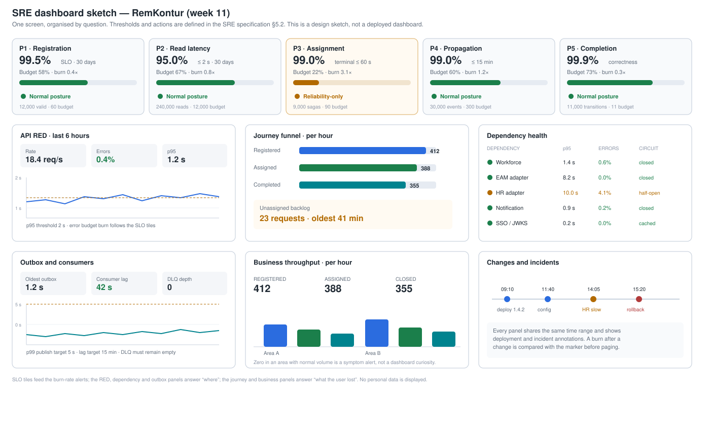

# Week 11 · SRE specification: reliability, observability and resilience

**Status:** design hypothesis v1.0 for the educational architecture. No production telemetry, traffic history or signed service-level agreement exists. The targets, volumes and thresholds below are engineering proposals to be validated in a pilot; they are not measured operational objectives.

**Basis:** Lecture 11, slides 6–32 and 34–37; [FR/NFR register](../04-requirements.md); [E2E catalogue](../quality/10-e2e-catalog.md); [traceability matrix](../quality/10-traceability.md); [integration architecture](../07-integration-architecture.md); [external environment](../08-external-environment.md); [access and audit](../security/09-access-audit.md); [ADR-004](../adr/ADR-004-message-broker-rabbitmq.md), [ADR-005](../adr/ADR-005-notification-channel-adapter.md), [ADR-006](../adr/ADR-006-external-boundary-acl.md), [ADR-007](../adr/ADR-007-assignment-security.md), [ADR-008](../adr/ADR-008-synthetic-test-data.md) and [ADR-009](../adr/ADR-009-disaster-recovery-strategy.md).

**Evidence labels.** `[D]` — derived from an existing Dossier artefact; `[H]` — design hypothesis introduced here and requiring measurement or approval.

## 1. Scope and method

Reliability is treated as an engineering objective, not as an aspiration to avoid all failures. The unit of reliability is a user journey, not a server: an SLO is attached to a business outcome that a named user can observe. A target of 100% is rejected because it is unaffordable, unattainable and would freeze change; the error budget converts the remaining risk into an explicit decision rule.

The specification covers five service-critical journeys, their SLIs, SLOs, proposed SLAs and error budgets (§2–3); the telemetry needed to calculate them (§4–5); the resilience patterns on the C2 container view (§6); graceful degradation (§7); and the verification programme (§8). The disaster-recovery plan with RTO/RPO and the corresponding decision are separate artefacts: [DR plan](11-dr-plan.md) and [ADR-009](../adr/ADR-009-disaster-recovery-strategy.md).

Out of scope: the internal reliability of EAM, HR, the corporate IdP and the notification provider; security incident response beyond the telemetry needed for investigation; the incident runbook and blameless post-mortem, which belong to Topic 3.4; and cost modelling of downtime, which is not available in the Dossier ([02 §10](../02-capability-value-stream.md)).

The method follows the lecture sequence: select an SLI from the user's perspective, set an SLO, derive the budget, instrument the journey, protect every external edge, define what degrades, and plan recovery. A target without a query, an owner and an alert is not an SLO.

## 2. Service-critical journeys

Five journeys are selected from the E2E catalogue. They cover the write path, the read path, the cross-boundary assignment, asynchronous propagation and the correctness of the maintenance record. Notification delivery is treated as a supporting dependency SLO rather than a sixth user journey, because the assignment remains valid when a notification is delayed ([08 §6](../08-external-environment.md)).

| ID | Journey | User and outcome | E2E and requirements | Why it is critical | Primary SLI type |
|---|---|---|---|---|---|
| P1 | Register a repair request | Operator obtains a confirmed, durable request ID without losing the report | [E2E-01](../quality/10-e2e-catalog.md); FR-01, NFR-01, NFR-02; DQ-01/03/04 | The request is the entry point; a lost report leaves a physical fault unreported and cannot be reconstructed | Availability and durability |
| P2 | Read the request list, card and history | Operator, dispatcher or engineer sees the current state and responsible person | [E2E-01/04](../quality/10-e2e-catalog.md); FR-03, NFR-03; A-02 | NFR-03 sets p95 ≤ 2 s; slow reads drive users back to phone calls and spreadsheets | Latency |
| P3 | Assign an engineer | Dispatcher obtains exactly one confirmed assignment | [E2E-02](../quality/10-e2e-catalog.md); FR-04, NFR-04; T-03/05/06; A-03/04/08 | Assignment crosses the Workforce boundary and is the longest synchronous business transaction | Success and consistency |
| P4 | Propagate the assignment result | Engineer, analyst and manager receive the confirmed fact | [E2E-03](../quality/10-e2e-catalog.md); FR-04; DQ-04/05/06; ADR-004/005 | Asynchronous consumers fail differently from the core; stale analytics hides operational drift | Freshness |
| P5 | Record the repair result and close | Engineer and dispatcher create a complete, auditable maintenance record | [E2E-04](../quality/10-e2e-catalog.md); FR-05/07; DQ-02; A-06/07 | The record is the durable business and legal evidence of the intervention | Correctness |

The journeys are deliberately not collapsed into one "system availability" SLO. A single number would hide the difference between a lost request, a slow card, a delayed notification and an incorrect closure, and would give the team no diagnostic direction.

## 3. SLI, SLO, SLA and error budget

### 3.1 Counting rules

An SLI is a ratio of good events to valid events over a defined window. The following rules apply to every SLO in this document.

| Rule | Definition |
|---|---|
| Valid event | A request or operation that the system was expected to serve: authenticated, syntactically valid, within the agreed load profile and not excluded by §3.1.1. |
| Good event | A valid event that meets the outcome and time threshold of its SLO. Partial success, an unknown outcome or a silent fallback is not good. |
| Window | Rolling 30 days for operational decisions; the calendar month is used only for SLA reporting. |
| Attribution | Events are attributed to the time of the business fact, not the time of ingestion; late-arriving data may change a closed window once, and the correction is recorded. |
| Deduplication | Retries with the same idempotency key or event ID count once. A duplicate effect is a guardrail violation (§3.8), not a second good event. |
| Data source | Server-side telemetry for technical SLIs; reconciled business records for correctness and freshness SLIs. Client-only measurements are diagnostic and do not set the budget. |
| Ownership | Each SLO has one accountable owner; the owner reviews the query, the budget and the alert monthly. |

#### 3.1.1 Exclusions

Excluded from valid events: requests rejected by schema validation or authorization before any business processing; `409`/`412` conflicts caused by a stale client version; `429` responses within the published rate limit; planned maintenance announced at least five business days in advance and limited to the agreed window; and synthetic monitoring traffic. Exclusions are applied by rule, not by operator discretion, and the excluded count is itself monitored to prevent budget manipulation.

A dependency outage is not an exclusion. If Workforce is slow, P3 burns budget; that is the purpose of the budget. The only exception is a declared force-majeure event approved by the business owner and recorded in the reliability log.

### 3.2 SLO catalogue

Monthly volumes are hypotheses `[H]` derived from the load profile `[D]` in [04 §6.5](../04-requirements.md) (up to 200 users, 50 concurrent sessions, 50,000 requests in history, peak 20 reads/s and 5 writes/s). They must be replaced by pilot measurements before the first SLA is signed.

| ID | Journey | SLI: good events / valid events | SLO, 30 days | Proposed SLA | Budget, events | Owner |
|---|---|---|---|---|---|---|
| SLO-01 | P1 Registration | Create commands that reach a confirmed, durable state within 60 s, including a queued operation confirmed within 60 s after connectivity returns / all valid create commands | 99.5% | 99.0% | 60 of 12,000 | Martin |
| SLO-02 | P2 Read | List, card and history responses completed in ≤ 2 s / all valid read requests | 95.0% | 90.0% | 12,000 of 240,000 | Martin |
| SLO-03 | P3 Assignment | Assignment sagas reaching one confirmed terminal outcome — `confirmed` with exactly one active assignment, or a correct business rejection with no assignment — within 60 s / all valid assignment commands | 99.0% | 98.0% | 90 of 9,000 | Andrey |
| SLO-04 | P4 Propagation | Domain events available in the warehouse within 15 min of commit / all committed domain events | 99.0% | 98.0% | 300 of 30,000 | Amir |
| SLO-05 | P5 Completion | Completion and closure transitions that persist the required result, author, timestamp and audit record / all valid transitions | 99.9% | 99.5% | 11 of 11,000 | Andrey |

The proposed SLA is deliberately looser than the internal SLO by at least one budget step. No SLA has been agreed with a customer; the column records the maximum external promise that the architecture could support without exhausting the internal budget on ordinary variance.

#### SLO-01 · Registration

Registration is the only journey where a failure destroys information that exists nowhere else. NFR-02 already provides a client-side queue with a four-hour autonomy window and a 60-second synchronisation target after recovery ([04 §6](../04-requirements.md), [Technical Spike](../04-technical-spike.md)). The SLO therefore counts confirmed durable acceptance, not an HTTP `200` alone: an operation that is durably queued and later confirmed is good, while a request that returns success but is lost is a guardrail violation. The 99.5% target is consistent with a single-region pilot-light architecture and is mitigated by the offline queue; 99.9% would require automated multi-zone failover and a mature on-call organisation, which the project does not yet have.

#### SLO-02 · Read latency

NFR-03 defines p95 ≤ 2 s for the list, card and creation form. The SLO reuses the same threshold but counts the proportion of individual requests below it, because an error budget must be additive in events; p95 remains the diagnostic percentile on the dashboard. The 95% target is the NFR threshold itself, not a relaxation: at least 95% of reads must meet the two-second budget. The proposed SLA of 90% leaves room for client-side and network variance outside the service boundary.

#### SLO-03 · Assignment

The assignment saga has a three-second synchronous budget, after which the API returns `202` and a saga location; the terminal outcome is expected within 60 s ([07 §3–4](../07-integration-architecture.md)). A correct business rejection, such as `ENGINEER_UNAVAILABLE`, is a successful outcome of the journey and is not counted as a bad event: the SLI therefore accepts either a confirmed assignment with exactly one active assignment or a correct rejection with no assignment. Bad events are timeouts, unknown outcomes that remain unresolved, duplicate active assignments, and inconsistent state between the saga and the request. The 99.0% target reflects the external Workforce dependency, whose availability is not under our control; the proposed SLA of 98.0% is the lowest value that still preserves a credible service promise.

#### SLO-04 · Propagation

DQ-06 requires at least 99% of events in the warehouse within 15 minutes over a daily window ([06](../data/06-oltp-olap-quality-lineage.md)). The SLO adopts the same threshold and measures freshness at event time, not at loader time. The journey is user-visible to analysts and managers, and a stale warehouse hides an assignment backlog; however, the core request process does not depend on it. The 99.0% target is therefore both a data-quality objective and a reliability objective, and the same query can serve both reviews.

#### SLO-05 · Completion correctness

The completion and closure record is the durable evidence of the intervention and is used in audit and legal review ([09 §3](../security/09-access-audit.md)). Correctness is weighted more heavily than availability: a missing or altered result is worse than a delayed closure. The 99.9% target allows 11 bad transitions per month at the assumed volume, while the zero-tolerance guardrails in §3.8 cover the cases that must never occur. A correctness SLO without guardrails would permit a small number of silent data corruptions; the combination is intentional.

### 3.3 Supporting dependency SLOs

Supporting SLOs are leading indicators. A breach does not by itself freeze releases, but it explains a user-path burn and is reviewed by the dependency owner.

| ID | Dependency | SLI | SLO, 30 days | Budget | Owner |
|---|---|---|---|---|---|
| SLO-S1 | Outbox publication | Events published with publisher confirm within 5 s of commit / all committed events | 99.5% | 150 of 30,000 | Amir |
| SLO-S2 | Notification delivery | Notifications accepted by the provider within 60 s / all notifications | 98.0% | 360 of 18,000 | Amir |
| SLO-S3 | Master-data freshness | Minutes in which the EAM/HR projection age is ≤ 15 min / all minutes in the window | 99.5% | 216 min | Martin |
| SLO-S4 | Audit buffer | Audit records durably written in the same transaction as the business change and neither lost nor altered / all audit records | 100% guardrail | No budget | ИБ |

SLO-S4 is intentionally not budgeted. Any confirmed loss or alteration of an audit record is a security incident, not a reliability variance. Shipping delay is a leading indicator (`audit_buffer_oldest_age_seconds`), not the guardrail itself: a delayed record that is still durable is an availability symptom, while a lost record is a security event.

### 3.4 The cost of the target

| Target | Allowed unavailability per 30 days | What the target normally requires | Decision for RemKontur |
|---|---|---|---|
| 99.0% | 7 h 12 min | One instance, manual recovery, basic monitoring | Too weak for the core write path |
| 99.5% | 3 h 36 min | Redundancy, monitoring, on-call, tested restore | Selected for P1 availability; P2 uses a 95% latency target at the same two-second threshold |
| 99.9% | 43 min | Automatic failover without manual steps, mature operations | Selected only for P5 correctness, not for availability |
| 99.95% | 22 min | Multiple availability zones, automated recovery | Not justified by the current cost model |
| 99.99% | 4 min 19 s | Multiple regions, very high cost, continuous exercise | Rejected as unaffordable and unnecessary |

The table is not a claim that 99.5% is cheap. It states the operational capability that each target implies. The Dossier has no measured cost of downtime ([02 §10](../02-capability-value-stream.md)), so the targets are provisional `[H]`; a business case must replace this reasoning before an SLA is signed. The offline ARM queue is the main reason a short server outage does not have to become a lost report, and it is why P1 can tolerate 3.6 hours of server unavailability without losing the user's work.

### 3.5 Error-budget calculation

The error budget is the number of bad events that the SLO permits in the window:

`budget = (1 − SLO) × valid events`

Worked examples at the assumed volumes:

| SLO | Calculation | Budget | Mid-window example | Remaining | Posture |
|---|---|---|---|---|---|
| SLO-01 | (1 − 0.995) × 12,000 | 60 | 25 failed registrations after two weeks | 35 (58%) | Normal |
| SLO-02 | (1 − 0.95) × 240,000 | 12,000 | 4,000 reads over 2 s | 8,000 (67%) | Normal |
| SLO-03 | (1 − 0.99) × 9,000 | 90 | 70 failed or unresolved sagas | 20 (22%) | Reliability-only |
| SLO-04 | (1 − 0.99) × 30,000 | 300 | 120 late events | 180 (60%) | Normal |
| SLO-05 | (1 − 0.999) × 11,000 | 11 | 3 incorrect transitions | 8 (73%) | Normal |

Budgets are per SLO and are not pooled. A team cannot borrow P2 latency budget to cover P1 losses: the user consequences are different. The budget is calculated from the SLO, not from the SLA, so the internal team always has less room than the external promise.

### 3.6 Error-budget policy

The policy is signed in advance by product, engineering and operations. The number, not the loudest voice, decides the release posture. A single journey can be frozen independently; freezing the whole system because one secondary path is exhausted would create unnecessary delivery risk.

| Budget remaining | Release posture | Required actions |
|---|---|---|
| More than 50% | Normal | Ordinary release cadence; experiments and non-critical migrations are allowed; reliability work is scheduled but not forced. |
| 25–50% | Cautious | Risky changes require a canary, a rollback plan and an owner; recent failure causes take priority; reliability work is planned in the next iteration. |
| 1–25% | Reliability-only | No feature releases on the affected journey; only fixes, tests, observability and operability work; an exception requires written approval from product, engineering and the reliability lead. |
| 0% | Freeze | All changes on the affected journey stop except emergency fixes; a blameless review is opened; the budget is re-baselined only after corrective actions are accepted. |

An exception is time-bound, names the accepted risk and expires automatically. It is recorded in the reliability log with the approvers, the affected SLO and the compensating control. Repeated exceptions on the same SLO trigger a target review rather than another exception.

### 3.7 Burn-rate alerts

Alerts are symptom-based: they fire when the budget is being consumed faster than the policy allows, not when a CPU threshold is crossed. A multi-window rule reduces false positives: the long window confirms a real trend, the short window confirms that the problem is still active.

| Long window | Short window | Burn rate | Budget consumed | Severity | Action |
|---|---|---|---|---|---|
| 1 h | 5 min | 14.4× | 2% | Page | On-call opens the journey dashboard, follows the dependency runbook and considers traffic or feature shedding. |
| 6 h | 30 min | 6× | 5% | Page or urgent ticket | Investigate the dependency and the recent deployment; prepare a rollback. |
| 3 days | 6 h | 1× | 10% | Ticket | Add to the reliability backlog; review at the weekly operations meeting. |
| 30 days | — | Budget exhausted | 100% | Freeze | Apply §3.6 and open a review. |

The 14.4× factor follows from 30 days divided by one hour and multiplied by the 2% allowance; 6× over six hours consumes 5% of the monthly budget. The rule is expressed against the SLO, not against a fixed error count, so it remains valid when traffic grows. Alerts carry the SLO ID, the current burn rate, the remaining budget, the affected journey and a link to the dashboard; they do not carry user identifiers.

### 3.8 Guardrails

Some events are not budgeted because their expected value is zero. They stop releases and trigger a security or data-integrity review regardless of the remaining budget.

| ID | Guardrail | Source | Response |
|---|---|---|---|
| G1 | No confirmed assignment outside the dispatcher's area or role | T-03, A-03/A-04, [09 §1](../security/09-access-audit.md) | Sev-1; revoke sessions if compromise is suspected; audit review by ИБ. |
| G2 | No lost or altered audit record | T-10, NFR-04, [09 §3](../security/09-access-audit.md) | Sev-1; stop privileged writes; restore from the immutable copy. |
| G3 | No duplicate active assignment and no duplicate request for one operation | DQ-04, [07 §3](../07-integration-architecture.md) | Sev-2; reconcile by idempotency key, saga ID and event ID; correct the data. |
| G4 | No false success shown to the user | NFR-02, [E2E-01](../quality/10-e2e-catalog.md) | Sev-2; the client must show an unknown or queued state, never a confirmed state without a server acknowledgement. |
| G5 | No cross-area or cross-role data exposure | A-02, [09 §1](../security/09-access-audit.md) | Sev-1; access review and audit correlation. |

A guardrail event consumes engineering attention, not error budget. This distinction prevents a team from "spending" its way out of a security defect.

### 3.9 Ownership and review

| Role | Responsibility |
|---|---|
| Reliability lead (Martin) | Owns this specification, the SLO queries, the budget review and the readiness checklist. |
| Journey owners | Martin for P1/P2, Andrey for P3/P5, Amir for P4 and the supporting dependency SLOs. |
| Product owner | Accepts the target, the SLA proposal and any budget exception. |
| ИБ | Owns the guardrails, the audit SLO and the incident classification for G1/G2/G5. |
| Operations | Executes the alerts, the degradation modes and the DR plan. |

The SLO catalogue is reviewed monthly against actual burn and quarterly against business value. A target change is a versioned change to this document with the reason, the new budget and the affected alerts. A target is never changed during an active incident to make the incident disappear.

## 4. Telemetry

### 4.1 Principles

Monitoring answers known questions through dashboards and thresholds. Observability allows a new question to be asked without deploying new code, because logs, metrics and traces are correlated by one identifier. In a distributed system almost every new incident is initially an unknown question, so the telemetry design is optimised for diagnosis rather than for a fixed list of dashboards.

The design follows four rules:

1. One business operation has one `correlation_id` from the ARM to the audit record and to every consumer.
2. Metrics answer "what is wrong", traces answer "where", logs answer "why".
3. Telemetry must never block a business transaction; the audit is not telemetry and follows its own fail-closed rule.
4. No personal data, secret or free-text request description leaves the service in a telemetry signal.

### 4.2 The three signals

| Signal | Role in RemKontur | Primary use | Retention |
|---|---|---|---|
| Logs | Structured events with context: state transition, rejection reason, retry, circuit state | Diagnosis of a specific request or actor; audit is separate | 30 days hot, 90 days cold |
| Metrics | Numbers over time: rate, errors, duration, saturation, business counters | SLI calculation, dashboards, burn-rate alerts | 30 days raw, 13 months downsampled |
| Traces | The path of one request across the ARM, API, database, broker and consumers | Localisation of latency and failure; dependency attribution | 7 days, errors 30 days |

A metric says that something is wrong; a trace says where; a log says why. None of the three is sufficient alone.

### 4.3 Correlation ID and trace context

| Step | Component | Action |
|---|---|---|
| 1 | ARM | Generates a UUIDv7 `correlation_id` when the user submits an operation, or when an offline operation is created; stores it with the idempotency key and the payload. |
| 2 | HTTP boundary | Sends `traceparent` (W3C Trace Context) and `X-Correlation-ID`; the server validates the format, creates an ID if absent, and echoes it in the response. |
| 3 | Repair Request Service | Places the ID in the request context, every structured log record and every span; returns it in error bodies and support headers. |
| 4 | PostgreSQL | Stores it in request history, the audit buffer and the outbox event, so the database fact and the message can be joined. |
| 5 | Event contract | Carries `correlation_id` in the event envelope together with `event_id` and `saga_id`; consumers continue the trace with a span link. |
| 6 | Audit and E2E tests | The audit record contains the ID; E2E oracles filter by it instead of sleeping for a fixed interval. |

Rules: a retry reuses the same ID; a new business operation gets a new ID; the ID is not a security token and carries no personal data; a missing ID at an internal boundary is a defect, not a reason to generate a second one silently. The `saga_id` identifies the assignment orchestration, and the `event_id` identifies one message; both are linked to, not substituted for, the correlation ID.

### 4.4 Logs

Logs are JSON objects with a stable schema. The following example is illustrative; identifiers are placeholders.

```json
{
  "timestamp": "2026-11-19T08:15:22.431Z",
  "level": "INFO",
  "service": "repair-request-service",
  "version": "1.4.2",
  "environment": "production",
  "event": "repair_request.created",
  "correlation_id": "018f4c2e-7d1a-7c3b-9a11-6f0f2d8b4c21",
  "trace_id": "4bf92f3577b34da6a3ce929d0e0e4736",
  "span_id": "00f067aa0ba902b7",
  "actor_id": "usr_7f3c",
  "effective_role": "operator",
  "request_id": "REQ-2026-000123",
  "outcome": "success",
  "latency_ms": 84,
  "idempotent_replay": false
}
```

| Level | When to use | What must be present |
|---|---|---|
| ERROR | An operation failed and requires action | `event`, `correlation_id`, `outcome`, `reason_code`, `dependency` if applicable; no payload and no stack trace with secrets. |
| WARN | Degradation, retry, circuit open, stale projection | `event`, `correlation_id`, `retry_count`, `circuit_state`, `age_seconds`. |
| INFO | Business state transition, one record per fact | `event`, `correlation_id`, `request_id` or `saga_id`, `actor_id`, `outcome`. |
| DEBUG | Diagnostic detail, disabled in production by default | Sampled and time-limited; never contains personal data. |

Prohibited in logs: names, phone numbers, e-mail addresses, free-text fault descriptions, tokens, cookies, authorization headers, full request or response bodies, and database connection strings. The `actor_id` is a pseudonymous stable identifier, not a login or an e-mail. Redaction is applied in the SDK and again in the collector; a schema test fails the build if a prohibited field appears.

Logging every successful internal step is also prohibited. It increases cost and noise without improving diagnosis; one INFO record per business fact and one ERROR or WARN per abnormal outcome is the default.

### 4.5 Metrics

Metric names are stable, use snake_case and carry a unit suffix. Labels are bounded enumerations; request IDs, user IDs, e-mail addresses and free-text values are forbidden as labels.

| Metric | Type | Labels | Purpose | SLO |
|---|---|---|---|---|
| `rr_requests_total` | Counter | `operation`, `outcome` | Request rate and error ratio by operation | SLO-01/02/03/05 |
| `rr_request_duration_seconds` | Histogram | `operation` | Latency distribution for commands and reads | SLO-02 |
| `rr_read_duration_seconds` | Histogram | `view` (`list`, `card`, `history`) | NFR-03 p95 per screen | SLO-02 |
| `assignment_saga_total` | Counter | `state` | Saga outcomes, including `failed_manual_review` | SLO-03 |
| `assignment_saga_duration_seconds` | Histogram | `outcome` | Time to terminal assignment outcome | SLO-03 |
| `outbox_events_total` | Counter | `result` | Publish success, retry and failure | SLO-S1 |
| `outbox_oldest_age_seconds` | Gauge | — | Age of the oldest unpublished event | SLO-S1 |
| `mq_consumer_lag_seconds` | Gauge | `consumer` | Delay between commit and consumption | SLO-04 |
| `event_freshness_seconds` | Histogram | `consumer` | Event age at warehouse availability | SLO-04 |
| `notification_delivery_total` | Counter | `result` | Accepted, retried, rejected, unknown | SLO-S2 |
| `notification_delivery_duration_seconds` | Histogram | — | Time to provider acceptance | SLO-S2 |
| `dependency_request_duration_seconds` | Histogram | `dependency`, `operation` | Timeout and latency attribution | All |
| `dependency_errors_total` | Counter | `dependency`, `reason` | Error budget diagnosis | All |
| `circuit_breaker_state` | Gauge | `dependency` | 0 closed, 1 half-open, 2 open | All |
| `db_pool_in_use` | Gauge | `pool` | Saturation and bulkhead health | SLO-02 |
| `db_pool_wait_seconds` | Histogram | `pool` | Connection starvation | SLO-02 |
| `audit_buffer_oldest_age_seconds` | Gauge | — | Audit delivery delay | SLO-S4 |
| `business_requests_registered_total` | Counter | `org_unit` | Business throughput, independent of HTTP | P1 |
| `business_assignments_confirmed_total` | Counter | `org_unit` | Confirmed assignments per area | P3 |
| `business_closures_total` | Counter | `org_unit` | Completed maintenance records | P5 |
| `business_unassigned_requests` | Gauge | `org_unit` | Count of unassigned requests | P3 |
| `business_oldest_unassigned_age_seconds` | Gauge | `org_unit` | Age of the oldest unassigned request | P3 |
| `slo_budget_remaining_ratio` | Gauge | `slo` | Derived budget remaining | All |
| `slo_burn_rate` | Gauge | `slo`, `window` | Derived burn rate for alerts | All |

Cardinality is controlled in review: `org_unit` is a bounded master-data dimension, not a free-text field; `reason` is an enumeration; route labels use templates such as `/v1/repair-requests/{id}`, not raw paths. A CI check rejects a new label without an approved cardinality note. The derived SLO metrics are calculated by a recording rule, not by application code, so the definition is auditable in one place.

The "golden signals" are covered by latency, traffic, errors and saturation; RED is used for request-serving services; USE is used for PostgreSQL, RabbitMQ and the host; business metrics are used because a technically green system with zero registrations is still failing the user ([Lecture 11, slide 18]).

### 4.6 Traces

A trace is a tree of spans sharing `trace_id`. The minimum span set for the two critical chains is:

| Span | Service | Key attributes | Diagnostic question |
|---|---|---|---|
| `arm.create_request` | ARM | `operation`, `offline`, `queue_depth` | Did the client wait, queue or fail? |
| `POST /v1/repair-requests` | API | `http.status`, `idempotent_replay`, `correlation_id` | Was the command accepted once? |
| `auth.verify_token` | API | `issuer`, `result`, `cache_hit` | Was authentication the delay? |
| `db.insert_request` | API | `db.system`, `db.operation`, `rows` | Was the database the bottleneck? |
| `outbox.append` | API | `event_type`, `event_id` | Was the event recorded with the fact? |
| `assignment.command` | API | `saga_id`, `request_id` | Which assignment attempt is this? |
| `saga.reserve_engineer` | Orchestrator | `saga_id`, `attempt` | Where did the saga wait? |
| `workforce.reserve` | Client | `http.status`, `timeout`, `circuit_state` | Was Workforce slow or unavailable? |
| `saga.confirm_assignment` | Orchestrator | `outcome`, `version` | Was the pivot reached once? |
| `outbox.publish` | Relay | `event_id`, `confirm_latency_ms` | Was the broker the delay? |
| `notification.consume` | Worker | `event_id`, `attempt` | Was the message redelivered? |
| `notification.deliver` | Adapter | `provider_status`, `attempt` | Did the provider accept it? |
| `analytics.consume` | Loader | `event_id`, `warehouse_latency_ms` | How stale is the warehouse? |

Trace attributes follow the same privacy rule as logs: no payload, no personal data, no token. Span names are low-cardinality; identifiers are attributes, not span names. Sampling is 100% for writes, errors and assignment sagas, 10% for successful reads, with tail-based retention of every trace slower than two seconds or containing an error. Sampling never applies to the audit record, which is a separate durable store.

### 4.7 Pipeline and failure modes

The implementation uses OpenTelemetry SDKs and a collector per environment; the backend is not selected in this document. Metrics are exported in an OpenMetrics-compatible format, logs as JSON, traces in OTLP. The collector performs redaction, tail sampling and routing, so application code does not depend on a vendor.

| Failure | Behaviour | Protection |
|---|---|---|
| Collector or backend unavailable | SDK buffers within a bounded queue (for example 10,000 spans or 50 MB); oldest data is dropped first; business traffic continues | Alert on drop ratio and buffer saturation; never block the request path |
| Clock skew | Durations use monotonic clocks; timestamps are UTC and NTP-synchronised | Reject events more than five minutes in the future; flag negative durations |
| Cardinality explosion | New labels are rejected in review and by CI | Cardinality budget per metric; drop unknown labels at the collector |
| Personal data leak | Redaction at SDK and collector; schema test | CI scan of log and span schemas; incident review if a leak is confirmed |
| Sampling bias | Writes, errors and sagas are always sampled | Documented sampling policy; SLOs use unsampled counters |
| Telemetry outage during an incident | Local buffers and the audit store remain independent | Operational fallback: database and broker metrics plus the audit trail |

The telemetry pipeline is not allowed to become a dependency of the business transaction. The audit buffer is the exception in the opposite direction: if the audit record cannot be written, a privileged action must fail rather than proceed unrecorded.

### 4.8 Retention and access

| Data | Hot | Cold | Reason |
|---|---|---|---|
| Metrics, raw | 30 days | 13 months at 5-minute resolution | SLO windows and quarterly review |
| Traces | 7 days | 30 days for errors and slow traces | Diagnosis and regression analysis |
| Logs | 30 days | 90 days | Incident investigation |
| Audit records | Per legal schedule | Immutable copy | Legal and security evidence; five years is a proposal, not an agreed retention period |
| SLO reports | 13 months | — | Target review and SLA reporting |

Access is role-based: on-call and the reliability lead read all telemetry; developers read their service; ИБ reads audit and security telemetry; business owners read aggregated dashboards without personal data. Access to the audit journal is itself audited. Break-glass access is time-bound and reviewed.

### 4.9 Blind spots

The following are not observable with the current design and must be stated rather than hidden: client-side rendering time inside the ARM beyond the measured API call; the internal state of EAM, HR, the IdP and the provider; the physical repair duration; the quality of a free-text fault description; and the behaviour of a user who works around the system by telephone. These gaps are covered by UX research, adapter metrics and business process observation, not by more application logs.

## 5. Dashboards

### 5.1 Hierarchy

| Level | Audience | Question | Refresh |
|---|---|---|---|
| Business | Process owner, management | Are requests being registered, assigned and closed at the expected rate? | 5 min |
| Service SLO | Reliability lead, on-call | Is any journey burning its budget? | 1 min |
| Dependency | On-call, service owners | Which external edge is slow, failing or open-circuit? | 30 s |
| Delivery | Team | What changed, and did the change correlate with a burn? | On deployment |

The main SRE dashboard is a sketch, not a deployed artefact: [dashboard sketch](../diagrams/11-sre-dashboard.svg). It is deliberately organised by question, not by data source.



### 5.2 Main dashboard panels

| Panel | Question | Content | Threshold and action |
|---|---|---|---|
| SLO tiles | Is a journey burning budget? | Five tiles: SLO, burn rate, budget remaining, 30-day trend | Red at 14.4×/1 h or budget below 25%; open the journey runbook |
| Request RED | Is the API healthy? | Rate, error ratio, p50/p95/p99 by operation | p95 above 2 s or error ratio above 1%; check dependency panel |
| Journey funnel | Where do users stop? | Created, assigned, completed; unassigned backlog and oldest age | Backlog rising for 30 min; check Workforce and dispatcher capacity |
| Dependency health | Which edge is failing? | Workforce, EAM, HR, provider, SSO: p95, errors, circuit state | Circuit open or p95 above the timeout; follow the degradation table |
| Outbox and consumers | Is asynchronous propagation healthy? | Oldest outbox age, consumer lag, DLQ depth | Outbox age above 5 s p99 or lag above 15 min; check broker and loader |
| Business throughput | Is the process actually working? | Registrations, assignments, closures per hour by area | Zero in an area with normal volume; treat as a symptom alert |
| Change log | What changed? | Deployments, feature flags, configuration changes, incidents | Any burn after a change; compare with the deployment marker |

The dashboard does not show every metric. A panel that nobody acts on is removed; a panel without a threshold and an owner is decoration. All panels use UTC and the same time range, and deployment annotations are visible on every time series.

### 5.3 Alerts and runbooks

Each alert links to the SLO tile, the dependency panel and a runbook section. The runbook itself belongs to Topic 3.4, but the alert must already name the first three checks: the current burn rate, the dependency circuit state and the most recent change. Alerts are routed by journey ownership, not by service name, so the person who receives the page knows which user outcome is at risk.

### 5.4 Dashboard hygiene

The dashboard uses a maximum of seven panels on the first screen; detailed per-endpoint views are one click away. Units are explicit, colours are reserved for state rather than decoration, and personal data never appears. The same recording rules that feed the dashboard feed the alerts, so a green tile and a firing alert cannot disagree.

## 6. Resilience patterns on C2

### 6.1 Cascade anatomy in RemKontur

A slow Workforce response is the most credible cascade in this system. The sequence is:

1. Workforce answers in 15 s instead of the contractual 2 s.
2. Each assignment request holds an application worker and a connection from the shared pool.
3. The queue grows; requests that do not need Workforce, including reads and registrations, wait for a free worker.
4. The API stops responding; the ARM shows a spinner or a timeout for every operation.
5. Dispatchers at all sites lose the assignment screen, and the incident is reported as "the system is down" although only one dependency is slow.

The purpose of the patterns below is to break the chain at step 2, before the shared resource is exhausted. A timeout alone is not enough if every caller retries; a circuit breaker alone is not enough if the caller has no bulkhead.

### 6.2 Pattern catalogue

| Pattern | Rule in RemKontur | Protects | Evidence |
|---|---|---|---|
| Timeout | Every external call has a timeout shorter than the caller's remaining budget and shorter than the user-facing NFR. | Caller threads and connection pools | [08 §6](../08-external-environment.md); §6.3 |
| Retry | Only idempotent operations; same key and body; exponential backoff with full jitter; maximum three automatic attempts; retry budget ≤ 10% of successful calls. | The dependency and the caller | [07 §3](../07-integration-architecture.md) |
| Circuit breaker | Per dependency and per instance; opens on 50% errors or five consecutive timeouts in 30 s with at least 20 requests; open for 30 s; three half-open probes. | Caller from a dead dependency | §6.3 |
| Rate limiting | Inbound per authenticated user and per IP; outbound per provider and per legacy system; `429` with `Retry-After`; queue where the contract allows. | Receiver and shared quota | §6.3 |
| Bulkhead | Separate connection and worker pools for Workforce, EAM, HR, notifications and analytics; a saturated dependency cannot occupy the read/write pool. | Unrelated journeys | §6.3 |
| Load shedding | Priority classes: P0 create/read/assign/complete, P1 history/export, P2 reports and ad-hoc analytics; P2 is rejected first under saturation. | Core user journeys | §7 |
| DLQ | After five attempts or one hour, a message moves to a dead-letter queue with its event ID and correlation ID; replay is idempotent. | Consumer progress and diagnosis | [07 §7](../07-integration-architecture.md) |
| Idempotency | Every command carries a key; every consumer has an inbox; every event has an ID. | Duplicate effects during retries and recovery | [07 §3, §5](../07-integration-architecture.md) |
| Backpressure | Bounded queues with an explicit `queued` state; no unbounded in-memory growth. | Process stability | NFR-02 |

The patterns are not independent. A retry without a timeout can hold a thread forever; a breaker without a bulkhead can still leave the caller with no capacity; a DLQ without an idempotent replay can duplicate a notification. The C2 view and the tables below treat them as one design.

### 6.3 C2 resilience map

The C2 v0.3 view adds resilience annotations to the external boundary of week 8. The diagram is a design artefact; the patterns are not yet configured in a running system.


The PlantUML source is [11-c2-resilience.puml](../diagrams/11-c2-resilience.puml). The numbered edges correspond to the tables below.

#### 6.3.1 Timeouts, retries and idempotency

| Edge | Caller → callee | Timeout | Retry policy | Idempotency key |
|---|---|---|---|---|
| E1 | ARM → Repair Request Service | 10 s command, 5 s read | Same key and body; three attempts; 0.5/1/2 s with full jitter; only on timeout, `429` or `5xx` | Operation UUID generated before the first attempt |
| E2 | Service → PostgreSQL | Connect 2 s; statement 1.5 s read, 2 s write; lock 1 s | Only serialization failure or deadlock; two attempts with jitter | Transaction and request ID |
| E3 | Service → SSO JWKS | 2 s | Two attempts with 200 ms pause | None (safe GET); cached key set |
| E4 | Service → Workforce | 2 s | No blind retry; read reservation by `saga_id` before any new attempt; at most three reconciliation reads over 60 s | `saga_id` |
| E5 | Service → audit buffer | Same local transaction | No network retry inside the transaction; transaction fails if the buffer cannot be written | `audit_event_id` |
| E6 | Outbox Relay → RabbitMQ | Publisher confirm 5 s | Retry indefinitely with capped backoff; outbox is the source of truth | `event_id` |
| E7 | RabbitMQ → Notification Worker | Consumer ack 30 s | Five attempts with backoff, then DLQ | `event_id`; inbox deduplication |
| E8 | Worker → Notification Adapter → provider | 5 s | Same key, maximum five attempts, then DLQ; no new key for a retry | `event_id` / delivery ID |
| E9 | RabbitMQ → Analytics Loader | Consumer ack 60 s | Five attempts, then DLQ; replay after correction | `event_id`; inbox deduplication |
| E10 | Master Data Adapter → EAM | 10 s | Three scheduled attempts with backoff; outside the user path | Sync batch ID |
| E11 | Master Data Adapter → HR | 10 s | Three scheduled attempts with backoff; outside the user path | Sync batch ID |
| E12 | Audit Writer → Audit Store | 5 s | Retry indefinitely from the durable buffer | `audit_event_id` |

#### 6.3.2 Circuit breakers, rate limits, bulkheads and fallbacks

| Edge | Circuit breaker | Rate limit | Bulkhead | Fallback and degradation |
|---|---|---|---|---|
| E1 | In the ARM: five consecutive failures or 50% in 30 s; open 30 s; three probes | 20 req/s per session, burst 40 | Offline queue, 500 operations or 4 h | Queue the create operation; show `queued` or `offline`, never a false success |
| E2 | Not used; database failover is the correct mechanism | Maximum connections in the pool | 20 connections, five reserved for writes | Writes fail fast or wait for failover; reads continue only from a promoted or read replica; no stale write acknowledgement |
| E3 | 50% in 30 s with at least 10 requests; open 30 s | Per-IdP client limit | Five connections | Use cached JWKS until TTL; new sessions fail closed |
| E4 | 50% in 30 s with at least 20 requests; open 30 s | Workforce quota; assignment commands per dispatcher | Ten connections | Assignment fails fast and remains retryable; no partial reservation; create, read and completion continue |
| E5 | Not used; the buffer is local | — | Dedicated writer | Privileged action fails closed if the buffer cannot be written |
| E6 | 50% in 30 s with at least 20 requests; open 30 s | Publish rate cap | Dedicated channel | Outbox retains events; core continues |
| E7 | Consumer pauses on a dependency failure | Prefetch 20; concurrency 4 | Dedicated consumer pool | DLQ; assignment remains valid |
| E8 | 50% in 30 s with at least 20 requests; open 30 s | Provider contract; token bucket | Ten connections | Notifications delayed and queued; no effect on assignment |
| E9 | On warehouse errors; 50% in 30 s | Replay rate cap | Concurrency 2 | Warehouse marked stale; events retained |
| E10 | 50% in 30 s with at least 10 requests; open 30 s | Configurable to the EAM limit | Five connections | Last valid projection; freshness banner |
| E11 | 50% in 30 s with at least 10 requests; open 30 s | Configurable to the HR limit | Five connections | Last valid projection; inactive or unknown employees are not assignable |
| E12 | Not used; the buffer is durable | Batch rate cap | Dedicated writer | Buffer grows; alert; no loss of confirmed audit records |

### 6.4 Parameter rationale

Timeouts are derived from the user budget, not chosen per dependency in isolation. NFR-03 allows two seconds for a read, so a read query that waits three seconds has already failed the journey; the database read timeout is therefore 1.5 s and the API read timeout 5 s, leaving room for authentication and serialization. The Workforce timeout remains 2 s because the saga has a three-second synchronous budget and a 60-second terminal budget ([07 §3](../07-integration-architecture.md)). The provider timeout is 5 s because the notification is asynchronous and a longer wait only occupies a worker. The EAM and HR timeouts are 10 s because those calls are batch and outside the user path.

Retries are capped at three automatic attempts and are owned by one layer only. Nested retries at three levels would produce 27 calls to a slow provider, which is the failure mode the lecture warns about. A retry budget of 10% prevents a retry storm from consuming the capacity needed by first attempts. Full jitter avoids synchronised waves after a dependency recovers.

Circuit-breaker thresholds require a minimum volume so that a handful of requests cannot open the circuit. The 30-second open period is long enough for a dependency to recover and short enough that the user does not wait indefinitely. Half-open probes are limited to three so that recovery does not create a new surge.

Rate limits protect the receiver, not the caller. Inbound limits stop one session or one misbehaving client from exhausting the API; outbound limits respect the provider contract and the legacy system's capacity. A `429` is a correct response when the alternative is a queue that eventually fails every request.

Bulkheads are sized from the load profile: 50 concurrent sessions, 20 reads/s and 5 writes/s. The pool of 20 connections with five reserved for writes prevents a read burst from blocking the write path; the dedicated Workforce pool prevents a slow external service from taking the last connection. The numbers are hypotheses to be tuned after the first load test.

### 6.5 Rejected anti-patterns

| Anti-pattern | Why it is rejected |
|---|---|
| Retry at every layer | Multiplies load on a failing dependency; one retry owner per call chain. |
| Unbounded queue | Converts a latency problem into memory or disk exhaustion and hides the failure from the user. |
| Circuit breaker on the database | Hides replication lag and prevents the correct response, which is failover or read-only mode. |
| Timeout longer than the caller budget | The caller has already given up; the work continues and consumes capacity for no user. |
| Silent fallback to stale data | Presents old data as current; freshness must be visible. |
| Alert on CPU only | A dependency can fail while the CPU is idle; alerts follow user symptoms. |
| Logging full payloads | Creates a personal-data and secret leak; the audit has a separate minimised schema. |
| One global SLO | Hides which journey is failing and lets a healthy path mask a broken one. |

### 6.6 Verification

Each pattern has a test that proves the intended behaviour, not merely the configuration. The full matrix is in §8.1. The minimum evidence for the C2 view is: a 15-second dependency delay does not exhaust the shared pool; an open circuit returns a fast, explicit failure; a retry does not create a duplicate; a DLQ message can be replayed without a second effect; and a saturated dependency leaves the other journeys within their SLO.

## 7. Graceful degradation

### 7.1 Operating modes

| Mode | Trigger | User-visible behaviour | Core invariant |
|---|---|---|---|
| M0 Normal | All dependencies within budget | Full function | — |
| M1 Assignment degraded | Workforce unavailable or circuit open | Create, read and completion continue; assignment returns a clear temporary failure and can be retried | No partial reservation and no duplicate active assignment |
| M2 Notification or analytics degraded | Provider, broker or warehouse unavailable | Core continues; notifications and dashboards lag with a visible freshness marker | Accepted business facts are not lost |
| M3 Offline ARM | Network loss between the site and the data centre | Create is queued locally; cached reads are available; assignment, priority and closure are disabled | Queue is bounded and synchronises once, without duplicates |
| M4 Read-only | PostgreSQL primary unavailable and failover in progress | Reads from the last consistent source; writes wait or are queued | No write is acknowledged before it is durable |
| M5 Privileged fail-closed | Audit buffer or identity attributes unavailable | Privileged changes are rejected; ordinary reads continue | No privileged change without an audit record |

### 7.2 Failure table

| Failure | Continues | Degrades | User message | Hard limit | Detection and owner |
|---|---|---|---|---|---|
| Workforce unavailable | Registration, card, history, result, closure | Assignment | "Assignment is temporarily unavailable; the request remains unassigned. Retry in a few minutes." | No reservation, no partial assignment, no duplicate | Circuit open, saga failures; Andrey |
| EAM projection older than 60 min | Known equipment registration, reads, assignment | Freshness of equipment data | "Equipment data as of HH:MM." | Unknown, retired or invalid-reference equipment cannot be used; request is marked as created from stale data | Projection age; Martin |
| HR projection older than 60 min | Reads, registration, completion | Assignment choice | "Employee data may be outdated; verify the assignee." | Inactive or unknown employee cannot be assigned | Projection age; Martin |
| SSO unavailable | Existing sessions until token expiry; offline queue | New login | "Sign-in is temporarily unavailable. Your queued work is preserved." | No new privileged session; no unsigned action | IdP errors, JWKS cache; ИБ |
| Notification provider unavailable | Assignment, card, closure | Notification delivery | "Notification delayed; the assignment is visible in the ARM." | No false "delivered" status | Provider errors, queue age; Amir |
| RabbitMQ unavailable | Registration, assignment, completion, reads | Analytics and notifications | No user-facing error for the core; dashboards show a lag | Outbox is durable; events are not dropped | Outbox age; Amir |
| Analytics warehouse unavailable | All core journeys | Dashboards and reports | "Analytics is delayed." | Core does not wait for the warehouse | Loader lag; Amir |
| PostgreSQL primary unavailable | Reads from a consistent replica where allowed; queued creates | Writes during failover | "Saving is temporarily delayed; your operation is queued." | No write acknowledgement before durability | Failover state; Martin |
| Audit store unavailable | Reads and ordinary operations | Privileged changes | "This action cannot be completed while the audit service is unavailable." | Privileged action fails closed; no unlogged change | Audit buffer age; ИБ |
| Site network loss | Offline create and cached reads | Assignment, priority, closure | "Offline. The request will be sent when the connection returns." | Four-hour or 500-operation queue; one confirmation per operation | ARM queue state; Martin |
| Telemetry backend unavailable | All business journeys | Diagnosis and dashboards | No direct user message | Bounded buffers; audit is independent | Drop ratio; reliability lead |

### 7.3 Rules

1. A read may be served from a stale source only if the freshness is visible; a write may never be acknowledged before it is durable.
2. A business fact that has been accepted must not be lost because a consumer, a notification provider or an analytics system is unavailable.
3. A privileged action must fail closed if the audit or the identity attributes cannot be verified.
4. A queue must be bounded and must expose its state; an unbounded queue is a hidden outage.
5. Degradation is tested, not assumed: each row of §7.2 has a fault-injection test and an expected user message.
6. Recovery is not complete when the dependency returns; it is complete when the backlog is drained, duplicates are reconciled and the SLO is stable.

### 7.4 User communication

Messages state what still works, what is delayed and what the user should do. They do not expose internal component names, stack traces or correlation IDs to the end user; the correlation ID is available to support through the error reference. A message that says only "Error" is a defect in the degradation design.

## 8. Verification and readiness

### 8.1 Test matrix

| ID | What it proves | Method | Frequency | Evidence |
|---|---|---|---|---|
| SRE-T01 | SLO queries and budgets are correct | Seeded event sets with known good and bad counts; compare the calculated budget with the expected value | On every query change | Query test report |
| SRE-T02 | Correlation ID survives the full chain | E2E-01/02/03 filtered by one `correlation_id`; assert one trace, one audit record and one event per fact | Every build | E2E report |
| SRE-T03 | Logs contain no prohibited fields | Schema test and redaction test with synthetic personal data | Every build | CI report |
| SRE-T04 | Metric cardinality is bounded | CI check of label sets and a cardinality budget per metric | Every build | CI report |
| SRE-T05 | Timeout and circuit breaker work | Inject a 15-second delay and a 5xx from each dependency; assert fast failure and open state | Every release | Fault-injection report |
| SRE-T06 | Retry does not become a storm | Count calls at three layers under a failing dependency; assert the retry budget | Every release | Load report |
| SRE-T07 | Bulkhead isolates a slow dependency | Saturate Workforce; assert create and read remain within SLO | Every release | Load report |
| SRE-T08 | Rate limit returns `429` and `Retry-After` | Burst above the configured limit | Every release | Integration report |
| SRE-T09 | DLQ replay is idempotent | Move a message to DLQ, replay it, assert one effect | Every release | Integration report |
| SRE-T10 | Degradation table is accurate | Execute each row of §7.2 and compare the user-visible result | Every release | Test report |
| SRE-T11 | Load shedding protects P0 | Saturate the API; assert P2 is rejected and P0 still succeeds | Every release | Load report |
| SRE-T12 | Burn-rate alerts fire correctly | Synthetic burn in staging; assert page, ticket and freeze thresholds | Every quarter | Alert test report |
| SRE-T13 | DR objectives are achievable | Full DR exercise per [DR plan](11-dr-plan.md) | Every six months | DR report |

### 8.2 GameDay scenarios

| Scenario | Expected automatic action | User impact | Budget burn | Evidence |
|---|---|---|---|---|
| Workforce answers in 15 s | Timeout at 2 s, circuit opens, assignment fails fast; create and read continue | Assignment unavailable; requests remain unassigned | SLO-03 burn; estimate from the number of attempts | Trace, circuit state, saga outcomes |
| Notification provider is down | Adapter retries with the same key, then DLQ; assignment stays valid | Notifications delayed; users see the assignment in the ARM | SLO-S2 burn | Queue age, DLQ, delivery status |
| A token is compromised | Sessions revoked, secrets rotated, audit queried by correlation ID | The compromised user is signed out; no unauthorized assignment | No SLO budget; guardrail G1/G5 review | Audit trail, correlation trace |
| A data centre is lost | DR plan activates: replica promotion, pilot-light scale-up, DNS switch | Core unavailable for the RTO window; offline ARM queues creation | SLO-01/02/03 burn | DR report, actual RTO/RPO |
| A table is logically deleted | Detection by audit and reconciliation; PITR restore to an isolated instance | Core may be read-only during recovery; lost facts reconstructed | SLO-01/05 burn | Restore report, reconciliation |
| Broker is lost | Quorum queue failover; outbox replay; consumers deduplicate | Analytics and notifications delayed; core continues | SLO-04/S1 burn | Outbox age, consumer lag |

For every scenario the review records what happened automatically, what the user saw, how much budget was consumed and which runbook step was missing. A GameDay without a written observation is a demonstration, not an exercise.

### 8.3 Readiness checklist

| Item | Status | Location |
|---|---|---|
| Five user-path SLOs with formulas, windows, owners and budgets | Designed | §3.2 |
| Error-budget policy signed by product, engineering and operations | Designed, not signed | §3.6 |
| Symptom-based burn-rate alerts | Designed, not deployed | §3.7 |
| Correlation ID from ARM to audit and consumers | Designed, not implemented | §4.3 |
| Logs, metrics and traces with retention and privacy rules | Designed, not deployed | §4.4–4.8 |
| Main dashboard with thresholds and actions | Sketched | §5.2 |
| Resilience patterns on every external edge | Designed | §6.3 |
| Graceful-degradation table | Designed, not exercised | §7.2 |
| RTO/RPO, DR strategy and ADR | Designed | [DR plan](11-dr-plan.md), [ADR-009](../adr/ADR-009-disaster-recovery-strategy.md) |
| Measured traffic volumes and pilot baselines | Missing | Open question Q1 |
| Signed SLA | Missing | Open question Q2 |
| Telemetry backend selected and deployed | Missing | Open question Q4 |
| DR exercise executed | Missing | [DR plan §9](11-dr-plan.md) |

### 8.4 Open questions

| ID | Question | Impact |
|---|---|---|
| Q1 | What are the real monthly volumes for registration, reads, assignment, events and closures? | All budgets and the cost of the target |
| Q2 | Which external SLA, if any, will be offered, and to whom? | SLO/SLA gap, contractual exposure |
| Q3 | What is the measured cost of one hour of downtime? | RTO/RPO targets and the DR strategy |
| Q4 | Which telemetry backend and retention product will be used? | Cost, retention, access control |
| Q5 | What audit-retention period will ИБ and legal approve? | Storage design and DR copy |
| Q6 | Is a second region available and funded? | DR strategy and RTO |
| Q7 | Who owns Workforce availability and its DR? | SLO-03 and the assignment degradation |
| Q8 | What are the provider's rate limits and delivery guarantees? | SLO-S2 and rate limiting |
| Q9 | Should users see a service-status page? | Communication and support load |
| Q10 | Are there data-residency constraints on telemetry and backups? | Backend and DR location |

## 9. Traceability to the homework

| Homework item | Where it is addressed | Status |
|---|---|---|
| SLI and SLO for 3–5 user journeys | §2–3.2, five journeys from the E2E catalogue | Designed |
| Error budget and budget policy | §3.5–3.7, including worked examples and burn-rate alerts | Designed |
| Telemetry contour and dashboard sketch | §4–5, [dashboard sketch](../diagrams/11-sre-dashboard.svg) | Designed |
| Resilience patterns on C2 | §6, [C2 v0.3](../diagrams/11-c2-resilience.svg), [PlantUML source](../diagrams/11-c2-resilience.puml) | Designed |
| Graceful-degradation table | §7, including operating modes and user messages | Designed |
| RTO/RPO, DR strategy and ADR | [DR plan](11-dr-plan.md), [ADR-009](../adr/ADR-009-disaster-recovery-strategy.md) | Designed |

The specification is complete as a design artefact. It is not evidence that the system meets the targets: no production telemetry, load test or DR exercise has been executed. The first pilot must replace the volume hypotheses, measure the baselines and record the difference between the designed and the observed reliability.
