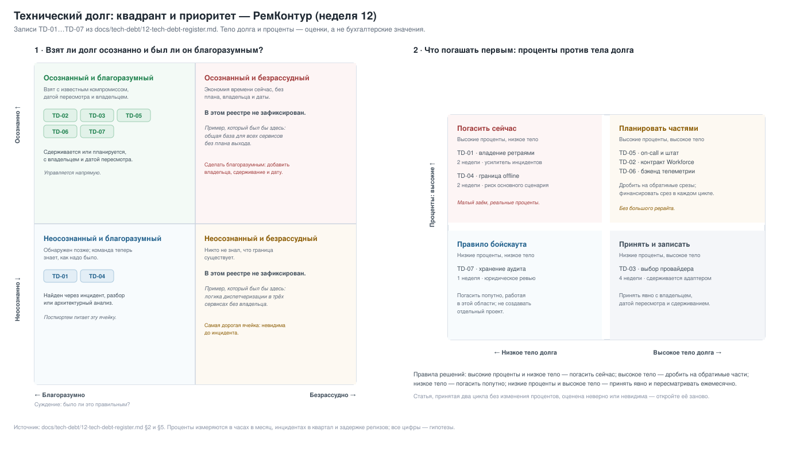

# Неделя 12 · Реестр технического долга

**Статус** — проект v1.0. Тело долга и проценты — оценки `[H]` для приоритизации. Реестр используется в модуле 4.

**Основание:** лекция 12, слайды 24–29; [реестр FR/NFR](../04-requirements.md); [SRE-спецификация](../sre/11-sre-specification.md); [план DR](../sre/11-dr-plan.md); [внешняя среда](../08-external-environment.md); [доступ и аудит](../security/09-access-audit.md); [постмортем INC-2026-04](../postmortems/12-incident-review.md); [ADR-005](../adr/ADR-005-notification-channel-adapter.md), [ADR-006](../adr/ADR-006-external-boundary-acl.md), [ADR-007](../adr/ADR-007-assignment-security.md) и [ADR-009](../adr/ADR-009-disaster-recovery-strategy.md).

**Метки доказательности.** `[D]` — выведено из существующего артефакта Досье; `[H]` — проектная гипотеза, введённая здесь и требующая измерения или согласования.

## 1. Определение и метафора

Технический долг ускоряет поставку ценой будущих работ и регулярных издержек.

| Часть | Значение | Поле реестра |
|---|---|---|
| Тело долга (principal) | Работа, нужная для погашения | Оценка в человеко-неделях |
| Проценты (interest) | Повторяющаяся стоимость жизни с долгом | Часы в месяц, инциденты в квартал, деньги, задержка релизов |
| Дефолт | Точка, в которой менять систему дешевле, чем обслуживать долг | Формулировка риска и решение модуля 4 |

ADR хранит причину решения, реестр — цену его сохранения и срок пересмотра.

## 2. Квадрант долга

Квадрант разделяет два вопроса: был ли долг взят осознанно и был ли он благоразумным (лекция 12, слайд 25). Вертикальная ось — осознанность, горизонтальная — суждение.

| Квадрант | Описание | Пример для РемКонтур |
|---|---|---|
| Осознанный и благоразумный | Взят с известным компромиссом, датой пересмотра и владельцем | Чтение EAM и HR через адаптер, пока контракт неизвестен; [ADR-006](../adr/ADR-006-external-boundary-acl.md) с датой пересмотра |
| Осознанный и безрассудный | Взят ради экономии времени без плана, владельца и даты пересмотра | Общая база для всех сервисов «потому что спешим», без плана выхода |
| Неосознанный и благоразумный | Обнаружен позже, и команда теперь знает, как надо было | Два слоя ретраев, каждый выглядел разумным в изоляции (TD-01) |
| Неосознанный и безрассудный | Никто не знал, что граница существует | Логика диспетчеризации размазана по трём сервисам без владельца |

Напрямую управлять можно только осознанным долгом. Неосознанный обнаруживается через инциденты, разборы и архитектурный анализ — поэтому постмортем и реестр связаны: отложенное действие становится строкой реестра, а не забытой фразой в документе.

## 3. Семь типов архитектурного долга

| Тип | Признак | Пример для РемКонтур | Запись реестра |
|---|---|---|---|
| Архитектурный | Границы и связи мешают изменениям | Политика ретраев назначения разделена между клиентом и оркестратором | TD-01 |
| Интеграционный | Интеграции без контракта или изоляции | Контракт Workforce и уведомления об изменениях неформальны | TD-02 |
| Данные | Дубли, отсутствие владельца, качество данных | Модель offline-конфликтов не проверена на границе очереди | TD-04 |
| Инфраструктурный | Устаревшие версии, ручное развёртывание | В этом реестре не зафиксирован; конвейер развёртывания вне текущего Досье | — |
| Тестовый | Нет тестов на критических путях | Профиль медленного провайдера 15 с отсутствует в нагрузочном тесте | TD-04 |
| Эксплуатационный | Нет наблюдаемости, runbook’а или алертинга | Бэкенд телеметрии не развёрнут; нет профинансированной круглосуточной ротации | TD-05, TD-06 |
| Безопасность | Уязвимости, секреты в коде | Срок хранения аудита не согласован; пять лет — предложение, а не политика | TD-07 |

Список не исчерпывающий, а подсказка. Долг, не подходящий под тип, всё равно остаётся долгом, если у него есть тело и проценты.

## 4. Реестр

Проценты сформулированы на языке бизнеса: часы в месяц, инциденты в квартал и, где возможно, деньги. Все значения — оценки `[H]`, которые нужно заменить измерениями после первого квартала пилота.

| ID | Долг | Тип | Квадрант | Источник | Тело долга | Проценты в месяц | Риск, если не погасить | Решение | Владелец | Пересмотр |
|---|---|---|---|---|---|---|---|---|---|---|
| TD-01 | Раздельное владение ретраями между АРМ и оркестратором назначения | Архитектурный | Неосознанный, благоразумный | [INC-2026-04](../postmortems/12-incident-review.md); [SRE §6.4](../sre/11-sre-specification.md) | 2 человеко-недели | 2 инцидента в квартал; 6 ч ручной сверки; задержка релизов P3 | Следующий сбой медленного провайдера может исчерпать SLO-03 и создать дубли резервов | Погасить к 2026-11-11 (A-01, A-02) | Andrey | 2026-11-25 |
| TD-02 | Контракт Workforce и уведомления об изменениях неформальны | Интеграционный | Осознанный, благоразумный | [08 §2](../08-external-environment.md); [ADR-006](../adr/ADR-006-external-boundary-acl.md) | 3 человеко-недели | 4 ч координации; 1 инцидент в квартал | Необъявленное изменение Workforce снова сломает назначение | Сдерживать правилом уведомления об изменениях (A-08); формализовать в Q1 2027 | Amir | 2027-01-31 |
| TD-03 | Провайдер уведомлений не выбран; гарантии доставки нет | Интеграционный | Осознанный, благоразумный | OQ-12; [ADR-005](../adr/ADR-005-notification-channel-adapter.md) | 4 человеко-недели | 4 ч ручных проверок доставки; 1 инцидент в квартал; риск lock-in | Отказ провайдера или смена цены оставят без вторичного канала | Сдерживать адаптером и флагом вторичного канала; выбрать в Q1 2027 | Amir | 2027-02-28 |
| TD-04 | Модель offline-конфликтов не проверена на границе 4 ч / 500 операций | Данные и тесты | Осознанный, благоразумный | [NFR-02](../04-requirements.md); [TS-01](../04-technical-spike.md); [SRE §7 M3](../sre/11-sre-specification.md) | 2 человеко-недели | Неизвестно; до 2 ч поддержки в месяц | Долгий простой площадки даст дубли или заблокированную очередь, нарушив NFR-02 именно в сценарии, для которого он написан | Погасить до пилота (2026-12-15) | Martin | 2026-12-15 |
| TD-05 | Нет профинансированного on-call 24/7; обнаружение в рабочие часы | Эксплуатационный | Осознанный, благоразумный с истечением | [План DR §7](../sre/11-dr-plan.md); [SRE §3.4](../sre/11-sre-specification.md) | 6 человеко-недель плюс регулярные затраты | 2 инцидента в квартал с большим MTTR; пробел ночного покрытия | Ночной SEV-1 тянется до рабочих часов; цель 99,5% не выглядит достоверной | Принять для пилота с истечением; профинансировать до подписания любого SLA | Amir с владельцем бизнеса | 2027-01-31 |
| TD-06 | Бэкенд телеметрии не выбран и не развёрнут | Эксплуатационный | Осознанный, благоразумный | [SRE §4.7](../sre/11-sre-specification.md); Q4 | 3 человеко-недели | 4 ч слепой диагностики; медленное обнаружение; нет доказательств SLO | SLO нельзя измерить, а инциденты диагностируются догадками | Погасить в Q1 2027 до выхода из пилота | Amir | 2027-01-31 |
| TD-07 | Срок хранения аудита не согласован; пять лет — предложение | Данные и безопасность | Осознанный, благоразумный | [09 §3](../security/09-access-audit.md); [SRE §3.3](../sre/11-sre-specification.md); Q4 | 1 человеко-неделя плюс стоимость хранения | Риск соответствия; неопределённость стоимости хранения | Недостаточное хранение уничтожает доказательства; избыточное создаёт стоимость и риск приватности | Принять с датой пересмотра; согласовать с ИБ и юристами к Q1 2027 | ИБ | 2027-03-31 |

### TD-01 · Раздельное владение ретраями между АРМ и оркестратором

Повторы АРМ и оркестратора давали до шести вызовов на команду и увеличивали объём ручной сверки. Назначить одного владельца, проверить размыкание по экземплярам и нагрузку при задержке 15 с.

### TD-02 · Контракт Workforce и уведомления об изменениях неформальны

Формализовать оповещения об изменениях Workforce и пробные выпуски. Пока этого нет, изменение поведения провайдера может вызвать инцидент у потребителя.

### TD-03 · Провайдер уведомлений не выбран

Адаптер ограничивает зависимость от поставщика, но остаются ручные проверки и отсутствует гарантированный резервный канал. Сдерживать до выбора договора. [ADR-005](../adr/ADR-005-notification-channel-adapter.md)

### TD-04 · Модель offline-конфликтов не проверена на границе

Короткий обрыв проверен на минимальном стенде. До пилота проверить четыре часа или 500 операций, конфликт и массовое переподключение с целью синхронизации за 60 с.

### TD-05 · Нет профинансированного on-call 24/7

Три инженера без финансирования не обеспечивают 24/7. До подписания SLA согласовать состав, компенсацию и эскалацию.

### TD-06 · Бэкенд телеметрии не выбран

Схема телеметрии готова. Затраты остаются на выбор хранилища, развёртывание и права. До реализации диагностика ограничена данными БД и брокера.

### TD-07 · Срок хранения аудита не согласован

ИБ согласует срок хранения. Короткий срок угрожает доказательствам, длинный увеличивает стоимость и риски приватности.

## 5. Приоритизация

Приоритет — функция процентов и тела долга, а не того, насколько долг раздражает (лекция 12, слайд 28).

| | Низкое тело долга | Высокое тело долга |
|---|---|---|
| **Высокие проценты** | **Погасить сейчас.** TD-01 (2 недели, усилитель инцидентов), TD-04 (2 недели, риск основного сценария) | **Планировать частями.** TD-05 (штат), TD-02 (контракт), TD-06 (развёртывание) |
| **Низкие проценты** | **Правило бойскаута.** TD-07 (юридическое ревью, сделать попутно) | **Принять и записать.** TD-03 (сдерживать адаптером и вернуться) |

Правила решений:

1. **Высокие проценты и низкое тело** — погасить немедленно; заём мал, а проценты реальны.
2. **Высокие проценты и высокое тело** — разбить погашение на обратимые части (Strangler Fig) и финансировать срез в каждом цикле; не ждать большого рерайта.
3. **Низкие проценты и низкое тело** — погасить попутно, работая в этой области; не создавать проект.
4. **Низкие проценты и высокое тело** — принять явно, с владельцем, датой пересмотра и сдерживанием; принятый долг всё равно записывается.

Ранжирование пересматривается ежемесячно. Долг, «принятый» более двух циклов пересмотра без изменения процентов, либо неверно оценён, либо невидим; и то и другое — повод открыть его заново.

## 6. Разговор с бизнесом

«Нам нужен рерайт системы» не продаёт. «Мы теряем 40 часов и два инцидента в месяц; погашение займёт три недели» — продаёт (лекция 12, слайд 29). Реестр написан так, чтобы второе предложение стало возможным.

| Аргумент | Что показать | Пример для TD-01 |
|---|---|---|
| Деньги | Часы, инциденты и задержку релизов, переведённые в стоимость | 6 ч сверки в месяц и 2 инцидента в квартал; 2 человеко-недели на погашение |
| SLO | Выгорание бюджета, вызванное долгом | Инцидент израсходовал 78% месячного бюджета SLO-03 |
| Цели | Какая бизнес-способность заблокирована | Новый диспетчерский участок нельзя подключить, пока назначение ненадёжно |
| Цикл | Постоянная доля мощности, обычно 15–20% | Два человеко-дня на двухнедельный цикл, пока статьи с высокими процентами не закрыты |

Разговор — не просьба разрешить инженерию. Это выбор между уплатой известных процентов и принятием известного риска. Решает владелец бизнеса; реестр фиксирует решение и дату пересмотра.

## 7. Governance

| Правило | Детали |
|---|---|
| Один реестр | Реестр в этом файле — единственный список; долг, упомянутый только в чате, не существует |
| Триггер записи | Временный ADR, отложенное действие постмортема, известное ограничение на ревью дизайна или обнаруженный обходной путь |
| Обязательные поля | Тип, квадрант, источник, тело долга, проценты, риск, решение, владелец, дата пересмотра |
| Каденция пересмотра | Ежемесячное архитектурное ревью; ежеквартальное бизнес-ревью статей с высокими процентами |
| Мощность | 15–20% каждого цикла поставки резервируется на погашение долга `[H]` |
| Истечение | Принятый долг без даты пересмотра эскалируется в архитектурную группу |
| Закрытие | Погашение закрывается доказательством (слитое изменение, тест, контракт, кадровое решение), а не отчётом о статусе |
| Связь с модулем 4 | Реестр — вход в TCO, последовательность миграции и решения о выводе из эксплуатации |

Реестр — не список наказаний. Команда, которая записывает долг, ведёт себя ответственнее команды, которая его прячет, и ревью должно поощрять запись, даже если сам долг неудобен.

## 8. Шаблон реестра

| Поле | Содержание |
|---|---|
| ID | TD-nn, стабильный и не переиспользуемый |
| Долг | Одно предложение на языке бизнеса |
| Тип | Архитектурный, интеграционный, данные, инфраструктурный, тестовый, эксплуатационный или безопасность |
| Квадрант | Осознанный или неосознанный; благоразумный или безрассудный |
| Источник | ADR, инцидент, разбор, требование или обнаружение |
| Тело долга | Человеко-недели с указанием допущения |
| Проценты | Часы в месяц, инциденты в квартал, деньги, задержка релизов |
| Риск, если не погасить | Конкретный сбой или стоимость, а не «это плохо» |
| Решение | Погасить, сдерживать, принять; с датой |
| Владелец | Один названный человек или команда |
| Пересмотр | Дата, а не «позже» |

## 9. Открытые вопросы

| ID | Вопрос | Влияние |
|---|---|---|
| Q1 | Какова внутренняя стоимость одного инженерного часа и одного инцидента? | Переводит проценты в деньги для бизнес-кейса |
| Q2 | Профинансирует ли бизнес 15–20% мощности на погашение долга? | От этого зависит вся модель governance |
| Q3 | Какие долги допустимо перенести в модуль 4? | Область миграции и TCO |
| Q4 | Кто подписывает «принятый» долг и на какой срок? | Предотвращает молчаливое накопление |
| Q5 | Каков юридический срок хранения аудиторских записей? | TD-07 и модель стоимости хранения |
